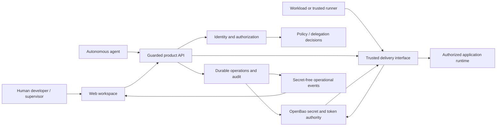

# Document 01 — mykey Project Northstar

**Working product name:** `mykey` *(placeholder; not a trademark, domain, or product-name clearance)*  
**Version:** 0.2 — Revised after strategic and document-governance audit  
**Date:** 25 October 2026  
**Horizon:** 2027 and beyond  
**Purpose:** Project-wide product vision, strategic boundaries, and enduring design principles  
**Next document:** Document 02 — Project Stage Breakdown (approximately 400 engineering hours per stage)

> **Document status and authority.** This is a proposed *project-wide* charter for **mykey**, not an assertion that the eventual SaaS has already been designed or validated. It draws on the four October 2026 Stage 1 documents and the clarified project strategy. It proposes long-term capabilities beyond Stage 1; these are **not** silently added to Stage 1 scope. The existing Stage 1 mission, functional specification, technical audit, and technical specification remain their own documents pending deliberate reconciliation. P-01, P-02, and P-03 are referenced by those documents but were not supplied for this draft; their specific content is not assumed here. Product-wide principles become binding only when this document is approved and conflicts have been recorded and resolved explicitly. It is intentionally **stage-agnostic**: aspirational features do not constitute stage requirements, and it does not certify implementation feasibility, compliance, production release, or market demand.

---

## 1. Executive thesis

### 1.1 Mission

Create a trustworthy, exceptionally usable, **agent-native secrets and credential-access service** that allows people, software agents, and workloads to obtain the authority they need—no more, no longer, and no less transparently than necessary—without normalizing plaintext credential distribution, permanent machine tokens, or unrestricted agent access.

The service will use **OpenBao as its secrets-security foundation** while owning the differentiated product layer: developer workflows, policy-mediated access, secure delivery, orchestration and reconciliation, agent-friendly interfaces, operational intelligence, and reliable recovery.

### 1.2 Intended future shape

The mature product is a cohesive control plane for application secrets and credentials, with several complementary surfaces:

- A polished **developer workspace** for projects, environments, secrets, identities, access, activity, and operational state.
- A stable, documented **API and CLI** for applications, CI/CD systems, scripts, and autonomous agents.
- **Machine and workload identity integrations** that prefer verified, short-lived authority over copied, long-lived bearer tokens.
- A **trusted delivery layer** that can supply secrets to a workload or execution boundary without unnecessarily exposing them to the requesting agent's language-model context or tool transcript.
- **Policy, delegation, and supervision controls** for bounded unattended activity, exceptional escalation, and attributable decisions.
- **Lifecycle automation** for issuance, expiry, rotation, revocation, environment changes, and eventually selected dynamic credentials.
- **Useful visibility and analytics** showing posture, access, health, usage, changes, failures, and actionable remediation—without persisting secret values or sensitive credentials.
- **Recovery and operations capabilities** appropriate to the chosen deployment model, with claims backed by tests rather than marketing language.

The product should be viable for direct human use, but must not depend on a human clicking through a UI for routine machine operations.

### 1.3 Northstar promise

**The right workload or agent gets the minimum necessary credential capability, at the right time, through a controlled execution path, with clear attribution, actionable feedback, and defensible recovery.**

This is a direction, not a claim that every aspect is achievable in every environment. Where a runtime or identity provider cannot establish the required trust boundary, the service must disclose that limitation, constrain the operation, or decline to promise protected delivery.

### 1.4 The product we are actually trying to create

mykey's intended product is an **agent-native secrets, identity-mediated access, and secure-delivery service**. Its focus is the practical boundary between *an actor being permitted to use a capability* and *the actor possessing reusable plaintext credentials*. It should make that boundary easier to establish, operate, understand, and audit than ad hoc developer workflows or direct infrastructure APIs.

It is not a generic credential inventory UI, a generic agent runtime, or a replacement for OpenBao's security engines. Its differentiated value must come from coherent end-to-end workflows and demonstrable reductions in credential exposure, manual coordination, and operational uncertainty. A feature is not valuable solely because OpenBao exposes a corresponding endpoint.

The long-term portfolio includes three complementary problems: **credential and configuration management**, **policy-governed machine/agent/workload access**, and **trusted delivery with operational explainability**. Which deployment models and advanced security features are commercially worthwhile must be learned, not assumed.

### 1.5 The validation-first strategy

This project does **not** begin by building a fully commercialized SaaS and discovering its assumptions too late. The first stage builds a real, bounded, end-to-end usable service from the best currently defensible assumptions. That service is used to gather evidence about architecture, operational cost, security, integration, workflows, and developer experience. Subsequent stages adapt the actual product to that evidence.

Stage 1 must distinguish three outcomes. **Engineering validation** establishes whether a mechanism works and fails safely under realistic conditions. **Usability validation** establishes how well a specific developer can complete supported tasks. **Commercial validation** requires broader evidence of demand, adoption, willingness to pay, and operating economics; a single-user Stage 1 field trial cannot prove product-market fit.

Stage 1 is therefore simultaneously:

1. A functioning service usable for real, carefully introduced applications after its release safeguards pass; and
2. An instrument for testing the assumptions that matter to the future SaaS.

A validation stage is not permission to leave included features unfinished, to simulate security controls, or to bypass recovery. It is permission to **limit breadth, measure reality, and change course intelligently**.

**Transition principle:** the eventual SaaS is designed *after* Stage 1 evidence has been evaluated; it must not be treated as merely the existing Stage 1 codebase with billing, team accounts, and more features added. Reuse working components when justified, but re-evaluate tenant topology, trust model, managed-service operations, security responsibilities, access patterns, and economics before treating the validation architecture as a commercial foundation.

---

## 2. The problem we intend to solve

### 2.1 Developer friction remains too high

Applications need credentials for databases, third-party APIs, infrastructure, automation, and deployment. Developers commonly contend with scattered configuration, plaintext files, brittle bootstrap procedures, uncertain versions, confusing permission models, hard-to-debug failures, and poor visibility into where credentials are used. Centralized storage alone does not eliminate these problems.

The desired improvement is **less effort between a legitimate intent and a verified, secure outcome**, while retaining visibility and control.

### 2.2 Agentic software changes the primary operating model

In the anticipated 2027+ environment, software agents will increasingly construct applications, launch tests, provision resources, execute deployments, maintain services, and coordinate with other agents. The secrets layer must address challenges that human-first products often leave implicit:

- Agents require machine-readable, deterministic interfaces and robust recovery after interrupted work.
- An agent's *ability to request an action* must not imply permission to read every underlying secret value.
- An agent acting for a human, team, or automation must have bounded, identifiable delegation rather than inheriting blanket authority.
- Prompts, retrieved files, tool outputs, and other agent inputs may be attacker-controlled; they cannot be treated as authorization.
- Secrets should, where possible, be delivered to a distinct trusted workload rather than surfaced in model context.
- Routine activity should run unattended; meaningful exceptions require informative escalation, not repeated approval fatigue.
- Multiple agents and workloads require attribution and comprehensible failure diagnosis at machine speed.

The product will be **agent-native**, not “AI-enabled” merely because it exposes an MCP server or includes a chat assistant.

### 2.3 Existing solutions are the baseline, not the enemy

mykey must be compared with direct OpenBao use, deployment-platform secrets, workload identity offered by existing runtimes, established secrets managers, and modest custom scripts. The comparison must use realistic workloads and include security, integration work, ongoing operations, usability, and cost. In some settings the correct outcome may be to use a simpler existing tool rather than mykey; the product should earn its place by producing measurable incremental value.

### 2.4 Security systems are often difficult to understand and operate

A protection system that is hard to configure, diagnose, rotate, or recover can cause users to bypass it. Developer experience is therefore not cosmetic. It is part of the practical effectiveness of the security system.

The product will invest in exceptional interface design, explanatory workflows, operational feedback, and useful visualization where the incremental implementation effort offers substantial practical value.

---

## 3. Who the product serves

| Consumer | Primary job | Desired outcome |
| --- | --- | --- |
| Individual developer | Manage application/environment credentials and launch software | Fast, understandable, secure daily workflow |
| Small engineering team | Share scoped access, audit changes, coordinate rotation | Collaboration without credential sprawl |
| Autonomous coding agent | Prepare and test applications within assigned authority | Complete work without receiving unrelated secret values |
| Deployment/operations agent | Configure and deploy workloads, rotate/revoke access | Safe unattended operation with durable status and attribution |
| Application or service workload | Authenticate and obtain needed runtime capabilities | Narrow, short-lived access with minimal bootstrap burden |
| Human owner or security supervisor | Set policy, inspect behavior, intervene when needed | Situational awareness without constant manual approvals |
| Platform/operator team | Provision, maintain, recover, upgrade and isolate the service | Predictable, evidence-backed operations |

**Design priority:** operational agents and workloads become first-class consumers alongside developers. The human interface shifts toward intent-setting, configuration, explanation, oversight, and exception handling, without losing practical manual workflows.

These groups describe the intended product market, **not** the Stage 1 user count. Stage 1 deliberately starts with one real operator/owner and one organization; multi-user and cross-organization behavior is initially exercised through test fixtures.

---

## 4. The eventual solution portfolio

The following are proposed **product capability families**, not committed stage assignments. Document 02 will decide order and bounded scope according to evidence, dependencies, and available engineering time.

### 4.1 Secrets workspace and environment configuration

**Outcome:** developers and agents can manage the right configuration for the right project and environment without ambiguity or accidental overwrites.

Target capabilities:

- Organizations, teams, projects, environments, ownership, and granular permissions.
- Versioned application secrets with controlled creation, update, soft deletion, recovery, history, and clear conflict reporting.
- Secure import, export, migration, validation, and environment promotion with explicit review of differences.
- Metadata discovery, tagging, search, ownership, usage context, and drift indicators that do not index secret values.
- Deliberately scoped bulk changes with auditable outcomes and recovery from interruption.
- Environment templates or reusable configuration structures where they reduce genuine duplication without introducing implicit privilege expansion.

**Product rule:** visual convenience must never bypass version preconditions or turn a review workflow into silent last-writer-wins behavior.

### 4.2 Identity, access, and credential brokerage

**Outcome:** human users, agents, and deployed workloads obtain justifiable access through verifiable identity and constrained policies.

Target capabilities:

- Human authentication, organizational roles, project/environment grants, session controls, and strong account recovery.
- Separately modeled machine, workload, agent, and delegated-principal identities; no assumption that an agent is identical to the person who invoked it.
- Short-lived, scoped credentials, expiry, revocation, issuer attribution, and inspectable lifecycle state.
- Federation with selected identity systems and workload attestation where trust and deployment conditions permit it.
- Policy that can constrain **who**, **what**, **which scope**, **which operation**, **for how long**, **from which trusted context**, and **under which delegation**.
- Explicit **delegation attenuation**: a delegate cannot obtain greater authority than its sponsor and active organizational policy permit. Delegation is bounded by resource, action, audience, intended use, time, and revocation; proof of agent identity alone does not authorize a secret read.
- Distinguish the **human sponsor**, **agent principal**, **requesting tool/client**, **trusted execution identity**, **resource owner**, and **authorizing policy**. These can differ and may require separate evidence, not a single overloaded user ID.
- A controlled path from approved intent to issued authority, without making product clients responsible for raw OpenBao administration.

Potential interoperability includes OIDC/JWT-based workload federation and SPIFFE/SPIRE-style identity systems. These are **evaluation candidates**, not mandatory universal dependencies or claims that any specific integration is already proven.

### 4.3 Safe delivery to applications and execution environments

**Outcome:** a legitimate application can start or operate with the complete credentials it needs, without fragile ad hoc copying.

Target delivery patterns:

1. **Launch-time injection:** a trusted CLI/launcher resolves a coherent configuration set, validates it, and starts the child process without a plaintext dotenv file.
2. **Workload-facing access:** an authorized workload requests permitted material through a narrowly scoped API or local trusted helper.
3. **Short-lived handoff:** where appropriate, use single-use or tightly time-bounded delivery artifacts instead of exposing permanent credentials.
4. **Deployment integration:** work with selected containers, CI/CD systems, hosts, and managed runtimes using capability-specific adapters.
5. **Dynamic credential use:** eventually issue or broker eligible short-lived database/service credentials where the backend and target support reliable generation and revocation.
6. **Rotation-aware delivery:** provide clear behavior for replacement, expired leases, interrupted starts, and applications that require restart or refresh.

Not every runtime offers the same containment guarantees. **A trusted runner is a genuine security boundary only if the agent cannot inspect its privileged memory, alter its trusted implementation, inject arbitrary code into the credential-bearing workload, or capture its sensitive output.** Mere separation into two software processes on the same agent-controlled host is not sufficient. mykey should describe supported protection tiers and refuse to label a weak arrangement as model-isolated.

Process-environment injection is useful, but the child and trusted host can ordinarily read the injected value. A compromised runtime, process dump, or overly privileged agent controlling that runtime may still expose it. The service must not call such a workflow “secretless” or promise impossible isolation. When a coding agent can run arbitrary code inside a test or application process, assume credentials available to that process can be extracted; respond with disposable low-privilege fixtures, isolation, constrained egress, and runtime-specific safeguards rather than claiming the code cannot access its own process secrets. The long-term product should treat **secret delivery, secret use, and actual non-disclosure** as separate claims, each with a stated threat model. Any intentional return of plaintext to a human, script, agent, or workload is an explicit privileged operation with understood downstream exposure.

### 4.4 Agent-native operations and bounded delegation

**Outcome:** autonomous software can perform approved work with less human friction and without blanket access.

Target capabilities:

- Stable product API contracts, structured errors, operation IDs, queryable state, idempotency where effects demand it, and documented concurrency semantics.
- An agent-oriented capability surface for **discovery, status, request, execution orchestration, and reconciliation** that does not default to plaintext reveal.
- Delegation records associating sponsor, requesting agent, executing workload, authorization basis, operation, scope, expiry, and result.
- Policy-controlled unattended actions, including standard access requests, credential setup, permitted rotation, and low-risk environment operations.
- Explicit authorization **at every effect boundary**, including contextual constraints and current revocation state; a previously approved plan or successful prior step cannot silently extend authority to new effects.
- Automation limits covering request frequency, scope expansion, maximum privilege, duration, monetary/resource budgets where applicable, and blast radius; policy is enforced by deterministic services, not inferred from the agent's explanation.
- Risk-sensitive escalation for actions exceeding the agent's standing authority, with a concise decision package for the human reviewer.
- Clear distinction between an **LLM planning a step** and a **trusted execution component actually holding credentials or performing the effect**.
- Ability to stop, revoke, reconcile, and inspect autonomous work even after an agent session, network connection, or task supervisor disappears.
- Optional protocol adapters, including MCP, built over the same guarded product API rather than creating a privileged alternate route.

**Hard rule:** model output, prompt text, tool descriptions, and agent self-assertions are data, **not** authority. The service must enforce the actual policy and identity boundary regardless of how convincing a model request appears.

### 4.5 Credential lifecycle and preventive security automation

**Outcome:** credentials do not quietly become permanent liabilities.

Target capabilities:

- Expiry policy, scheduled reviews, rotation workflows, replacement coordination, and verified revocation.
- Credential inventory with owner, scope, creation source, age, usage indicators, and last verified backend state.
- Detection of excessively broad scope, dormant credentials, unexpected access, missing rotation, and configuration inconsistencies based on reliable metadata and events.
- Automated corrective action only within preauthorized, verifiable boundaries; otherwise surface a clear recommendation or request intervention.
- Support for selected dynamic secrets and other OpenBao engines when a real workflow validates their value and operational cost.

OpenBao's broader capabilities—including dynamic credentials and cryptographic transit operations—are potential foundations. The product should integrate only where it can add meaningful developer or agent-native value beyond exposing the underlying engine unchanged.

### 4.6 Governance, audit, and explainability

**Outcome:** legitimate activity is attributable, suspicious or denied activity is diagnosable, and policy can be reviewed without revealing sensitive values.

Target capabilities:

- Consistent identity, tenant, delegation, workload, request, operation, and resource correlation.
- Tamper-resistant *within clearly stated threat boundaries* audit storage, secure export, retention, and review workflows.
- Clear explanations for access denial, review state, uncertain operations, incomplete environment resolution, and policy conflicts.
- Inspectable histories of authorization changes, credential issuance/revocation, secret changes, and recovery events.
- Risk-focused supervisory views showing matters that require attention, not merely raw event volume.
- Machine-readable audit/event feeds for external operations and security tooling.

The system should distinguish **observed events** from **inferred risk**, and **known backend outcomes** from **uncertain effects**. Visual timelines, posture ratings, and anomaly labels must identify their evidence, freshness, and confidence rather than presenting inference as verified fact. It must never invent success, certainty, or human attribution.

### 4.7 Exceptional developer experience and operational intelligence

**Outcome:** complex security infrastructure feels intelligible, controllable, and efficient rather than burdensome.

The experience layer is a first-class product investment, not a deferred garnish.

Expected surfaces include:

- A carefully designed web workspace with clear information hierarchy, useful defaults, fast navigation, responsive interactions, and accessible controls.
- Contextual onboarding and progressive disclosure: ordinary workflows are simple; advanced controls are available when necessary.
- Environment/credential relationship views; lifecycle timelines; change and rotation histories; inventory and policy summaries.
- Diagnostics that explain *what happened, what is known, what is uncertain, why it matters, and what can safely be done next*.
- Practical analytics: credential age/expiry distribution, success and denial categories, CLI/API usage trends, operation latency, incident/recovery data, backup age, and service health.
- An excellent CLI with predictable output, script-friendly modes, useful errors, safe defaults, and a complete setup/rotation story.
- Excellent API documentation, generated schemas where reliable, examples that contain no real credentials, and appropriate interactive reference functionality.
- Human supervisory experiences that emphasize meaningful exceptions and preserve an audit trail of approvals and interventions.

The product-local interface is intended for mykey resources, credentials, policies, delivery, lifecycle, and directly related incidents. It is **not** a general cross-agent or cross-application observability platform: external operations systems can consume neutral, privacy-preserving telemetry and audit exports, but mykey remains authoritative for its own policy and execution decisions.

Visualization must answer a question or improve a decision. Attractive charts with no operational value do not qualify. Analytics must be aggregated or derived from **nonsecret, appropriately minimized events**, never from captured application values, raw tokens, authentication factors, or agent prompts containing credentials.

### 4.8 Dependable service operation and deployment choices

**Outcome:** the product can be operated, upgraded, backed up, restored, and trusted at the level its deployment promises.

Long-term possibilities include a hosted SaaS offering, supported self-managed deployments, and deployment-specific availability options. A hosted offering must explicitly define who can access plaintext, how tenant isolation is enforced *across every layer*, who controls keys and recovery authority, and which operational duties belong to mykey versus the customer. An OpenBao namespace by itself is not a complete isolation argument for a commercial multi-tenant control plane. The economics and actual guarantees of these deployment models remain future decisions, not automatic entitlements of an OpenBao-based design.

Capabilities to pursue as warranted:

- Tenant provisioning, isolation checks, limits, lifecycle management, and safe offboarding.
- Automated backup verification, consistent recoverable state, tested clean-host restore, key custody and controlled reopening.
- Explicit handling of sessions, workload identities, tokens, and delegated access after disaster recovery.
- Safe upgrades, forward/backward compatibility policies, change evidence, advisory response, and incident runbooks.
- Availability and capacity improvements supported by real demand and operational data.
- Service plans, usage visibility, administration and support workflows if and when a commercial SaaS offering is justified.

The product must not claim zero-knowledge operation, universal secret non-disclosure, instantaneous revocation of already-released data, high availability, or a recovery objective that it has not actually achieved.

---

## 5. Representative northstar workflows

These stories illustrate the product we intend to build; they are not all Stage 1 acceptance criteria.

### 5.1 A developer starts a service without credential-file choreography

The developer selects a project/environment, sees the configuration and access state, and launches the service through a trusted CLI. The launcher obtains a coherent authorized secret set, starts the child only when the required inputs are complete, and gives a useful diagnostic if the backend, policy, or environment state prevents startup. There is no required plaintext `.env` file in this workflow.

**What matters:** setup friction, correctness, clear failure behavior, and confidence that a failed lookup does not start a partially configured application.

### 5.2 An autonomous coding agent runs integration tests

An agent working on a bounded repository task requests a test capability for a particular environment. The service verifies the sponsoring authority and execution context. A trusted runner obtains only disposable, low-privilege test credentials and executes within a constrained environment whose output and egress are controlled; the language model receives safe diagnostics and selected artifacts, not credential values. This does not assume that arbitrary code running inside the credential-bearing process is itself unable to access credentials. An unauthorized production credential request is denied and attributed.

**What matters:** task success, least privilege, actual separation of model context from trusted runtime, and prompt-injection resistance.

### 5.3 A deployment agent operates without recurring approvals

A deployment agent authenticates through an approved workload identity, proves its permitted delegation, and obtains narrowly scoped access with a bounded lifetime to complete a deployment. A separately trusted runner is required for any claim that secret values remain outside the agent's reach; otherwise the workflow must truthfully disclose exposure. The service records its effective identity, delegation, issued access, backend outcome, and any required rotation. Routine approved actions complete unattended; a materially broader production request produces a precise escalation.

**What matters:** safe autonomy, intervention frequency, recovery from interruption, and auditable attribution.

### 5.4 A supervisor investigates an unexpected credential pattern

A supervisor views a meaningful posture summary: an expiring credential, unusual denial category, or policy mismatch. The interface shows affected scope, trusted evidence, current state, and safe options. The supervisor can revoke or constrain authority without having to inspect plaintext secrets.

**What matters:** understanding, correctness of explanations, time to resolution, and avoidance of alarm fatigue.

### 5.5 A team rotates a credential with minimal disruption

An authorized workflow requests a replacement, validates the supported delivery mechanism, coordinates the transition, verifies consumers where practical, and revokes obsolete authority. If any step is interrupted or uncertain, the operation remains inspectable and prevents unsafe blind repetition.

**What matters:** reproducible rotation, interruption safety, actual revocation, and truthful reporting of incomplete transitions.

### 5.6 An operator restores after a lost host

The operator restores a consistent, independently held recovery set onto a clean host. Public access begins closed. Restored identities and credentials are treated as potentially stale or compromised; the operator verifies current authority, rotates/revokes relevant access, reconciles unfinished effects, and reopens deliberately. Historical events remain available as permitted, but restored state does not silently reactivate obsolete authority.

**What matters:** demonstrable recoverability, invalidation of old access, accurate recovery instructions, and measured—not assumed—recovery duration.

---

## 6. Non-negotiable trust and security principles

The project should preserve the strongest enduring principles from its Stage 1 foundation even as capabilities expand.

1. **Honest plaintext boundary.** The service, trusted operator infrastructure, and authorized execution components may encounter plaintext. It is **not zero-knowledge**. Secret delivery to a process does not protect against that process or its host.
2. **One authority per fact.** OpenBao remains the intended authority for secrets and backend credential validity; product metadata, policies, delegation, and operation coordination have explicit authorities. No competing value store should arise accidentally.
3. **Least privilege, including agents.** Public-facing product processes never receive unconstrained global OpenBao administration merely for convenience. Every human, machine, agent, and operator action is scoped and attributable.
4. **No secret-bearing diagnostics on service-controlled surfaces.** Plaintext application values, issued tokens, factors, reset links, or equivalent sensitive material must not enter the product's logs, traces, persistent UI caches, audit/analytics, job payloads, examples, or controlled agent-tool outputs. Explicit authorized delivery is a separate, bounded flow. Third-party runtimes, prompts, and downstream logging remain external trust boundaries that must be assessed and disclosed, not falsely guaranteed.
5. **Fail closed on missing authority or uncertainty.** An unavailable identity source, revoked scope, inconsistent backend policy, invalid state, or unresolved operation cannot create new permission.
6. **Durable, truthful outcomes.** A timeout is not proof of failure; a database transaction is not atomic with OpenBao. External effects require traceable operation states, safe retry semantics, and reconciliation before conflicting work proceeds.
7. **Freshness and revocation semantics are explicit.** Newly started requests after committed revocation are denied; already delivered values cannot be recalled. In-flight and offline behavior must be defined, not implied.
8. **Recovery cannot silently restore authorization.** Off-host recovery material, closed-by-default restoration, revalidation, and rotation/revocation are essential.
9. **Evidence over labels.** “Secure,” “isolated,” “recoverable,” “high availability,” and “agent-safe” are testable claims with bounded threat models, not design adjectives.
10. **Safe software supply chain and operations.** Versions, configuration, code provenance, deployment changes, testing, incident practices, and privileged operator procedures are part of product correctness.
11. **No circular bootstrap or recovery dependencies.** The service must have a documented, independently held means to establish its own identity, acquire necessary unlock/recovery authority, and restore access without fetching bootstrap credentials from the unavailable service itself.
12. **Trust boundaries are environmental, not marketing abstractions.** Tenant-level logical policy is necessary but cannot substitute for verified host, process, storage, network, key, and provider controls. Hosting and self-management require separate responsibility models.
13. **Credential scope and disclosure are separable.** A caller may be authorized to *trigger an approved use* without being authorized to *inspect the underlying value*. Policy, execution, and product UX must preserve this distinction wherever the runtime can actually enforce it.

**Threats explicitly considered:** compromised browser/session, stolen machine token, malicious or overprivileged agent, prompt injection, cross-tenant access attempts, long-lived delegated authority, confused-deputy requests, unsafe secret delivery, stale writes, delayed backend effects, host loss, backup compromise, operator mistakes, and sensitive telemetry leakage.

**Threats not magically eliminated:** compromise of a trusted host/process, a privileged infrastructure operator, exposure after a legitimate recipient reads a value, and unavailable external identity or cloud providers. In particular, if an agent can execute arbitrary code inside the process that receives plaintext, access its environment or memory, or control output capture, mykey cannot credibly claim that the agent is prevented from obtaining that secret. The product must mitigate these honestly and document residual risk.

---

## 7. Architecture principles rather than premature architecture lock-in

The project-wide Northstar fixes **responsibility boundaries** more strongly than individual frameworks or deployment products.

### 7.1 Conceptual control and data paths

The diagram is a **responsibility map**, not a final topology. Trust-boundary details, namespace selection, identity issuance, network segmentation, exact OpenBao roles, and deployment interfaces must be established by later specifications and verified implementations. A language-model agent should ordinarily receive only safe metadata, operation status, and diagnostics; it should not be the recipient of secret-bearing responses merely because it called a tool.

### 7.2 Enduring design choices

- **OpenBao-centered, product-owned experience.** Reuse validated OpenBao security engines and primitives; own the interfaces, policy workflows, safe delivery contracts, operational reasoning, and DX that differentiate the product.
- **Identity first.** Treat human sessions, agent identities, workload identities, delegated authority, and infrastructure operator authority as distinct concepts even when early implementations support only a subset.
- **Backend-enforced policy.** A UI hiding an action, a client claiming a role, or a model presenting a rationale is insufficient authorization.
- **Typed, versioned product contracts.** Keep clients decoupled from raw OpenBao topology and administration, with explicit compatibility and runtime validation.
- **Deterministic invariants, bounded autonomy.** Let intelligent actors make contextual decisions within explicit authority; do not let models override security checks, deadlines, budgets, or irreversible-operation controls.
- **Composable adapters, not ecosystem lock-in.** Identity, execution, deployment, agent protocol, and monitoring adapters should sit at controlled boundaries. Avoid dependencies on a single agent framework or protocol for core functionality.
- **Operational maturity matched to the claim.** Differentiate validation deployments from commercially supported SaaS, and hosted service guarantees from self-managed responsibilities.
- **Incremental evidence-based replacement.** Retain components that work and replace failed assumptions without protecting architectural decisions for their own sake.

### 7.3 Authorization and execution separation

mykey should retain three separately testable responsibilities even if a particular implementation combines them in one service: **identity verification**, **product policy/admission**, and **backend capability enforcement**. Product authorization must not be delegated entirely to UI routing or an agent protocol adapter; OpenBao policy must not be treated as a substitute for tenant/resource-state checks in the product. Access is permitted only when all required authorities agree.

Read-oriented and effectful operations need different contracts. A safe lookup returns metadata without credential values; an effectful request carries a stable operation identity and never infers successful backend completion from a network timeout. Delayed effects, replay, partial failure, issuer uncertainty, and restoration must be visible as explicit states.

No strategy document can select a universally secure execution host. Delivery adapters must declare their threat model and the capabilities they can and cannot provide. This preserves support for simple trusted developer launchers as well as future strongly isolated agent runners without falsely conflating them.

### 7.4 Technology position

The **Stage 1 implementation baseline** currently selects TypeScript/Hono, Better Auth, PostgreSQL/Drizzle, pg-boss, React, a CLI, Docker Compose/Traefik on OVHcloud, OVHcloud KMS integration, and R2-backed recovery. Those choices are the subject of explicit technical feasibility proofs in the supplied specifications. They are **not a permanent requirement that every later deployment or service tier use an identical runtime topology**.

OpenBao itself is central to the thesis, but individual engines, auth methods, KMS integrations, deployment patterns, runtime packaging, and availability mechanisms remain subject to actual compatibility, security review, and value evidence.

---

## 8. Product differentiation: where we intend to win

The ambition is **not** to reproduce every capability of established secrets-management suites or to add a cosmetic agent chat panel to a conventional vault.

The intended differentiators are:

1. **Excellent end-to-end developer workflows.** Getting a real application working safely is easier than with manual secret copying and environment-file choreography.
2. **Agent-native bounded autonomy.** Machine consumers can perform their authorized jobs without impersonating a fully privileged human or ingesting unnecessary plaintext into model context.
3. **Explainable operations.** Status, denial, uncertainty, rotation, and recovery have understandable, actionable representations for both people and machines.
4. **Information-rich supervision.** Developers and owners can see what matters, trace decisions, and intervene meaningfully without wading through raw infrastructure detail.
5. **Pragmatic engineering and cost.** Reuse robust infrastructure primitives, avoid unnecessary operational dependencies, and evaluate actual total ownership cost.
6. **Portable composition.** Integrate into heterogeneous application, agent, and deployment environments through stable, limited contracts rather than bespoke per-project glue.

These are **hypotheses**, not proven competitive advantages. The product will be judged against realistic alternatives and the user's actual end-to-end work, including existing OpenBao workflows, other secrets services, and basic well-maintained libraries or deployment-native identity features. If a feature merely exposes what OpenBao already offers with no meaningful improvement, it may not deserve a product layer.

---

## 9. What we will deliberately not become

The following boundaries guard focus and security:

- **Not a generic AI agent orchestrator.** This product governs secrets, identities, access, and related workflows. A separate agent system may plan or execute broader work.
- **Not a system that grants an LLM unrestricted secret reveal.** Natural language is never an authorization override, and secret-bearing tools should be exceptional and narrowly justified.
- **Not a general-purpose enterprise platform by default.** Compliance suites, advanced federation, complex org structures, and broad integrations must earn their implementation cost through specific use cases.
- **Not an observability-platform replacement.** Rich *product-local* diagnostics, analytics, inventory, and supervisory views belong here; general cross-system tracing, log analysis, and incident operations can integrate with an external operations platform.
- **Not a zero-knowledge promise.** Trusted backend and runtime components necessarily encounter plaintext in several supported flows.
- **Not a compatibility wrapper for every OpenBao feature.** Features are productized when they solve a verified end-user problem coherently and safely.
- **Not feature breadth at the expense of complete delivery.** Shipping partially implemented security features to meet a stage budget is not acceptable.
- **Not locked to one identity, cloud, deployment, or agent protocol where neutrality materially improves future options.** Avoid paying for hypothetical portability before evidence justifies the integration.

---

## 10. How we will measure whether the strategy works

Feature count is an inadequate success measure. We will assess **security/correctness, practical utility, developer experience, agent autonomy, operational quality, and economic efficiency together**.

| Dimension | Questions and candidate measures |
| --- | --- |
| Functional utility | Can a real project adopt the service? Time from account/environment setup to first successful launch; recurring workflow success |
| Developer experience | Time and steps for onboarding, import, environment change, rotation and recovery; task completion, error comprehension, perceived friction |
| Agent effectiveness | Autonomous task success under granted scope; manual interventions per workflow; successful escalations; failures attributable to missing interfaces |
| Security and containment | Cross-tenant denial tests; leaked secret canaries in prohibited surfaces; policy boundary tests; unauthorized requests blocked; revocation verification |
| Operation integrity | Duplicate effects prevented; unresolved-effect frequency; reconciliation time; stale writes rejected; complete-set read guarantees |
| Credential hygiene | Scope distribution, credential age, expiry, rotation success, orphaned/dormant access indicators, replacement success |
| Reliability and recovery | Availability as observed, P50/P95 latency, failure categories, backup age, restore test success/time, restart/outage behavior |
| Explainability and supervision | Time to diagnose failure, escalation relevance, false alarm rate, successful resolution without plaintext inspection |
| Engineering/operational cost | Implementation effort, external service costs, cost per legitimate workflow, maintenance toil, infrastructure utilization |
| Strategic value | Incremental outcome versus OpenBao used directly or plausible alternatives; validated demand for proposed next capabilities |

Measurement rules:

1. Establish baselines and repeat comparable tasks; do not present a single demonstration as broad validation.
2. Collect the smallest useful nonsecret metadata; never improve analytics by capturing protected payloads.
3. Separate controlled synthetic security evidence from field-use usability and operational evidence.
4. Record negative results, uncertainty, workarounds, and abandoned approaches, not just successes.
5. Judge agent value against a deterministic baseline and real human workflow, not against an intentionally weak comparison.
6. State what a measurement **does not** prove; a successful injection demo does not prove safety against a compromised host.

### 10.1 Validation quality and evidence limits

- Define hypotheses, baseline workflows, measurement methods, pass/fail criteria, and unacceptable regressions **before** each meaningful experiment; do not select thresholds after seeing outcomes.
- Separate **feasibility proofs** (a mechanism can work), **integrated acceptance** (the whole service actually works), **field-use evidence** (it works and feels useful in routine tasks), and **market evidence** (other users need it enough to adopt or pay).
- Record sample size, supported environment, test date, versions, confidence limits, and known confounders. A single developer's experience can identify friction, but cannot validate diverse-team usability or commercial demand.
- Negative security findings and uncertain operational outcomes are first-class results. No improvement in agent autonomy or DX compensates for a violation of a declared security boundary.

### 10.2 Stage-level decision questions

At the end of each implementation stage, decide explicitly:

- What works end to end, with reproducible evidence?
- Which assumptions are now supported, rejected, or unresolved?
- What risks or costs became visible only in real use?
- Which capabilities warrant continued investment, redesign, replacement, or removal?
- Is the next stage justified by expected practical value, not merely by the original roadmap?

A stage may conclude **advance, harden/re-scope, or stop**. Progress should be earned through evidence rather than momentum.

---

## 11. Unresolved strategic questions and experiments

These are questions to investigate deliberately; this document does not manufacture answers.

| Question | Why it matters | Initial validation direction |
| --- | --- | --- |
| Can OpenBao provide the required scoped identity and policy primitives efficiently for our workloads? | The entire authority model depends on actual backend semantics | Direct privilege, lease, expiry, revocation and isolation tests |
| Which identity forms best support agent and workload access? | Long-lived tokens are operationally fragile; federation varies by runtime | Compare bounded tokens with selected attested/federated flows in realistic hosts |
| Where can secret values be isolated from an agent? | Agent-controlled shells and tool logs may defeat nominal separation | End-to-end trusted-runner tests with hostile prompts and controlled logging |
| How much orchestration should the service own? | Too little forces bespoke glue; too much becomes a generic agent platform | Measure recurring lifecycle workflows and integration burden |
| What is the smallest useful policy and delegation model? | Expressiveness adds complexity and can obscure decisions | Model real tasks; test deny paths, usability, and reviewer comprehension |
| Which product-local visualizations materially help? | Attractive dashboards can distract from valuable workflows | Usability observation, task completion, diagnostic resolution time |
| Which broader OpenBao engines warrant productization? | Capability existence does not establish differentiated value | Compare end-user outcomes for dynamic credentials and selected cryptographic workflows |
| When is hosted SaaS preferable to self-managed deployment? | Trust, economics, tenancy, recovery and support differ materially | Measure administration effort, user demand and operational cost |
| What isolation and availability tiers are economically credible? | “SaaS-ready” can conceal expensive, unverified guarantees | Fault injection, realistic deployment studies, restore and tenant-isolation evidence |
| Which protocol adapters will matter in 2027+? | Agent ecosystems will evolve and standards may change | Preserve API-core neutrality; integrate only stable, validated high-value adapters |

These questions belong in a living evidence/decision register, with experiment design and observed results in the relevant stage documentation. They are not reasons to delay a complete Stage 1 service indefinitely.

---

## 12. Evolution and implementation-stage policy

**Document 02 will convert the Northstar into a dependency-ordered sequence of stages.** Target a planning budget of **approximately 400 engineering hours per stage** as a *scoping heuristic*, not a forced allocation or justification for an unsafe shortcut.

The stage breakdown must:

- Keep each stage **usable and verifiably complete within its declared scope**, not a set of partially connected subsystems.
- Deliver the most consequential functionality and evidence early; defer breadth, integrations, and sophisticated automation until their prerequisites and value are established.
- Explicitly distinguish **implemented and tested**, **feasibility-proven but not yet integrated**, **planned**, and **speculative** capabilities.
- Include security review, fault tests, recovery drills, usability validation, documentation, and deployment work within estimates.
- Treat a failed feasibility proof as a design decision point, not a reason to fake a pass or silently weaken the requirement.
- Preserve a practical Stage 1 experience while avoiding speculative features that provide no validation value.
- Permit modest stage-budget overruns when necessary for correctness, completeness, security, or responsible release; otherwise reduce the included feature set. The ~400-hour target is not a claim that the existing Stage 1 plan has already been estimated or reconciled to that budget.
- Revisit later-stage architecture and feature allocation using evidence from earlier stages.

**No per-stage feature assignment is established by this Northstar.** In particular, future multi-user administration, hosted SaaS operation, workload federation, dynamic credentials, advanced delegation, protocol adapters, richer analytics and commercial packaging should not be read as Stage 1 commitments simply because they appear here.

### 12.1 Canonical document sequence and responsibilities

The following is the **proposed canonical sequence**. Documents 01–02 govern product-wide direction; Documents 03–08 concern Stage 1. The sequence repeats in an adapted stage-level form for later stages after preceding-stage evidence has been considered. Existing uploaded `1-01`–`1-04` filenames are *source identifiers*, not a claim that their contents have been renumbered or superseded.

| No. | Document | Required responsibility | Explicitly not its responsibility |
| --- | --- | --- | --- |
| **01** | **Project Northstar** | Product-wide purpose, future shape, non-negotiable principles, candidate solutions, strategic validation questions | Stage-level commitments, detailed technical choices or release claims |
| **02** | **Project Stage Breakdown** | Dependency-ordered stage outcomes, approx. 400-hour planning envelopes, evidence objectives, exclusions, stage transition logic | Fine-grained implementation session runbooks |
| **03** | **Stage 1 Mission Brief** | Bounded usable deliverable, hypotheses, audience, trust and release/field-use criteria | API/schema decisions or session implementation instructions |
| **04** | **Stage 1 Functional Specification** | Observable workflows and states, authorization semantics, DX expectations, failure cases, acceptance tests | Package/version assumptions or algorithms |
| **05** | **Stage 1 Technical Audit** | Independent feasibility and consistency assessment of requirements and candidate technologies; primary-source verification, known limitations, risks, alternatives, proof register and blockers | Pretending capabilities or feasibility tests are already proven; selecting hidden architecture by assertion |
| **06** | **Stage 1 Technical Specification** | Selected architecture, precise protocols, trust boundaries, schemas, deployment/operations contracts, verification hooks, decisions conditional on proofs | Repeating an audit in place of implementable contracts |
| **07** | **Stage 1 Pre-Roadmap: Workload and Session Breakdown** | Decompose the entire verified scope into meaningful work packages and coherent sessions; determine critical path, dependencies, ordering, capacity, prerequisites, proof timing, and acceptance/evidence ownership | Detailed commands, full task-by-task per-session execution runbooks |
| **08** | **Stage 1 Implementation Roadmap** | One executable runbook per session: entry state, exact objectives, ordered TODOs, implementation checkpoints, commands/tests, completion evidence, failure branches and handoff | Redesigning the stage or making unapproved scope changes mid-runbook |

**Document 05 and Document 06 are distinct deliverables. Document 07 and Document 08 are also distinct deliverables.** A workload is first made logical and dependency-ordered in 07, then made executable and auditable in 08. Do not assign arbitrary equal-duration coding sessions merely to fill the available hours; derive meaningful sessions from real dependencies and complete tested increments.

For future stages, use stage-specific identifiers or file naming that avoids reusing 03–08 ambiguously; exact conventions belong in Document 02. A tentative next-stage mission may be created as a **non-binding hypothesis document**, to be revised against completed field-use evidence before governing the next stage.

### 12.2 Authority, reconciliation and change control

1. **Project-wide direction versus local contract.** Once approved, 01–02 guide stage selection; a stage's mission, functional contract, and safety gates govern what that stage must actually ship. A Northstar feature never silently enlarges an approved stage.
2. **Audit before mechanism commitment.** 05 identifies verified facts and unresolved proofs; 06 makes explicit conditional design decisions and operational contracts. Neither may represent an unexecuted integration test as a passing proof.
3. **Decompose before scripting.** 07 owns *what work exists and in which dependency order*; 08 owns *how each session is performed, proven, and handed off*. Each acceptance requirement must trace to a work package, a session and evidence.
4. **Approved changes propagate.** Scope or architectural changes require a recorded decision, affected tests/requirements and technical contracts to be reconciled, and then 07/08 reworked as necessary. Old versions remain identifiable.
5. **Existing governing records matter.** The four uploaded Stage 1 documents refer to P-01, P-02 and P-03, which were not available for this Northstar. They must be inspected before asserting conflicts are resolved or that current stage documentation has been superseded.
6. **Exit integrity.** Only completed evidence-backed acceptance and field-use gates permit a stage to be declared complete. A technically successful Stage 1 is not by itself proof of a viable future SaaS.

---

## 13. Criteria for eventual product success

The Northstar is realized when the service can demonstrate, for its **declared supported environments and threat model**, that:

1. Developers and small teams can adopt and use it for real application credentials with less friction than the workflows it replaces.
2. Agents and workloads can perform meaningful authorized tasks using constrained identity and trusted delivery rather than broad copied credentials.
3. Policy and delegation are enforced independently of agent reasoning and resist tested cross-scope and confused-deputy attacks.
4. Secret values and credential material stay off prohibited persistence and model-context surfaces in supported execution paths, with documented residual risks.
5. Secret mutations, issuance, expiry, revocation, interrupted work, and recovery have verified, truthful behavior.
6. The web workspace, API, CLI, and analytics materially improve understanding, task success, and operational efficiency—not just visual appeal.
7. The service can be operated and recovered within measured, documented constraints at a sustainable cost.
8. It supplies **measurable incremental value** over using OpenBao directly, a simpler solution, or an existing service.
9. Product and architectural decisions reflect real usage evidence rather than attachment to the original plan.

A successful Stage 1 need not satisfy every long-term criterion. It must, however, create a real and defensible foundation for testing the trajectory toward them.

---

## 14. Northstar decision rules

When choosing between plausible directions, apply these priorities in order:

1. **Security and truthfulness:** do not invent authority, guarantee, or outcome; protect sensitive material and preserve tested invariants.
2. **Practical end-to-end value:** prefer a complete workflow that solves a real problem over a larger surface of disconnected features.
3. **Agent-native suitability:** make autonomous legitimate use secure and understandable without assuming that agents deserve unrestricted authority.
4. **Exceptional developer experience:** reduce cognitive effort and provide informative, effective interfaces and diagnostics from the beginning.
5. **Empirical validation:** make important assumptions testable and incorporate negative results into decisions.
6. **Simplicity and operational economy:** prefer maintainable designs with comprehensible trust boundaries and justified dependencies.
7. **Future option value:** avoid irreversible commitments to a provider, framework, or protocol when a modestly more neutral interface preserves meaningful flexibility.

**Final strategic statement:** mykey is not a legacy secrets manager with an AI feature bolted onto it. We are building and validating an OpenBao-centered security and developer-experience layer for a world in which software agents increasingly become active operational participants, while humans retain meaningful authority, understanding, and control.

---

## Appendix A — Source basis and provenance

### A.1 Existing project documents consulted

These provide the current Stage 1 starting point, not evidence that the longer-term capabilities above are already specified or built:

- `1-01_stage_1_mission_brief_v2.1_audited(1).md` — Stage 1 intent, scope, trust guarantees, release and field-use gates.
- `1-02_stage_1_functional_specification_v2.1_audited(1).md` — resource/authorization model, workflows, failure and recovery behavior, acceptance scenarios.
- `1-03_stage_1_technical_audit_v2.0(1).md` — technical decisions, caveats and unclosed executable proof obligations.
- `1-04_stage_1_technical_specification_v2.1_audited(1).md` — selected Stage 1 implementation protocols, boundaries and proof gates.

**Proposed extensions beyond those documents:** agent/workload identity federation, explicit delegated agent authorization, advanced trusted-delivery integrations, agent-oriented policy workflows, broader lifecycle automation, more ambitious developer analytics, multi-user SaaS management, and future hosted-service options. These express product aspirations and testable hypotheses, not accomplished integrations.

### A.2 Selected official technical background (consulted 25 October 2026)

These indicate candidate ecosystem capabilities; they do not establish compatibility or security of this service:

- [OpenBao: Secrets Engines](https://openbao.org/docs/secrets/) — secret-engine categories, including generated credentials and cryptographic functions.
- [OpenBao: Response Wrapping](https://openbao.org/docs/concepts/response-wrapping/) — single-use wrapping as a potential delivery primitive.
- [OpenBao: Namespaces](https://openbao.org/docs/concepts/namespaces/) — versioned namespace semantics and limits for logical tenant isolation.
- [OpenBao: Transit Secrets Engine](https://openbao.org/docs/secrets/transit/) — candidate cryptographic operations.
- [SPIFFE Overview](https://spiffe.io/docs/latest/spiffe-about/overview/) — workload identity standard and SVID model.
- [SPIRE Concepts](https://spiffe.io/docs/latest/spire-about/spire-concepts/) — workload attestation implementation concepts.
- [MCP July 2026 specification announcement](https://blog.modelcontextprotocol.io/posts/2026-07-28/) — current agent-tool protocol direction, subject to future change.
- [MCP: Authorization specification](https://modelcontextprotocol.io/specification/2025-11-25/basic/authorization) — explicit token, audience, scope, and confused-deputy concerns; cited here as background rather than an integration decision.

### A.3 Additional audit clarification

Official source materials confirm that OpenBao offers secret engines, response-wrapping primitives, and namespace isolation concepts; that SPIFFE defines workload identity artifacts; and that MCP publishes an evolving authorization model. **None of those facts establishes** that a mykey integration is safe, supported by a selected release, economical, or practical for the intended runtime. In particular, namespace isolation and a protocol's identity claims are not substitutes for testing product-level authorization and the actual execution boundary.

### A.4 Versioning convention

This document is a **strategic proposal for review**, not a lockfile, final technical design, commercial feature commitment, or completed security audit. Its document-structure revisions and product-name designation do not by themselves revise, approve, or supersede the existing Stage 1 materials. Once approved, revisions should preserve explicit decisions and rationale; stage-level documents should record which Northstar goals they address, defer, or intentionally revise.
