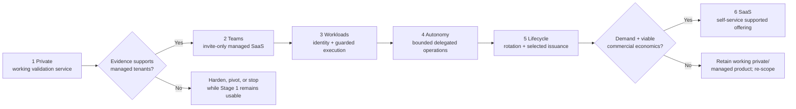

# Document 02 — mykey Project Stage Breakdown

**Working product name:** `mykey` (placeholder)  
**Version:** 0.3 — Final pre-implementation consistency and recovery-boundary audit  
**Date:** 7 November 2026  
**Governing strategic reference:** Document 01, *mykey Project Northstar*, v0.2 audited  
**Planning horizon:** 2027+; stages are capability/evidence transitions, not calendar release promises  
**Planning unit:** approximately 400 engineering hours per stage, subject to verified scope and safety  
**Next artifact:** Document 03, *Stage 1 Mission Brief* (reconciled), followed by the Stage 1 document sequence in §11  
**Status:** Final pre-implementation audit passed for use as a *project-level planning baseline*, subject to project approval. It is **not** approval of Stage 1 scope, feasibility, release, or any future commercial commitment. Stage 1 source contracts and open proofs remain in force until expressly reconciled; later-stage feature sets remain conditional hypotheses.

> **Governing stage rule:** **Every stage delivers a complete, self-contained, end-to-end, operable product shape. This includes Stage 1.** A stage is not a partially integrated platform, an unfinished milestone, or an advance payment on features that will work only after a later stage. At any stage exit, users can accomplish the declared core workflows; operators can deploy, monitor, protect, upgrade, and recover the declared service; and all included features meet their acceptance and failure criteria. When the effort envelope is exceeded, remove or defer an *entire coherent capability* before approval, choose a different proven design, or explicitly increase the stage budget. Never quietly ship half of a security-sensitive feature.

---

## 1. Purpose, authority, and planning posture

This document translates the Northstar's eventual secrets, credential-access, trustworthy delivery, agent-native operations, governance, developer experience, and service-operation ambitions into an **evolutionary sequence of complete product forms**. It answers: *What new, independently useful shape exists at the end of each stage, why is it the logical next form, what evidence permits advancing, and what must be excluded so the stage is finishable?*

It does **not** prescribe per-session tasks, commands, exact packages, infrastructure topology, or a final commercial architecture. Those are established by the mission, functional and technical documents for the particular stage, and then decomposed in the pre-roadmap and executed through roadmap runbooks.

### 1.1 What is fixed versus provisional

| Classification | Meaning for this document |
| --- | --- |
| **Strategic invariant** | A rule taken from the agreed direction: OpenBao-centered product, trustworthy boundaries, no unsupported security claims, first-class DX, agent-native orientation, evidence-led choices, and **complete stages**. It governs every stage. |
| **Current Stage 1 reference obligation** | A requirement in the supplied Stage 1 mission/specifications. It is not removed or weakened merely by appearing differently in this plan. |
| **Proposed stage allocation** | A reasoned candidate capability bundle and sequencing choice for an approximately 400-hour effort envelope. It can change after evidence and before stage approval. |
| **Feasibility hypothesis** | A mechanism, integration, isolation boundary, cost, or user-value assumption requiring technical proof and/or field evidence. |
| **Deferred horizon** | A potentially valuable later capability with no approved delivery stage. It must not be represented as an included feature. |

**Authority and change control:** Document 01 sets project-wide direction once approved. Document 02 sets the proposed evolutionary plan once approved. A particular stage is governed by its *approved* mission and functional/technical contracts. Existing Stage 1 documents refer to P-01, P-02 and P-03, which have not been supplied here; this document cannot certify that their requirements have been reconciled. Stage 1's existing 88 functional requirements, 44 acceptance scenarios and 24 proof obligations remain outstanding until the appropriate governing documents are explicitly revised and approved. No budget table below supersedes them.

**Meaning of “self-contained”:** a stage's released product must run and serve its declared users **without features promised by a later stage**. It may rely on *declared, supported* external infrastructure such as OpenBao, PostgreSQL, KMS, a hosting provider and a workload platform; “self-contained” does not imply zero external dependencies. It may reuse and extend a prior stage's code and deployment, and it need not be a separate standalone codebase or commercial offering. The *operational product* is complete at every stopping point. Existing supported workflows continue working unless a deliberately approved, tested migration or deprecation replaces them.

**Two acceptance moments:** the *release/controlled-use gate* verifies that the integrated service is safe and usable for its approved scope; the *stage completion/evidence gate* additionally closes any required real-use observation and adoption decision. A failed strategic hypothesis or negative commercial signal is a valid empirical result; it does not make correctly functioning software unfinished. A security/recovery defect or unfulfilled included workflow does make it unfinished.

### 1.2 Why approximately 400 hours

The target is intended to force meaningful, disciplined scope choices, not uniform session lengths or artificial deadlines. Estimates cover architecture, implementation, UX, APIs, CLI, security and abuse cases, fault injection, cloud/protocol proofs, integration and regression tests, deployment, backup/restore, documentation, independent review where applicable, and exit evidence. **No work is “free” because it is not a feature.**

Effort is *engineering labor*, not elapsed wall-clock time or vendor spend. Field observation, cert renewal windows, immutable-object retention/expiry, and other time-based proofs can extend the release calendar independently of coding hours. A stage containing a four-week field-use gate cannot be declared complete on the last coding day simply because the code compiles.

The allocations in §5 are **planning allowances, not measured estimates**. Each retains an *explicit 50-hour risk/verification reserve inside the nominal 400 hours*. This is a placeholder, **not** evidence that the other 350 hours suffice; the reserve cannot substitute for specified security work or be treated as work already performed. Document 07 must estimate the entire scope from dependencies, including likely uncertainty and correction effort, and replace the allowances with defensible numbers. There is no assumption of 40 ten-hour sessions: derive meaningful sessions in their real dependency order. An overrun of 400 hours is acceptable when documented and necessary to close security, recovery, verification or genuine completion; if a much larger overrun becomes likely, reconsider the product slice before it becomes sunk cost.

**Scheduling and accounting convention:** count engineering time spent on integration proofs, ongoing field-use diagnosis, remediation, regression reruns, usability observation, independent review and operational runbooks against the stage. Calendar-only waiting is not labor. Identify third-party security reviews, legal work, procurement and provider spend separately; exclusion from the labor estimate does not waive them as preconditions for the product shape.

---

## 2. The evolutionary model

### 2.1 Six proposed, complete product shapes

| Stage | Product shape at exit | Real primary consumer | New durable value | Planning target |
| --- | --- | --- | --- | ---: |
| **1** | **MyKey Private** — single-operator, production-usable validation service | Owner/developer and scoped CLI consumers | Real central secrets, controlled machine use, exceptional owner UX, secure recovery, trustworthy operational evidence | ~400 h, **high reconciliation risk** |
| **2** | **MyKey Teams** — controlled-access managed, multi-organization service | Small invited teams on hosted service | Real team onboarding, tenant boundaries, delegated human access, tenant-safe managed operation | ~400 h, conditional |
| **3** | **MyKey Workloads** — identity-mediated agent/workload access and guarded execution | Automation, coding/deployment agents, workload executors | Less copied long-lived authority and a verified constrained execution path | ~400 h, conditional |
| **4** | **MyKey Autonomy** — policy-governed delegated agent operations | Autonomous agent workflows and supervising humans | Bounded unattended changes, accountable decisions, exceptional HITL | ~400 h, conditional |
| **5** | **MyKey Lifecycle** — safe credential rotation and selected dynamic issuance | Developers, teams, unattended runtime operations | End-to-end credential maintenance with verified transitions | ~400 h, conditional |
| **6** | **MyKey SaaS** — self-service commercial service for a deliberately supported market | External subscribing teams and operators | Self-service tenant lifecycle, measured service economics, supported commercial operation | ~400 h, **high conditionality** |

**Illustrative envelope:** six stages × approximately 400 engineering hours = approximately **2,400 hours including an internal nominal risk reserve in each stage**, but excluding approved overruns, non-engineering specialist/provider expenditure, and calendar-only aging. It is not an additive reserve *on top* of 2,400 hours. This is a **candidate portfolio**, not a forecast that all six will be built or that their current boundaries will survive validation. It is not a promise of general availability at Stage 6.

Stage 1 is a genuine product, despite serving principally as a validation instrument. Stage 2 is intended to be the first *actual hosted multi-organization SaaS shape* if Stage 1 evidence justifies that move; it is not yet a public self-service commercial product. Stages 3–5 progressively make the SaaS more capable and agent-native. Stage 6 adds a complete self-service commercial operating model **if** demand, security responsibilities and economics warrant it.

### 2.2 Evolution, not an assembly line of half-features

Dependencies and evidence matter more than the drawing's apparent linearity. In particular, agent workload identity might move before team SaaS if Stage 1 proves that agent users—not invited teams—have the clearest immediate value. Any such reprioritization requires an explicit Document 02 revision and a fully specified, independently usable alternative Stage 2; it cannot turn Stage 2 into a proof-of-concept-only stage.

### 2.3 What grows, and what remains true

**Accumulates with each accepted evolution:** product usefulness, supported workflows, customer trust, DX quality, operational clarity, coverage of known failure modes, measured evidence, and explicit capability/compatibility contracts.

**Never traded away to accelerate a stage:** correct authorization; secret containment within the stated trust model; no fictitious security boundary; truthful outcome/replay semantics; safe revocation; audit attribution; recoverability; meaningful UI/API/CLI usability; tested deployment; honest operating claims.

**Not promised to remain identical:** authentication provider, physical tenant placement, job orchestration, hosting topology, API internals, runner model, KMS configuration, or implementation modules. Prior implementations are not protected from replacement if Stage 1 evidence demonstrates a better design; migration, regression and recovery are part of the replacing stage's completion.

---

## 3. Universal stage completion contract

A stage can be declared **COMPLETE** only after every condition below holds for the **entire approved scope**, not for a curated demonstration path.

| Gate | Required exit state | Evidence that qualifies |
| --- | --- | --- |
| **C-01 — Complete user outcome** | Every included workflow works end to end for its declared users and supported environments. There are no permanently mocked or “finish next stage” steps. | Real integrated demonstrations and scenario runs against pinned dependencies. |
| **C-02 — Closed capability boundaries** | Included features include setup, routine path, authorization denial, error handling, concurrency/replay where relevant, replacement/revocation, and lifecycle/cleanup. Excluded capabilities are absent or explicitly disabled, not misleading UI affordances. | Product acceptance matrix and direct-API/CLI negative tests. |
| **C-03 — Defensible security** | Explicit threat model, least privilege, isolation, credential handling, privileged operations, supply-chain review, and no prohibited secret leakage. Safety claims match what was tested. | Adversarial and authorization tests, secret-canary checks, scoped security review. |
| **C-04 — Truthful effects** | Mutations and external effects survive interruption with correct outcomes, explicit uncertainty, safe replay rules, and reconciled conflicts. | Fault injection, restart and delayed-effect tests for the stage's affected operations. |
| **C-05 — Deployable and recoverable** | The whole supported product can be installed/deployed, monitored, upgraded or deliberately restored, backed up and recovered without unknown bootstrap dependencies. | Clean-install, upgrade/migration and clean-host restore evidence; runbooks. |
| **C-06 — Excellent usable interface** | Human-facing UI and machine-facing API/CLI are coherent and understandable. Their errors, status and useful product-local metrics are accurate; no unsafe value capture. | Actual task observation, accessibility/usability checks, API/CLI contract tests, data-lineage checks for displays. |
| **C-07 — Regression integrity** | All previously supported and deliberately retained product workflows pass, or their replacements pass an explicitly approved migration/deprecation plan. | Versioned regression suite and migration/rollback or restore rehearsal. |
| **C-08 — Reproducible evidence** | Release commit, exact pins, deployed artifacts, test commands, expected/observed outputs, failure cases, review decisions and unresolved limitations are recorded. | Auditable release/evidence manifest; no unproved gate is labeled PASS. |
| **C-09 — Operable after handoff** | A developer/operator can run the actual service using finished documentation and alert-response procedures; no reliance on unwritten author knowledge. | Operator dry run and user onboarding walkthrough. |
| **C-10 — Observed value and exit decision** | A measured outcome against relevant baseline alternatives is presented with limits, failed hypotheses and next-stage implications. **Negative findings count as valuable evidence**; strategic success is not required to establish technical completion. Required field-use duration and long-term proofs are complete where contractually required. | Evidence review and signed **advance / harden–re-scope / stop** decision. |

**Release gate versus evidence gate:** where a stage requires a real-use observation period, first pass the security/release gate before onboarding real sensitive workloads. The stage is **released for controlled field use**, but **not complete** until the required field evidence and final decision are recorded. Bugs discovered during field use must be resolved or explicitly bounded without violating the approved complete-product contract. The product must remain usable in its approved scope even if the next stage is cancelled indefinitely.

**Forbidden exit rationales:** “the backend works but the CLI/UI will come later”; “restore is documented but untested”; “the policy is enforced by a hidden button”; “the runner should hide secrets from arbitrary agent-controlled code”; “we will implement revocation next stage”; “the API works in unit tests but the real OpenBao integration is open”; “400 hours are up.”

**Allowed stage changes before exit:** reduce an unapproved capability bundle; replace a failed candidate integration with a verified equivalent; narrow supported OS/runtime/tenant environment; eliminate a complete planned add-on; or accept an evidence-backed budget overrun. Once a stage's mission/functional scope is approved, such changes require an amended contract, acceptance matrix, and dependent technical/pre-roadmap/runbook revisions—not silent omission.

---

## 4. Scope construction and prioritization

### 4.1 Define the smallest closed vertical product

For every proposed capability, assess its **full closure cost**, not just its happy-path implementation:

1. Principal and authorization semantics; limits and trust boundary.
2. User/agent entry point, setup and configuration, API/CLI/UI affordances.
3. State and data ownership, backend effects and consistency across stores.
4. Revocation, deletion/expiration/rotation, retry and interrupted execution.
5. Logs/audit/diagnostics/analytics that reveal state without revealing values.
6. Deployment/configuration, upgrades, backup/restore and administrative rescue.
7. Positive and negative tests, performance limits, abuse/fault cases, independent review where required.
8. Documentation, operator runbooks and real-use validation.

If this package cannot fit responsibly, **defer the entire capability or reduce its supported use cases**. For example, ship one fully tested workload-identity provider instead of three half-integrated providers, or one complete credential-rotation connector instead of several unverified ones. Do not create a general adapter framework without one robust real consumer.

### 4.2 Prioritization rule

Choose the capability that offers the highest combination of: necessary security foundations, real end-to-end utility, importance to the 2027+ agent model, measurable incremental value over current alternatives, developer-experience leverage, and confidence of completing the *whole* lifecycle in approximately one stage.

**Stage order is conditional on evidence:** a low-value feature does not become mandatory merely because it was assigned a stage. A critical invariant cannot be relegated to an optional later stage. Any unresolved proof that underpins an included feature is a hard dependency, not an “acceptable technical debt” item.

### 4.3 Stage sizing convention

A provisional 400-hour planning envelope is assigned to the *full stage workload*, including integration, test work, field-study engineering and final evidence. The following tables earmark 350 hours of illustrative work-package allowances and 50 hours of **unassigned risk/verification reserve**; they are not estimates grounded in measured implementation velocity. Reserve consumption must be accounted for against actual corrective work, and any remaining reserve cannot be counted as “complete work.” A pre-roadmap must convert packages into bottom-up estimates with lower/expected/upper uncertainty, proof-calendar dependencies, external-review availability and the source of evidence for each estimate. Significant underestimation triggers scope or budget review **before** work is promised. Do not reserve testing, documentation and recovery for a fictitious later hardening stage.

**Commitment threshold:** approve a stage implementation roadmap only when (a) its entire chosen end-to-end product scope has requirements and acceptance coverage, (b) proof prerequisites have executable pass/failure branches, (c) integration/recovery and operator support are costed, and (d) the effort choice is explicit: feasible near 400 hours, narrowed whole capability slices with revised authority, or justified overrun. For Stage 1, the present 88-FR/44-AC/24-PO contract takes precedence until approved replacement documents say otherwise.

---

## 5. Stage profiles and provisional engineering allocation

### Stage 1 — MyKey Private: complete operator validation service

**Product proposition.** One owner can securely centralize real application secrets, administer projects and environments through a polished interface, provision bounded machine access, run a supported application without normal plaintext dotenv-file choreography, diagnose failures, and recover the complete service after host loss. Other organizations/users are exercised synthetically to test isolation and authorization; Stage 1 does not claim to be a multi-user hosted SaaS.

**Who uses it.** One human operator/owner and their actual non-critical application workload, plus tested synthetic users/tenants. A controlled automation/agent consumer may use the machine-facing CLI/API under a real authorized identity, without implying that the model itself receives the token or secret values. The bounded agent evaluation uses a *separate, explicitly trusted task executor* with synthetic or disposable credentials; its result and security limitations are recorded as experiments rather than as a new general-purpose Stage 1 agent-runtime feature.

**Complete end-to-end demonstration.** Bootstrap owner → authenticate with mandatory second factor → create project and environment → enter/import values as specified by the **approved** Stage 1 contract → issue a scoped expiring read-only machine credential → supply the credential through a documented protected setup path → run a real supported application with a complete resolved environment or launch nothing → inspect status and relevant product-local activity → revoke and prove subsequent access denial → restore from a valid off-host backup on a clean host in closed state → rotate/invalidate old access → revalidate authority and reopen. Demonstrate with synthetic values before introducing any real secrets.

**Document-authority boundary.** The following describes the intended Stage 1 *shape*, including stronger developer-facing experience and one agent fixture. It is a candidate reconciliation target, **not** an assertion that every enhancement was already required by the supplied 1-01/1-02. Any added human interface, analytics, or agent-facing acceptance requirement must be explicitly adopted and estimated in Documents 03–04 and traced through 05–08. Existing approved FRs/ACs/POs cannot be silently displaced by these additions.

**Stage 1 candidate product capabilities:**

- Complete owner account and verified MFA/recovery, authorization boundary and organization/environment lifecycle appropriate to the approved Stage 1 contract.
- Functional secret creation, retrieval, update/version safety, and deliberately supported deletion/recovery behavior; no ambiguous “successful” mutations following uncertain backend outcomes.
- Machine credential issuance, inventory, expiry and verified revocation; real CLI consumption with verified TLS and no unintended local secret cache.
- A complete, usable web workspace, versioned product API, first-class CLI errors/help, contextual state and action explanation, useful secret-free inventory/health/activity visualizations, and supported Scalar developer reference.
- Crash/replay safety, authenticated audit and diagnostics, independent recovery material, consistent recoverable backups, restore quarantine, incident runbooks and controlled deployment.
- At least one realistic **end-to-end agent-initiated validation fixture** (for example an external coding agent requests that a trusted test runner launch integration tests using pre-authorized access). Observe setup burden, completion/denial, error comprehension, transcript exposure, and failures with synthetic/disposable credentials. The trusted executor is external to MyKey or a deliberately narrow fixture; this does **not** promise workload federation, autonomous issuance, agent delegation, safe handling of arbitrary agent-controlled code, or a production sandbox.

**Explicit Stage 1 exclusions unless its governing contract is revised:** real multi-user membership/grant administration, public signup, billing, hosted public SaaS, workload identity federation, dynamic secrets, SDK breadth, HA, a general agent operations console, and autonomous credential mutation/delegation. This does **not** waive any presently approved requirement for direct authorization/security tests with synthetic users/organizations.

**Principal hypotheses:** OpenBao + PostgreSQL coordination is tractable; proposed auth and KMS integrations are implementable with the required safeguards; complete secret resolution and crash-safe mutation are achievable; paired recovery is operable; developer-facing UI/API/CLI save time and clarify failures; realistic operational cost is acceptable.

**Critical proof prerequisites:** the existing technical audit's **24 unexecuted obligations**, especially Better Auth protected session/factor behavior; OpenBao scoped privileges and real OVH KMS restart/unseal; independent KMS seal-key and client-certificate custody; delayed-backend-effect exclusion and reconciliation; complete reads; backup/retention/maintenance and clean-host restore; CLI packaging/security and strict browser/telemetry behavior. A design document, vendor compatibility statement, or isolated mock cannot close a live integration proof.

**Provisional 400-hour work allocation (not yet verified):**

| Package | Hours | Included in the allocation |
| --- | ---: | --- |
| Dependency/feasibility gates and architecture closure | 40 | Pins, core proof spikes, adjudication of failed candidates |
| Identity, account lifecycle, tenant/resource authority | 55 | MFA, protected sessions, tenant tests, denial paths |
| Secret state and durable cross-store operations | 75 | CAS, versions, unknown effects, reconciliation, concurrency/fault coverage |
| Machine credential and CLI full workflow | 40 | Issuance/revocation, secure supply, launch failure behavior, platform checks |
| Web/API, DX, documentation and secret-free visualizations | 45 | Owner workflows, Scalar reference, diagnostics, accessibility, canaries |
| Deployment, backup/restore, security operations | 60 | KMS/TLS/host, paired capture, restore quarantine, alerts, drills |
| Integrated acceptance, independent review and field-use instrumentation | 35 | Real service scenarios, release evidence, handoff and observation prep |
| Explicit risk, proof rerun and correction reserve | 50 | Allocated only to work actually performed; not a waiver or estimate |
| **Indicative total** | **400** | Testing is included **within every package**, not just the final row |

**Budget realism warning — HIGH:** the existing Stage 1 documents mandate **88 FRs, 44 ACs and 24 POs** and extensive operations/security work; nothing reviewed establishes that this entire scope fits 400 hours. The table above is a constraint to test, **not** an assertion of feasibility. The present specification may require substantially more hours. Before implementation commitment, Document 07 must produce a real bottom-up work inventory and show either (a) complete coverage with defensible effort; (b) an expressly revised, smaller but still self-contained Stage 1 contract, consistent with governing P-01/P-02/P-03; or (c) an explicitly approved overrun. Do not cut security, recovery or unfinished cross-store effect handling to manufacture fit. If the existing full Stage 1 contract remains binding, complete all of it regardless of the estimated number of sessions.

**Stage 1 release and completion:** gate real secrets behind executed synthetic security/restore proofs; deploy and field-use the released, end-to-end complete service with at least one real non-critical application **after** release; complete the currently required **minimum four weeks of daily field use** and scheduled staging recovery drill; record observed DX, API/CLI usefulness, backup age, restore time, latency, resource use, failures, costs and defects; then decide to advance, harden, revise architecture, or stop. Four weeks is calendar time, not 160 engineering hours automatically added to the stage; **actual diagnosis, on-call response, defect fixes and verification during that period count as engineering labor**. An unfavorable Stage 2 recommendation does not negate the completed Stage 1 service.

**No-work-in-progress test:** if Stages 2–6 are cancelled, Stage 1 remains a maintainable, usable operator secrets service with meaningful workflows, documentation, monitored operation, revocation and recovery. It does not depend on promises of hosted tenants, workload identity or future UX fixes.

---

### Stage 2 — MyKey Teams: controlled hosted multi-organization SaaS

**Entry dependency.** Stage 1 meets both the complete-product and field-evidence gates, and the recorded Stage 1 decision supports operating a hosted service for selected external team users. Prior single-host/operator assumptions are revisited; no blind promotion of the Stage 1 deployment architecture. **This is the default candidate, not the mandated next stage:** if evidence favors an agent-native private product, substitute a fully specified alternative complete Stage 2 before implementation approval.

**Product proposition.** Invited small teams can use a **real managed MyKey service**, with independently provisioned organizations, supported human membership/roles/grants, clear onboarding/offboarding, and reliable managed operations. This is the first proposed SaaS **service delivery model**: controlled-access and appropriately limited, but end to end for its declared tenants. Payment, public registration and a broad SLA are not required to call it a hosted service; it must not market itself as a generally available commercial SaaS.

**Complete end-to-end demonstration.** Managed operator provisions two genuinely separate tenant organizations → invites/designates real users and owners through a supported controlled process → users enroll MFA and obtain least-privilege access → each team manages its projects, credentials and CLI consumers → forbidden cross-tenant identity/API/backend/storage operations are denied → membership removal invalidates subsequent access and affected machine authority per contract → operator executes a **documented tenant-specific recovery/export procedure where supported** and a separate **full-deployment disaster recovery** procedure, each without resurrecting invalid permissions or exposing another tenant's data → teams continue using the service after host/deployment recovery.

**New complete capability package:**

- Deliberately selected tenant isolation model, threat model and hosting responsibility matrix, verified **beyond** OpenBao namespaces at API, database, storage, key, network, backup, restore, telemetry and privileged operator boundaries.
- Owner/admin-controlled invitation or operator-mediated invitation as selected; end-to-end membership and scoped grant management, lifecycle and recovery; no speculative enterprise directory integration.
- Tenant-safe provisioning, quotas, resource state, account/session/credential invalidation, deprovisioning, backup isolation and tested removal/retention policies. **Credential lineage and removal semantics** must be explicit: removing a person does not magically revoke every machine token unless issuance ownership and revocation policies make that guarantee enforceable.
- **Separate disaster recovery from tenant-specific recovery.** A normal OpenBao integrated-storage/Raft snapshot covers the underlying cluster state; it is not a verified per-tenant rollback primitive. Select a topology or a carefully authorized per-tenant logical export/replay procedure that can meet the chosen tenant-level recovery promise, or explicitly support only a tested *whole-service* restore plus tenant export/version recovery. A tenant recovery must not roll back other tenants or reinstate revoked sessions/tokens. Test non-target tenant continuity, reauthorization and consistency with PostgreSQL.
- Before admitting external users or their credentials, establish the hosting responsibilities and applicable privacy/data-processing terms, breach/incident process, retention/deletion disclosures and off-host recovery/key custody. These are **Stage 2 prerequisites**, even though broad public signup and billing are deferred to Stage 6.
- Hosted release/deployment/migration routines; tenant-safe observability, support diagnostics, alerting, incident response, documented availability/recovery behavior and onboarding documentation.
- Strong team UX: invitations, permission explainers, organization/project switcher, credential/access maps and relevant product-local usage/health dashboards, with no sensitive payload analytics.

**Not included:** public signup, automated billing, enterprise SSO, extensive RBAC policy DSL, generalized identity federation, universal geographic regions, unsupported HA claims, or agent delegation. All existing Stage 1 workflows continue to work or are safely migrated.

**Key validation:** verify isolation and clean tenant lifecycle with real team usage; cost per active tenant; administration hours and recovery burden; tested recovery granularity; whether team collaboration materially outperforms direct OpenBao or deployment-native tools. Validate with more than the owner, but do not confuse an invite-only trial with market proof. If a promised tenant-level restore is not achievable under the selected shared-storage model, narrow the **declared recovery service** and obtain approval *before* onboarding users, or select a different topology; do not claim isolation from namespaces alone.

**Provisional 400-hour allocation:**

| Package | Hours |
| --- | ---: |
| Tenant/isolation architecture and executable adversarial validation | 85 |
| Account, invitations, membership and scoped grant lifecycle | 65 |
| Managed provisioning, backup/restore, migration and offboarding | 70 |
| Team UX, API/CLI adaptation, documentation and analytics | 50 |
| Hosted hardening, support/incident controls and integrated field acceptance | 80 |
| Risk/verification and corrective-work reserve | 50 |
| **Indicative total** | **400** |

**Critical constraint:** Stage 2 cannot be declared complete by reusing a single-tenant production deployment with only a tenant selector in the UI. If verified multi-tenant managed operation and its recovery/security model do not fit, reduce supported tenants/users/features, use a safer isolation model, or increase the budget. An invitation-only model is a legitimate closed product; half-built tenant isolation is not.

**No-work-in-progress test:** if Stage 3 never happens, small teams can independently onboard, use, administer, recover from incidents and leave a controlled hosted secrets service without any agent identity or delegation feature.

---

### Stage 3 — MyKey Workloads: identity-mediated execution for agents and services

**Entry dependency.** A completed Stage 2 (or a formally approved revised predecessor) and demonstrated needs for autonomous workloads. Select supported workload hosts and identity issuers from real use; do not promise provider-independent attestation before actual integration tests.

**Product proposition.** A supported workload or automation agent can authenticate through a **verifiable, time-limited non-human identity**, obtain only narrowly scoped authority, and perform one complete useful execution workflow through a guarded delivery path without routinely copying long-lived secrets into agent prompts, tool responses or local files.

**Complete end-to-end demonstration.** A coding/deployment agent uses an **external orchestration system** to request an approved test/deployment task from its executor (MyKey does **not** schedule or reason about the task) → identity and context are verified at the real trusted boundary → permitted scope and lifetime are established → a runner/workload acquires and uses only the required credential capability → the language model receives safe status/artifacts, not secret-bearing results on MyKey-controlled channels → a cross-scope or prompt-injected request is denied → identity expiry/revocation denies subsequent new access → failures, interrupted launches and recovery are attributable and operable.

**New complete capability package:**

- **One** real workload-identity/attestation integration for **one** explicitly supported execution environment; bounded token exchange/access lifecycle, issue/expiry/revoke and trust renewal or recovery.
- **One supported external trusted-runner/delivery integration**, not a general-purpose hosting or orchestration service, with exactly stated protections and limitations, including network, logs, output filtering, process placement and runtime trust assumptions. Arbitrary agent-controlled code inside a secret-bearing process remains able to extract the values available to that process; use disposable low-privilege test credentials and containment rather than impossible non-disclosure claims.
- Identity-to-workload/resource binding, human sponsor attribution if applicable, server-enforced authorization and backend capability boundaries; current grant/revocation checks.
- Agent-usable typed API/CLI statuses and diagnostics, reproducible onboarding and workload identity inventory in the UI.
- Test suites for hostile prompts/tool inputs, confused-deputy attempts, runner escape/exfiltration in the declared threat model, credential leak canaries, interruption and cleanup.

**Not included:** generalized sandbox cloud, support for every attestation provider, arbitrarily safe execution of hostile code, broad delegation across agents, LLM-based policy judgment, dynamic credentials for every engine, or unrestricted plaintext MCP tools.

**Key validation:** agent-task completion against a deterministic/manual baseline *for the credential-handling portion of the task*, credential exposure reduction on MyKey-controlled surfaces, failure recovery, intervention rate, provider costs and actual security boundary. Where robust runner isolation cannot be proved, state the weaker supported protection tier or replace the design; a nice diagram does not close the proof.

**Provisional 400-hour allocation:**

| Package | Hours |
| --- | ---: |
| Selected workload identity/issuer feasibility and full integration | 75 |
| Credential exchange, scope/expiry/revocation and backend enforcement | 65 |
| One guarded runner/delivery environment and operational lifecycle | 80 |
| Agent interface, onboarding and developer/supervisor UX | 45 |
| Adversarial/fault testing, security review, deployment/recovery evidence | 85 |
| Risk/verification and corrective-work reserve | 50 |
| **Indicative total** | **400** |

**No-work-in-progress test:** if Stage 4 never happens, agents and workloads on the specifically supported platform can autonomously complete scoped, preauthorized *read/use* workflows with secure lifecycle and clear failure/diagnostic behavior; they need no future delegation engine to function.

---

### Stage 4 — MyKey Autonomy: bounded delegation and exceptional supervision

**Entry dependency.** Stages 2–3's human/tenant authority and workload execution model are proven. Actual unattended workflows show repeated, clearly bounded operations worth productizing. Human approval frequency is measured rather than assumed.

**Product proposition.** A team can delegate a small but useful class of **effectful** operations to a named agent/workload under enforceable limits, with verified policy, current authorization, attributable changes, safe retries, human escalation for exceptional cases, and clear supervisory diagnostics.

**Complete end-to-end demonstration.** An owner creates a bounded delegation for one environment and supported operation set → an agent proposes/executes allowed work autonomously → each effect is independently authorized, durably tracked and backend-verified → exceeding scope, lifetime or risk limit denies or creates a specific human decision request → the reviewer approves/denies through a scoped, freshness-checked path → the agent resumes or remains denied → mid-flight revocation, retries and restarts cannot produce extra untracked authority or duplicate effects → the human can see the full reasoned event sequence without plaintext inspection.

**New complete capability package:**

- Policy model limited to a **real, finite action vocabulary**, attenuation and non-amplification rules, expiring delegation, sponsor/agent/executor attribution, revocation and replay-safe effect admission.
- A small complete set of autonomous actions, such as bounded environment configuration changes or controlled issuance/revocation actions **already fully supported by the predecessor product**; each action includes lifecycle/compensation/reconciliation contracts. Do not add “approve anything” agents.
- Deterministic policy enforcement, durable approval/denial records, risk-sensitive exception packages and a supervisor UI that avoids routine approval fatigue.
- Machine-readable action/status/event interface and optionally **one** tested protocol adapter (for example MCP) over guarded API contracts, with no privileged bypass.
- Post-effect evidence, audit and product-local analytics for agent operations, policy denials, unusual patterns and human interventions.

**Not included:** general agent orchestration, arbitrary natural-language grants, a universal policy language, autonomous privileged infrastructure administration, or wholesale credential rotation across third-party systems before connectors are complete. Do not label a request to rotate an unsupported external credential as a completed autonomous lifecycle action: that end-to-end capability belongs in Stage 5 if later approved.

**Key validation:** unattended completion rate, frequency and usefulness of human escalation, unauthorized effect denial, time to understand and resolve a request, attribution integrity, and whether policy complexity is justified by operational value.

**Provisional 400-hour allocation:**

| Package | Hours |
| --- | ---: |
| Delegation and finite-action policy contract, UI and migrations | 85 |
| Complete effectful actions and durable reconciliation | 90 |
| HITL workflow, supervision and diagnostic/analytics views | 60 |
| Agent API/adapter, developer docs and lifecycle onboarding | 40 |
| Authorization abuse/fault tests, incident recovery and integrated field evidence | 75 |
| Risk/verification and corrective-work reserve | 50 |
| **Indicative total** | **400** |

**No-work-in-progress test:** if Stage 5 never happens, teams can safely delegate the documented operations to agents, revoke them and supervise exceptional cases. No part of the stage depends on a promised future generalized rotation engine.

---

### Stage 5 — MyKey Lifecycle: verified credential maintenance and issuance

**Entry dependency.** Completed authorization, workload delivery and bounded effect protocols. Choose credentials and providers that actual teams/agents need to manage; do not implement engines for their own sake.

**Product proposition.** A supported credential class can be created or replaced, safely delivered to its consumers, transitioned, verified and revoked through a coherent unattended or supervised workflow, including recovery from partial failure. For the deliberately supported credential class, the product reduces the likelihood that credentials silently become unmanaged liabilities; it does not claim universal coverage.

**Complete end-to-end demonstration.** A supported application/third-party credential is inventoried → impending expiry or explicit rotation request is surfaced → an authorized workflow initiates replacement → new authority is issued or retrieved through a **fully supported connector/engine** → consumer delivery is verified in the supported environment → old authority is revoked or the operation enters a truthful, actionable review state → affected services continue or fail according to the stated availability policy → audit, timelines and client diagnostics reflect backend evidence. Demonstrate both successful and intentionally interrupted transitions.

**New complete capability package:**

- **One** high-value, fully implemented rotation/credential provider path (or a single selected dynamic-credential engine, if that better serves evidence), with all required issuer/consumer/revocation rights tested.
- Clear transition state, ordered operations, overlap policy where supported, verification, expiry, safe rollback/recovery and non-secret audit/analytics. Never assume all external credential issuers allow atomic replace/undo.
- Client/runner compatibility for updated credentials, with stated restart/reload semantics; supported automation cadence and bounded budgets.
- Credential age/expiry/scope posture insights and intervention tooling backed by reliable data; notifications/alerts without leaking values.
- Negative testing for issuer outage, consumer rollout failure, double issuance, uncertain backend outcome, permissions removed mid-rotation and recovery from backups.

**Not included:** blanket support for every cloud/provider, universal no-downtime rotation, automatic destructive remediation of unknown services, all OpenBao dynamic/transit engines, or speculative ML anomaly scoring.

**Key validation:** successful complete rotations, avoidable downtime, human steps, orphaned credentials, recovery times, operator burden, and incremental value over provider-native rotation facilities.

**Provisional 400-hour allocation:**

| Package | Hours |
| --- | ---: |
| Select one issuer/engine and implement scoped integration | 75 |
| Complete rotation/issuance state machine and reconciliation | 100 |
| Consumer/runner delivery, restart/refresh and fallback behavior | 55 |
| Credential lifecycle UI, explainable posture and alerts | 45 |
| Integration/failure drills, recoverability, docs and field validation | 75 |
| Risk/verification and corrective-work reserve | 50 |
| **Indicative total** | **400** |

**No-work-in-progress test:** if Stage 6 never happens, supported teams and agents can manage the selected credential lifecycle end to end on the managed service without any public billing or self-serve provisioning system.

---

### Stage 6 — MyKey SaaS: self-service commercial operation

**Entry dependency.** Evidence of demand outside a single owner, reliable managed-tenant operations and realistic unit economics. A paid/self-service SaaS is not justified merely because previous stages built a sophisticated platform. Legal, tax, privacy and provider prerequisites must be explicitly addressed outside engineering estimates where appropriate.

**Product proposition.** A defined customer segment can discover, register, select a documented service plan, onboard, use, pay for where applicable, administer, recover access to, and exit a supported hosted MyKey service without bespoke operator choreography for routine actions. The operator can deliver that service with honest guarantees, credible cost controls, security and customer support.

**Complete end-to-end demonstration.** New customer signs up under enforced abuse controls → creates and verifies its tenant → configures supported identity/projects/workloads → completes the core secret-delivery workflow → understands usage and plan limits → completes a billing/payment/subscription lifecycle where offered → manages authorized members and credentials → receives tested incident/support and recovery pathways → changes/cancels service, exports permitted data and offboards safely → provider and tenant failure cases obey documented responsibility, data retention and service guarantees.

**New complete capability package:**

- Self-service tenant signup/onboarding, abuse controls, provisioning limits, tenant lifecycle and account recovery without expanding bootstrap authority.
- One coherent commercial plan/entitlement model with metering, usage presentation, safe enforcement, billing provider integration where selected, refunds/failures/cancellation handling and support handoff. Sensitive payment information remains with an appropriately qualified provider; avoid handling raw payment cards.
- Production tenant support and incident process, status/communications appropriate to claims, tested restore procedures, backups/retention, upgrade/migration and resource/cost limits at published scale.
- Policy/identity/credential and tenant boundary revalidation under realistic customer concurrency and adversarial workflows, plus UX/CLI/API onboarding documentation and clear responsibility disclosures.
- Product-local analytics for adoption, workload success, credential posture and actual operating cost without storing values or private prompts.

**Not included by default:** enterprise SSO/SAML, formal certification claims not earned, limitless public scale, geo-redundancy or HA without proofs, extensive integrations or a public plugin marketplace. If the chosen customer promise *requires* HA or another major operational property, either build and prove it within an expressly revised stage budget, narrow the advertised promise, or defer commercial launch.

**Key validation:** secure conversion from signup to useful workload, actual recurring usage, retention, cost per tenant/workload, support load, incident readiness, customer demand and the financial viability of continuing the service.

**Provisional 400-hour allocation:**

| Package | Hours |
| --- | ---: |
| Self-service account/tenant onboarding and anti-abuse controls | 65 |
| Plan/entitlements, metering, billing and cancellation lifecycle | 75 |
| Commercial operations: support, deployment, recovery and service reporting | 75 |
| Customer/developer UX, API/CLI docs and analytics | 50 |
| Tenant isolation/security/failure regression and release evidence | 85 |
| Risk/verification and corrective-work reserve | 50 |
| **Indicative total** | **400** |

**High risk:** legal/compliance preparation, support operations, market validation, security review, high-availability requirements and commercial hosting costs may exceed this engineering envelope or require specialist work. **No commercial-launch claim is authorized solely by this stage allocation.** A complete invite-only SaaS may remain the right endpoint; a partially ready public SaaS is not.

**No-work-in-progress test:** if development stops permanently after Stage 6, authorized customers can self-serve the declared plans and workflows, the operator can uphold the explicitly published service contract, and tenant exit/recovery are complete. Otherwise the stage remains open or the commercial scope is reduced and reapproved.

---

## 6. Cross-stage capability and trust evolution

The table distinguishes **minimal stage ownership** from possible later enhancement. “Present” means a whole supported workflow, not an architecture placeholder. No future column silently removes a previous stage's contract.

| Capability family | 1 Private | 2 Teams | 3 Workloads | 4 Autonomy | 5 Lifecycle | 6 SaaS |
| --- | --- | --- | --- | --- | --- | --- |
| OpenBao values, versions and controlled delivery | Owner workflow | Team/tenant ready | Guarded workload use | Delegated allowed effects | Lifecycle aware | Commercially supported |
| Human identity/authorization | One actual owner, synthetic tenants/roles for tests | Real team members/grants | Sponsors and agents distinguishable | Delegation and exception paths | Lifecycle authority | Self-service tenant governance |
| Machine/workload identity | Scoped expiring read-only machine token | Tenant-safe machine access | One verified workload federation | Delegated agent actions | Credential consumer identities | Supported customer environments |
| Secure execution | CLI process launch with honest trust claims | Team CLI access | One guarded runner/delivery tier | Policy-governed effect execution | Renewal/rotation-aware delivery | Productized supported runtime tiers |
| Operations/recovery | Backup, restore/quarantine, alerts | Multi-tenant managed lifecycle | Identity/runner recovery | Delegation/approval recovery | External issuer and consumer failure recovery | Published hosted service obligations |
| Product-local UX/analytics | Rich owner workspace, state, errors and usage | Team access and org health | Workload attribution and setup | Policy/effect timelines, HITL | Rotation posture and transitions | Subscription, support and usage clarity |
| Commercial operations | None | Closed hosted beta, no public signup/billing | Preserve closed service | Preserve closed service | Preserve closed service | Controlled self-service commercial offer |

**Observability ownership boundary:** each stage provides product-local authorization/audit, lifecycle status, decision packages, relevant diagnostics and clear actionable visualizations. This does not imply building a general agent-operations observability console, cross-application trace aggregation, or a universal monitoring platform. Exported portable telemetry may serve a future separate observability product; MyKey's local control plane remains authoritative for its own policy and effects.

**Workload and agent boundary:** an agent invoking a tool is not by itself an identity verifier or trusted execution environment. Distinguish sponsor, requesting model/tool, workload executor, backend issuer and resource owner. A delivery method that injects process environment values into agent-controlled code does not shield those values from that code. Each new stage can claim only the confidentiality/integrity levels established by tests in its supported runtime.

**Managed tenants:** the Stage 1 synthetic authorization matrix is useful preparatory evidence but insufficient for commercial multi-tenancy. Stage 2 must re-assess physical/logical isolation, recovery authority, operator privilege, and cross-tenant data handling from first principles.

---

## 7. Cross-stage evidence and decision gates

### 7.1 Gate E1 — Stage 1 to the first hosted service

Evidence required: the actual Stage 1 release/field-use contract (including four weeks of daily use), passing security and restore proofs for the implemented scope, measured reliability/DX/maintenance costs, honest comparison with alternatives, and explicit reassessment of hosted tenant security and operating economics. Compare at least **three coherent next-shape choices**: (A) invited managed teams, (B) agent/workload-enabled private deployment, and (C) maintenance/no expansion. Select a complete stage on user value, security feasibility and full delivery cost—not the default stage number.

**Advance to proposed Stage 2 only if** those results justify real invited teams and there is a viable way to protect them. If evidence instead points primarily toward agent tooling in a private deployment, rewrite the next stage as a complete *agent-ready private product* and revise the sequence; do not pretend the hosted stage happened.

### 7.2 Gate E2 — Teams to Workloads

Evidence required: multiple real tenant users with complete on/offboarding, denial/isolation tests, recoverable managed operations, support burden and real agent/workload requests. Select **one** workload identity plus execution context with enough practical demand and a credible threat model.

**Do not advance** from “agent API available” to “agent-safe credential delivery” on the basis of a protocol demo. Require tested supported trust boundaries and credential exposure behavior.

### 7.3 Gate E3 — Workloads to Autonomy

Evidence required: workload identity and delegated human sponsorship separation demonstrated; real repeated agent operations; clean exposure and failure evidence; requests requiring effectful policy and exceptions. Define the finite actions and limits before granting them.

**Do not advance** if identity/scope is uncertain or if autonomous work would require the agent to receive unbounded production credentials.

### 7.4 Gate E4 — Autonomy to Lifecycle

Evidence required: audited delegation/approval and operation replay/reconciliation; recorded need for specific rotations or dynamic credentials; viable provider/engine capabilities, consumer replacement semantics and acceptable interruption behavior.

**Do not advance** if there is no complete issuer + consumer + revoke/recovery path for even the chosen initial credential class.

### 7.5 Gate E5 — Lifecycle to self-service commercial SaaS

Evidence required: repeated external demand, a demonstrably differentiated outcome, pricing/operating hypothesis tested with prospective customers, credible tenant economics, legal/operational responsibilities, abuse response, recoverability and supported service commitments.

**Do not advance** merely to achieve the planned sixth stage. Maintain the previous complete managed product or select another capability if commercial evidence is inadequate.

### 7.6 Decision outcomes

Every gate produces a signed decision with **ADVANCE**, **HARDEN/RE-SCOPE**, **PIVOT** or **STOP**, plus the next-stage rationale, unresolved assumptions and maintenance plan for the already complete released product. Stopping a roadmap does not make prior stages unfinished; they remain operated/maintained within their declared support commitments, or deliberately and safely retired.

---

## 8. Cross-stage risks and budget stress tests

| Risk | Implication | Planning response |
| --- | --- | --- |
| Stage 1 existing requirement count exceeds realistic 400-hour delivery | High likelihood of unsafe schedule compression if ignored | Treat as a **red-flag estimate**, derive bottom-up effort in Document 07, explicitly re-scope or approve overrun; never imply audit proofs are complete |
| Protected session/auth integration is not supported by maintained extension points | Can block real launch | Conduct early executable proof; replace/integrate architecture only through approved decision and security review |
| Native KMS interoperability or long-duration backup retention is unproven | Could prevent recovery or hold gate open beyond coding | Begin real KMS and retention trials early; use tested fallback only via recorded change; separate engineering and aging/calendar time |
| Auto-unseal key or certificate custody is treated as a replaceable backup detail | Losing the external seal key can make otherwise intact OpenBao snapshots unreadable; OpenBao recovery-key shares are not an alternative decryptor | Protect and rehearse independent access to active and historical seal keys, KMIP client certificates, renewal and provider permissions; explicitly disclose irrecoverable key-loss boundary and exercise KMS outage versus key loss |
| Repository pruning is assumed compatible with storage retention locks | Locked R2 objects may block backup repository rewrites/deletion and prevent ordinary maintenance | Prove the chosen backup repository format, lock policy, expiration, cleanup and oldest-eligible restore together; do not infer compatibility from backup creation alone |
| PostgreSQL/OpenBao effects survive process timeouts | Risks duplicate/reordered mutations and forged success | Durable operation/admission, delayed-effect containment and operator reconciliation are foundations, not deferred UX |
| A host or an agent controls credential-bearing runtime code | Claims of confidentiality may be false | Maintain explicit trust tiers, low-privilege test accounts, egress/output controls and supported-runner tests; disclose residual risk |
| Moving from one operator to real hosted tenants | Changes isolation, key custody, support and recovery responsibility | Stage 2 is a new complete architecture/ops assessment; do not equate namespaces with full isolation |
| Stage 2 managed SaaS is too broad for one stage | Incomplete membership, tenant recovery or offboarding would be dangerous | Limit tenant count, provider topology, users, supported regions/features; fund full closure or approve extra hours |
| Stage 2 shared-store backup misread as per-tenant rollback | Replaying a cluster snapshot can also roll back another tenant and resurrect revoked rights | Specify whole-service versus tenant-scoped recovery promises, choose a provable approach, and test non-target isolation and current authorization |
| Stage 2 external trial without service/privacy obligations | Real outsiders and their credentials create responsibilities before billing exists | Define access terms, privacy, retention, incident/support and recovery responsibilities before any external onboarding |
| Agent delivery mistakenly becomes a general orchestration/sandbox product | Could consume entire stage and misrepresent guarantees | Use one external executor integration and explicitly limit trust and exfiltration claims |
| Stage 6 billing/HA/customer operations exceed 400 hours | Commercial promise becomes unreliable | Choose a narrow honest supported plan; keep private beta until full scope and legal/operational prerequisites pass |
| UX and analytics become decorative or leak data | Lost differentiation and security exposure | Require question-oriented interfaces, task tests, event provenance and telemetry allowlists |
| External protocol changes | Hidden dependency and repeated migrations | Core guarded API independent of MCP/agent framework; narrow tested adapters |
| Fixed stage order ignores contrary evidence | Expensive low-value features | Explicit decision gates, replaceable proposed sequence, preserved prior working product |

### 8.1 Stage 1 reconciliation checkpoint before proof-dependent implementation

The submitted Stage 1 mission, functional specification, audit and technical specification predate this project-level stage model. They already contain a substantive release gate and substantial security work. **Do not re-label these documents as complete or budget-verified simply because Document 02 now exists.** Before a binding implementation roadmap is accepted:

1. Obtain and inspect the missing governing P-01/P-02/P-03 records or record the concrete blocker; clarify authority and affected changes.
2. Assign the canonical Document 03–06 identities and reconcile any necessary mission/functional/technical wording, preserving revision history and existing test identifiers where useful.
3. Decide which functional capabilities are essential to a complete operator validation product versus optional breadth. Any departure from the currently binding 88 FR/44 AC contract requires explicit approval and synchronized changes, **not** a planning footnote here.
4. Re-run the technical audit against selected compatible release pins and define early failure actions for open proofs. Stage 1 implementation must not proceed into proof-dependent features without the prerequisite evidence.
5. In Document 07, enumerate all work, acceptance/proof ownership, actual dependencies, full-life-cycle estimates, a realistic risk reserve, independent-review capacity and field-use correction hours. Expose the likely 400-hour shortfall honestly if present.
6. In Document 08, create executable session runbooks only for the agreed complete scope, with checkpoints, acceptance evidence and precise handoffs.
7. Maintain a field-use plan whose calendar duration and observations can genuinely influence Stage 2 design.

**Start-date rule (updated 7 November 2026):** The owner plans to begin engineering in the **week beginning 9 November 2026**. This is a work-planning window, **not** approval to implement proof-dependent features or onboard real secrets. If a governing record, scope reconciliation, pin, or security proof remains unresolved, begin with safe synthetic-data feasibility work, explicit decisions, or independent infrastructure preparation only. Do not treat the start of coding as a passed gate.

---

## 9. Stage-level interfaces and migration discipline

The service evolves, but should not accumulate incompatible half-transitions. At each stage boundary establish:

- **API/version contract:** what remains supported, how clients detect changed behavior, which versioned endpoints and error codes are stable, and how machine consumers migrate.
- **Identity/policy contract:** principals, credential formats, scopes, lifetimes, previous-stage revocation and account recovery semantics, including restoration.
- **Data/operation contract:** authoritative store of each fact, state transitions, durable operation history, audit retention, migration backfill and interrupted-upgrade recovery.
- **Runner/delivery contract:** the declared trusted actor, deployment assumptions, secret-bearing path, unsafe paths that remain unsupported, and testing evidence.
- **Backup and restore contract:** whether previous snapshots can be restored under the new version, schema compatibility, key retention, quarantine and reauthorization.
- **Hosting and support contract:** the actual owner of infrastructure, keys, logs, operational privileges, incidents and customer communications.
- **Developer interface contract:** no unsupported UI affordance, meaningful statuses and errors, accessible workflows, minimal and nonsecret analytics.
- **Evidence contract:** source commit, dependency pins, migration commands, security regression, documented limitations, metrics and acceptance owner.

Replacing a Stage 1 implementation in Stage 2 may be the correct decision. If so, the new deployment must reach feature parity for retained workflows and pass a planned transfer/migration/restore. A broken old service plus a half-migrated new service is **not** a completed stage.

---

## 10. Scope intentionally left outside the six-stage baseline

These ambitions remain **option space**, not secretly promised deliverables: universal cloud/CI workload identities; arbitrary agent runtime sandbox hosting; enterprise SAML/SCIM and complex policy languages; multi-region active-active or a guaranteed HA tier; certifications or compliance claims without process evidence; broad third-party credential rotations; a complete library of dynamic secret engines; SDKs for every language; public extension marketplace; generalized agent orchestration; generic cross-application observability; predictive security analytics without defensible data; and commercial deployment tiers lacking demand/cost evidence.

Any of these can become a *new* coherent stage, replace a proposed stage, or be intentionally discarded. To enter the approved plan, it must have a measurable user outcome, a supported threat model, complete lifecycle/operations closure, a demonstrated need, and a plausible effort estimate. The Northstar remains a direction, not an obligation to implement every attractive feature.

---

## 11. Canonical documentation sequence and future-stage templates

| No. | File identity for current planning series | Governs | Owner of detail |
| --- | --- | --- | --- |
| **01** | `doc_01_mykey_project_northstar.md` | Product-wide mission and boundaries | Strategy; stage-agnostic |
| **02** | `doc_02_mykey_project_stage_breakdown.md` | Product-shape sequence, stage boundaries, stage gates and planning envelope | Cross-stage allocation; **no session task graph** |
| **03** | `doc_03_mykey_stage_1_mission_brief.md` | Stage 1 exact objective, scope, validation hypotheses, deployment and exit commitments | Stage contract |
| **04** | `doc_04_mykey_stage_1_functional_specification.md` | Stage 1 behavior, authorization, states, nonfunctional requirements, acceptance scenarios | Observable behavior |
| **05** | `doc_05_mykey_stage_1_technical_audit.md` | Current verified facts, primary sources, technical risks, feasibility proofs, blockers and decisions | Evaluation, **not** executable implementation design |
| **06** | `doc_06_mykey_stage_1_technical_specification.md` | Selected mechanisms, schemas, security/operations protocols and proof-backed implementation design | Precise implementation contract |
| **07** | `doc_07_mykey_stage_1_pre_roadmap.md` | Workload inventory, coherent session design, dependencies, sequencing, critical path, estimates and evidence traceability | **What sessions exist, why and in what order** |
| **08** | `doc_08_mykey_stage_1_implementation_roadmap.md` | Detailed per-session runbooks: prerequisites, ordered tasks, commands, intermediate checkpoints, tests, exit criteria and exact handoff | **How to execute and prove each session** |

The existing uploaded Stage 1 `1-01`–`1-04` files are **source documents** for 03–06, not automatically superseded by the new names. P-01/P-02/P-03 conflicts and all approved changes must be reconciled explicitly. The canonical labels above describe future artifact identity rather than claiming every listed file currently exists.

For later stages, keep Documents **01 and 02 global**. Create stage-specific `stage_N_mission_brief`, `stage_N_functional_specification`, `stage_N_technical_audit`, `stage_N_technical_specification`, `stage_N_pre_roadmap`, and `stage_N_implementation_roadmap` using unique stage identifiers (for example `stage_2_...`), rather than reusing document numbers 03–08 ambiguously. A tentative next-stage brief may capture hypotheses before the previous stage finishes but gains **no authority** until the evidence gate is evaluated.

**Governance flow:** Northstar → approved stage allocation → stage mission → functional contract → independent technical audit → technical specification → pre-roadmap workload/session design → executable per-session implementation roadmap → verified complete stage → field evidence and transition decision. Technical facts discovered during build feed back into all affected governing artifacts before changed work continues.

---

## 12. How Document 02 should be used

**Now:** use this candidate sequence to finalize Stage 1's bounded but complete product scope and validation hypotheses, and to expose any collision between the approximately 400-hour heuristic and the existing mandatory requirements. Prioritize proof feasibility before feature implementation; do not spend time creating an attractive but unverifiable roadmap.

**During Stage 1:** maintain actual effort against the work packages, record deviations without hiding unfinished work, capture failed experiments and developer friction, and keep product-local diagnostics/analytics useful and secret-free. Field evidence is part of product validation and future-stage selection.

**At Stage 1 exit:** compare MyKey Teams, a fully complete agent/workload-enabled private product, and maintenance/no expansion; choose whether MyKey Teams is genuinely the correct next complete product shape. If real evidence points elsewhere, revise the stage plan before creating Stage 2's mission/specifications. The fact that Stage 1 is complete does not compel Stage 2, and a planned Stage 2 does not excuse leaving Stage 1 incomplete.

**At every later exit:** repeat the same discipline: demonstrate the complete service, document the real trust and failure boundaries, account for costs, preserve intentional prior functionality, and authorize the next evolutionary shape only with evidence.

**Final rule:** the only valid meaning of “Stage N delivered” is **a fully functioning product that can be used, secured, operated, recovered and judged on its own merits if development stops there**. Everything else is an internal development checkpoint, not a stage.

---

## Appendix A — Source basis and limitations

This document uses the following supplied material as its source basis; it does **not** imply that unexecuted proofs have passed or that the proposed future stage allocations were contained in those sources:

- `doc_01_mykey_project_northstar_v0.2_audited.md` — project thesis, 2027+ agent orientation, DX, trust principles, product capability families, stage and documentation governance.
- `doc_01_mykey_northstar_audit_report_v0.2.md` — identified Stage 1 budget realism, proof status, hosting trust-boundary concerns, and handoff to Document 02.
- `1-01_stage_1_mission_brief_v2.1_audited(1).md` — current Stage 1 scope, owner workflow, release and field-use gates.
- `1-02_stage_1_functional_specification_v2.1_audited(1).md` — current 88 FR / 44 AC behavioral baseline and exact authorization/secret/operation requirements.
- `1-03_stage_1_technical_audit_v2.0(1).md` — 24 open executable proof obligations and critical feasibility risks.
- `1-04_stage_1_technical_specification_v2.1_audited(1).md` — selected conditional mechanisms, data/control boundaries and verification design.

**Source-derived facts:** the current Stage 1 contracts, open proofs, Stage 1 field-use requirement, trust model and the eight-document governance sequence. **Planning proposals introduced here:** the six-stage evolutionary order, future product shape definitions, effort allocations and individual future-stage capability boundaries. **Not established:** precise future demand, provider compatibility, commercial cost, release dates, stage effort accuracy, tenant/runner security beyond executed tests, or feasibility of all selected future integrations.

**Review questions before approving this plan:** Is a six-shape horizon useful without implying a commitment to six stages? Is the Stage 2 controlled SaaS the best first post-validation product *versus agent-native private expansion*? Is its entire tenant isolation and recovery promise viable for the selected topology? Does Stage 1 require an approved budget overrun or explicitly reconciled narrower scope? Are the complete-product gates acceptable as mandatory release conditions for every stage?

### Audit and primary-source clarification (25 October 2026)

This v0.2 is the result of a cross-document governance, capability-closure, budget and recovery-boundary audit, recorded separately in `doc_02_mykey_stage_breakdown_audit_report_v0.2.md`. Additional targeted OpenBao documentation checked for the Stage 2 recovery ambiguity: [2.7.x Namespaces](https://openbao.org/docs/concepts/namespaces/) (namespace-level isolation is not a whole managed-tenancy security proof), [integrated-storage Raft snapshot API](https://openbao.org/docs/2.6.x/api/system/storage/raft/) (cluster snapshot/restore, not a stated per-tenant rollback API), and [Storage Concepts](https://openbao.org/docs/concepts/storage/) (atomic snapshot guidance). These sources establish mechanism boundaries, **not** tested end-to-end MyKey multi-tenant or restore correctness. Any Stage 2 technical choice must recheck the documentation for its pinned version and prove the complete product-specific behavior.

## Appendix B — 7 November 2026 pre-implementation audit delta

This v0.3 retains the six **provisional** complete-product shapes, the 400-hour **illustrative** planning envelope, the source requirement counts, and all stage completion/evidence gates. It updates the obsolete implementation checkpoint to the week beginning 9 November 2026 and explicitly names two potentially release-blocking dependencies: (1) independent custody and recoverability of the OpenBao external seal key/certificate, which recovery-key shares cannot replace, and (2) proven compatibility between the backup repository’s maintenance operations and R2 retention locks. These are obligations to test in Documents 04–08, not assertions that the mechanisms have passed. The original 25 October v0.2 remains the previous planning edition.
