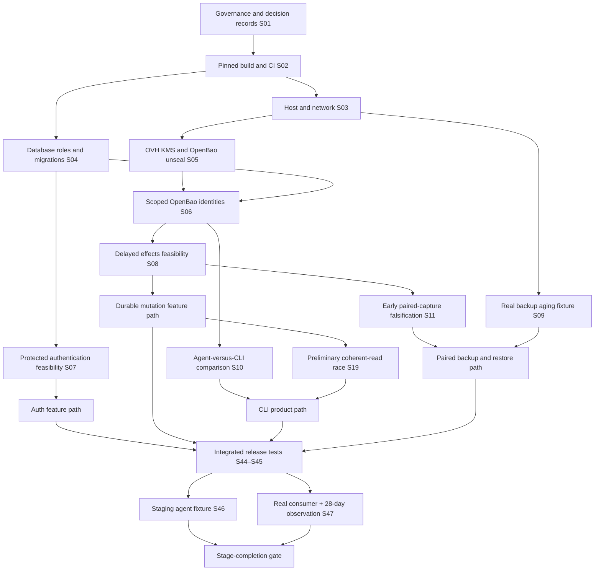

# 07 — MyKey Stage 1 Pre-Roadmap

| Field | Value |
| --- | --- |
| Project | MyKey (working title) |
| Product increment | Stage 1 — MyKey Private |
| Document | 07 — Engineering Workload Decomposition and Logical Sequencing |
| Version / date | **v0.3 pre-implementation audit · 7 November 2026** |
| Implementation start target | Week beginning **9 November 2026**; feasibility/governance first, no automatic authorization for dependent feature implementation |
| Scope authority | 01 Northstar v0.2 (unchanged); **02 Stage Breakdown v0.3; 03 Mission v0.3; 04 Functional Contract v0.3; 05 Technical Audit v0.3; 06 Technical Specification v0.3** |
| Coverage | **102/102** FRs, **60/60** ACs, **29/29** stable technical proofs (**24 inherited + 5 supplemental**) have named owners and release/field gates |
| Workload | **47 coherent sessions; 903 provisional active person-hours before contingency; +136 h (rounded-up 15%) uncertainty reserve = 1039 h planning envelope** |
| Status | **Revised planning baseline for governance review only**; no authorization to commit the uncut scope, to represent OPEN proofs as passing, or to exceed ~400 engineering hours without approval. P-01/P-02/P-03 and AC-1.42 interpretation remain explicit governance dependencies. |
| Next document | 08 — per-session engineering runbooks (exact commands, ordered TODOs, checkpoints and handoffs) |

> **Governing completion rule:** MyKey Private must be a complete, secure, recoverable, usable service at controlled-use release, independently maintainable if subsequent stages never occur. Neither a promising prototype nor a collection of partially built subsystems satisfies Stage 1. The later four-week field-use and bounded agent experiment validate the **already complete** product; they do not excuse missing release functionality.

## Final pre-implementation roadmap audit disposition — v0.3

This audit retains **47 coherent complete-product sessions** and the existing **102 functional requirement / 60 acceptance case / 24 inherited proof** contracts while incorporating all **five additional stable proofs** defined in Document 05 v0.3 (**KMS-L1, DB-G1, R2-L1, AGENT-B1, COST-B1**). It repairs the previously stale authority versions and first-real-consumer gate handoff, allocates the new proof effort to specific mini-projects, adds recoverable PostgreSQL cluster globals and irreversible KMS key-loss checks, and removes an unnecessary scheduling dependency between the independent post-release agent test and the start of field observation. The provisional effort rises from **848 to 903 active person-hours**, plus **136 hours** of unassigned uncertainty reserve, for a **1,039-hour candidate envelope**. This is **neither a measured estimate nor a budget authorization** against the nominal 400-hour target.

**Governing prerequisites remain OPEN:** (a) obtain and reconcile P-01/P-02/P-03 and sign the Documents 03–06 v0.3 baseline; (b) record an approved interpretation or targeted amendment for inherited **AC-1.42** (its literal first-consumer deployment wording remains while AC-1.52 is explicitly synthetic-only); and (c) authorize the realistic budget or amend the complete product scope before dependent engineering commitments. Document 04 v0.3 assigns real first-consumer onboarding to **post-release AC-1.58** and reserves **pre-release AC-1.52** for synthetic rehearsal. This pre-roadmap follows that assignment without pretending to amend inherited AC-1.42. All 24 inherited and five added technical proofs remain OPEN until executed.

**Verification scope:** static inspection against revised Documents 02–06, machine-checked session IDs, hours, prerequisite DAG, all 102 FR and 60 AC ownership rows, and all 29 stable technical proof records. These are **planning checks**, not executed provider, authentication, token, R2, or restore tests. Complete assignment does not establish implementation feasibility.

## 1. Purpose, planning authority and non-claims

Document 07 answers **what engineering work must happen, in which dependency order, with which evidence and estimated effort**. Document 08 will answer **exactly how to execute each approved session**: file paths, commands, ordered checklists, intermediate breadcrumbs, failure playbooks, test invocations, exit artifacts, and next-session handoff. Do not substitute this planning document for those executable runbooks.

The revised source documents (01 v0.2, 02–06 v0.3) contain a conditionally audited candidate architecture, **not running application code**. This pre-roadmap is a source-derived decomposition augmented with planning judgments (sessions, dependencies, hours, risk). The engineering-hour values are estimates, not measured productivity data or hard deadlines. They must be recalibrated after the first feasibility sessions. Primary vendor capabilities reviewed in Document 05 and implementation mechanisms in Document 06 remain **conditional** until proved against exact deployed pins.

The governing P-01/P-02/P-03 records were not among the supplied materials. **S01 must obtain and reconcile them before granting dependent implementation authority**. Do not assume the new documents can silently override those records; inconsistencies require signed synchronized amendments. Decisions DEC-01–DEC-15 from Document 06 v0.3 are carried forward as explicit gate decisions, not silently closed; DEC-11–DEC-15 govern the new proofs.

The plan is intentionally risk-first, native-first and complete-product-first. Existing components—OpenBao, PostgreSQL/Drizzle, Better Auth, Hono/Zod, Traefik OSS, Docker Compose, React and Scalar—must be exploited where they truly reduce system cost. Neither use of a native feature nor a design citation is evidence that it meets the product contract. Failed or insecure native implementations require a documented alternative and repeated proofs.

## 2. Scope ledger: release product vs. stage validation

| Lifecycle gate | What must exist | Evidence timing |
| --- | --- | --- |
| **R — Controlled-use release** | Complete owner auth/MFA/recovery; multi-synthetic-tenant authorization; project/environment and secret lifecycle; safe import/export; machine issuance/revocation; coherent read and four-platform CLI; polished owner workspace and truthful analytics; private operator diagnostics; audit/alerts/limits; KMS unseal; encrypted paired backups and clean-host restore; runbooks and deployment. | **56 release ACs**: AC-1.01–AC-1.52 and AC-1.55–AC-1.57 and AC-1.60. All release-applicable POs and negative evidence close against exact release pins. Synthetic-only evidence before onboarding any real secret. |
| **F — Post-release stage completion** | Service already released and usable; one controlled synthetic agent-to-trusted-runner exercise with denials; at least 28-day genuine daily-use observation after connecting a non-critical real consumer; staging restore and evidence-based transition decision. | **4 post-release ACs**: AC-1.53, AC-1.54, AC-1.58, AC-1.59. Do not mark these release FAIL or pre-release PASS; use `NOT YET DUE` until eligible. |

**AC-1.42 remains an inherited interpretation decision:** Document 04 v0.3 deliberately preserves its original phrase "in local development and first-consumer deployment" even though the same revised contract unequivocally assigns **synthetic-only pre-release onboarding to AC-1.52** and **real non-critical consumer onboarding after release to AC-1.58**. S31 and S45 must test the complete token setup, launch, rotation, revoke and post-restore replacement **on the intended deployment shape with synthetic-only values**, with S42 verifying post-restore conditions. S47 performs and records the first real onboarding before the 28-day observation clock starts. Obtain a **signed compatibility interpretation or a named AC-1.42 wording amendment** during S01; no unreviewed reinterpretation or silent relaxation. AC-1.36 and AC-1.44 remain release-due with actual lock-aging evidence unless formally amended.

Stage 1 **excludes** a publicly accessible self-service SaaS, additional real users/invitations, grant-management UI, workload federation, dynamic secret engines, arbitrary agent-code execution, delegable agent identities, SDK ecosystem, HA, generalized monitoring console and billing. The test-only agent fixture is not product functionality and must not be advertised as such. The platform is not zero-knowledge, cannot retract disclosed credentials or safely shield secrets from arbitrary hostile code running with their environment, and does not offer tenant-selective Raft restore.

## 3. Estimation and the ~400-hour collision

**The current, uncut scope does not defensibly fit ~400 hours.** The plan preserves the contracts rather than manufacturing a 40-session/400-hour schedule. The first estimate is a planning judgment after decomposing the whole contract; it will be revised from measured early sessions and technical proof outcomes.

| Workstream | Sessions | Active engineering estimate | Major drivers |
| --- | ---: | ---: | --- |
| A — Governance, infrastructure, early feasibility | 10 | **167 h** | External-provider proofs, protected auth integration, isolation, evidence setup |
| B — Foundational product behavior and durable state | 11 | **218 h** | MFA/authorization, crash-safe OpenBao mutations, lifecycle closure |
| C — Import, machine access, CLI and product API | 11 | **198 h** | Protected import, coherent resolution, issuer/revocation, four-platform CLI |
| D — Owner experience, security and operations | 11 | **234 h** | UI/DX, audit, off-host alerting, real-time backup aging, clean-host restore |
| E — Release and post-release validation | 4 | **86 h** | Independent security testing, release evidence, bounded agent and observed field use |
| **Total implementation + specified verification** | **47** | **903 h** | Includes session-local tests, integration work, operational docs and named reviews; does **not** include elapsed 28-day observation or R2 retention aging. |
| **Explicit uncertainty reserve (15%, rounded up; not task scope)** | — | **+136 h** | Conditional for failed integration spikes, extra recovery work, deployment/provider surprises or repeat independent tests. |
| **Risk-aware planning envelope** | — | **1,039 h** | **Not an approval** to overrun; prompts a governance scope/budget decision before implementing the dependent backlog. |

**Reason for the +55-hour revision:** work not explicitly costed in v0.2 is assigned to KMS key-loss and version-custody proof (S05/S42), PostgreSQL globals and privilege-restoration proof (S04/S11/S42), R2 per-object errors and actual lock-aging/cleanup (S09/S41), beta CLI maturity assessment (S10/S31), measured backup economics (S09/S41), cross-proof review/manifest closure (S43–S45), authority reconciliation (S01), version/pin review (S02), and first-real-consumer onboarding evidence (S47). These are **provisional incremental labor allowances**, not results of measured spikes. The reserve remains unallocated and is not counted as implementation.

The 903-hour base exceeds the nominal 400 hours by **503 hours** (**125.75%**). The 1,039-hour envelope exceeds that target by **639 hours**. These are not precise forecasts; early implementation must record actual versus planned hours and recompute each remaining session. A useful provisional uncertainty band is approximately **±20–30%** on unproven integration-intensive work, not an implied statistical confidence interval.

**Budget decision required:** choose either (a) an expressly approved Stage 1 engineering budget change, with its operational and calendar implications, or (b) a coherent product-scope amendment to Documents 03–06 followed by re-decomposition and new FR/AC/PO coverage. **Neither choice is silently made here.** There is currently no defensible, documented 400-hour implementation plan for all 102 FRs, 60 ACs, 24 inherited proofs and five supplemental proofs. Work can begin on signed, bounded feasibility probes after S01 governance, but dependent feature commitments and release dates cannot be authorized from an unreconciled estimate.

### 3.1 Estimation integrity and decision threshold

The session hours are **rough expected-effort judgments**, not bottom-up estimates supported by implementation velocity, integration benchmarks, or time studies. In particular, the 18–25-hour security/recovery mini-projects may be optimistic once cross-process fault testing and independently reviewed operator drills are performed. **903 hours is a planning reference, not a validated price or a ceiling.** The 400-hour per-stage target from Document 02 is a **whole-stage allocation inclusive of its internal contingency**, so neither the revised 903-hour baseline nor the 1,039-hour envelope can be approved by silently redefining the target.

For each session, Document 08 must allocate expected engineering, integration/verification, independent reviewer, and runbook/evidence effort **without double-counting**. S01 establishes who supplies independent reviews; if that effort is not already within a session estimate, it is added explicitly rather than claimed free. Produce a low/expected/high estimate and a practical failure-branch allowance for each critical path session at the first recorded replanning checkpoint. Reserve covers genuine uncertainty, **not** known work omitted from the catalog. Provider spend, infrastructure procurement, reviewer availability, and calendar-only waiting must be tracked separately. An early spike does not validate the estimates for all downstream work.

**Release-effort split:** sessions S01–S45 account for **866 active hours**; stage-only S46–S47 account for **37**. At a purely illustrative 40 productive engineering hours per week, 903 hours is at least **22.575 person-weeks** before reserve or provider/reviewer/calendar constraints; it is not a release-date prediction and does not permit the 28-day post-release observation to be counted before it begins. A critical-path arithmetic lower bound is separately reported in §5.3 and presupposes unrealistic perfect parallelism if only one engineer is assigned. Complete-product release cannot be achieved merely by meeting the workstream subtotal.

### 3.2 Where genuine optimization may exist

The audit’s native-first alternatives should be decided at their owning gates: Better Auth verified adapter versus supported replacement, OpenBao KMIP versus OVH plugin, scoped issuer within the API versus isolated private issuer, OpenBao Agent versus the thin CLI, PostgreSQL-native coordination versus additional services, and sealed Restic-per-pair retention economics. These may save time **only if** the associated end-to-end proof, operational cost and threat model improve. Do not apply arbitrary percentage “AI productivity” discounts before measured evidence.

### 3.3 Illustrative *not approved* scope valves

| Candidate product boundary change | Why it could save time | Cost and required approval |
| --- | --- | --- |
| Support one fully tested Linux distribution rather than all four promised CLI architectures | Shrinks packaging, platform signal/file and consumer test matrix | Changes FR-1.51, AC-1.20/21/37/42 and PO-8/20; requires approved Docs 03–06 and public platform claims updates; no pretending four-platform support. |
| Remove import/export as entire product slices while retaining safe UI/API creation/update and CLI `run` | Eliminates codec/preview/retry/export interfaces and verification | Material loss of developer value; alters FR-1.33–1.38, import/CLI tests and owner UX; requires explicit product decision and redesign of onboarding workflow, not a stub. |
| Reduce lifecycle features (e.g., archive/reactivation or historical restore) as whole supported capabilities | Removes complex revocation/provenance and UI matrices | May weaken useful complete product and require alternate safe deletion/revocation behavior; affected FR/AC/PO and security invariants must be re-audited; no hidden incomplete routes. |
| Restrict optional visual presentation while keeping truthful status/diagnostics/analytics | May simplify presentation implementation | Cannot remove the actual FR-1.89–1.97 minimum value, screen operability, accessibility or useful data; decorative-only reduction has limited savings. |

These examples are **hypotheses for governance**, not approved removals. Do **not** reduce MFA, tenant isolation, authorization freshness, leakage protection, durable unknown-outcome handling, verified revocation, transport security, audit, backup/restoration, staging, incident controls or independent release review to close the budget. Likewise, do not claim that selected feature cuts automatically reach 400 hours: re-estimate all integration and test paths.

## 4. Workload decomposition rules

1. **One coherent session, one observable increment.** A session may run 9 or 24 hours; no arbitrary ten-hour chopping. It may close a foundational proof or a usable feature vertical, but not a claim whose essential tests are deferred.
2. **One accountable requirement owner and acceptance owner.** Contributing sessions may be numerous; the traceability appendices have one accountable owner, an evidence destination and a final release replay. Cross-cutting invariants are verified again at S44/S45.
3. **A proof spike only authorizes dependency work.** Early G-* evidence is marked `SPIKE-PASS`, never `RELEASE-PASS` until integrated execution on exact release pins. The late integrated proof retains the same identifier and links back to original failures.
4. **No scope-hidden queues.** Unknown backend outcome is not safe to retry; `needs_review` is not success; failed alerts/backup restore cannot be waived through documentation. Sessions dependent on an unproven boundary remain BLOCKED.
5. **Native before new services.** PostgreSQL and OpenBao are the load-bearing state/coordination systems; pg-boss is transport not safety authority; Traefik/Compose supply enforceable network/host boundaries; Scalar is static read-only. New dependencies need a documented security and total-cost delta.
6. **Contract-first evidence.** Session runbooks in Document 08 must include negative tests against real PG/OpenBao where the contract requires them, capture exact code/pins, and contain no secret values in evidence. A versioned route entry (method, schema, actor, effect, errors and generated OpenAPI snapshot) must be approved **at the start of every API-owning vertical**, not deferred to S32. S02 defines the contract freeze workflow; S32 reconciles the already-shipped contracts and protected reference.
7. **Independent review and operational handoff are work.** Every sensitive implementation proof has a named non-author reviewer; unresolved checks cannot be reclassified as green because a session ran out of time.

## 5. Dependency graph and gates

### 5.1 Early critical decision sequence



This is a **summary graph**; the exact acyclic edges are the prerequisites printed per session below. Sessions whose dependencies are satisfied may overlap in calendar time when independent contributors exist. The order numbered S01–S47 is one valid topological execution order—not an injunction to serialize an independent retention fixture behind all frontend work. In particular S09 must begin actual-time R2 experiments after network and bucket access are established; it must not wait for unrelated native-KMIP qualification.

### 5.2 Gate ownership and closure criteria

| Gate | Early proving session(s) | Integrated closure and release owner | Stop / fallback rule |
| --- | --- | --- | --- |
| G-PINS | S02 (Node 26/24 LTS, maintained stable service pins) | S43, S45 | Unsupported pins/build/migration fail: pick compatible versions; repeat affected proofs and ensure route-contract freeze before feature coding. |
| G-AUTH | S07 | S14, S44 | If protected bearer and atomic MFA cannot be proven through maintained hooks/adapters, replace integration by approved decision; never store plaintext token or recoverable backup code. |
| G-BAO | S05, S06; KMS-L1 disposable key loss and version inventory in S05 | S26, S42; KMS-L1 integrated closure S42/S45 | Choose tested native KMIP or OVH seal plugin; permanent referenced-key loss is not recoverable with shares. |
| G-EFFECT | S08 | S21, S27, S28 | An unverifiable delayed effect stays uncertain/blocked; no lease-expiry takeover or silent redispatch. |
| G-RESOLVE | Preliminary concurrent-read adversarial spike in S19 | S24, S30, S44 | If a coherent set cannot be proved, stop launch/export development. |
| G-BACKUP | S09 (R2-L1 real-clock fixture, COST-B1 baseline); S04/S11 (DB-G1 globals and paired-capture spike) | S41 (R2-L1/COST-B1), S42 (DB-G1/KMS-L1) | No real secrets without provider-aged retention, verified per-object cleanup, priced capacity, independent KMS key-version custody and globals-complete restore. |
| G-CLIENT | S10 (AGENT-B1 beta decision) | S31, S32; S44/S45 proof review | Prefer first-party thin CLI; a beta Agent-supervisor substitution needs explicit approved exception plus full platform/security equivalence. |
| G-OPS-DX | Minimal off-host alert test at S03, security-event plumbing at S11 | S37, S39, S40 | API-only server, ornamental dashboards or operator status publicly exposed are release failures. |
| G-AGENT-FIELD | Not eligible before release | S46, S47 | Do not convert test-only harness into a product promise or mislabel field observations as pre-release evidence. |

**Entry-edge rule:** prerequisite sessions and named G-gate statuses are conjunctive. If a session depends on a completed predecessor but the predecessor's necessary `SPIKE_PASS` is still BLOCKED, the successor is not eligible. When a shared package, identity policy or infrastructure config changes, mark affected proof evidence **STALE** until re-executed; a green earlier checkpoint cannot be inherited across incompatible pins or a changed threat boundary. In the session runbooks, distinguish `SESSION_DONE`, `SPIKE_PASS`, and `RELEASE_PASS` rather than using one ambiguous checkbox.

### 5.3 Critical engineering and calendar paths

**Dependency-bound arithmetic (not a release-date forecast):** on the updated DAG, the longest serial prerequisite chain to **S45** is **507 estimated active hours**. The longest chain to the *post-release stage gate* (requiring both S46 and S47) is **529 hours** (S46: **522**, S47: **529**), assuming unlimited independent parallel engineering resources and no calendar wait. Release critical-chain session IDs: `S01, S02, S03, S05, S06, S08, S11, S12, S13, S15, S16, S17, S19, S20, S21, S23, S24, S29, S38, S40, S41, S42, S43, S44, S45`. S47 depends on S45 for *starting* first real use, while the final dossier requires completed S46 evidence too. These are **theoretical dependency lower bounds**, not single-engineer effort or elapsed schedule. A single engineer bears **903 total active person-hours** before uncertainty reserve, and provider-aging, external-review and field-observation clocks are additional constraints. Recompute the chain after any session-hour or edge change.

**Engineering constraints:** G-AUTH unlocks protected user access; G-BAO + G-EFFECT unlock correct external mutations; those lead to lifecycle, coherent machine reads, issuer/revocation and CLI. Full backup and restore wait for safe operational state but their **retention-aging experiment does not**. Any of these can invalidate downstream estimates or require alternate components. Vendor/provider outages and reviewer availability can extend elapsed time independently of coding hours.

**Calendar constraints:** G-BACKUP includes provider-observed retention behavior on actual clocks; starting a 30-day retention policy and altering timestamp metadata does not prove 30-day expiry. Stage-completion observation requires four weeks of actual use **after** a signed controlled-use release. These constraints must appear as calendar milestones rather than being falsely converted into consecutive engineering hours. The final release commit must rerun affected tests after any pin/configuration change, even if an early spike passed.

## 6. Session catalog — coherent mini-projects

Each session below describes scope and exit **at the architecture/decomposition level**. The detailed runnable steps, file changes, commands, checkpoints, evidence links, independent review assignment and handoff commands belong exclusively in Document 08. Estimate includes normal coding, direct tests, targeted integration/fault evidence, and session-local notes. `Prerequisites` are **hard gates**, not suggested reading. Dependent features must not begin on an OPEN/FAILED prerequisite proof.

### Workstream A — Governance, infrastructure, early feasibility (167 h)

#### S01 — Authority reconciliation and executable evidence system  · 13 engineering hours · High risk

**Entry prerequisite:** Access to the *available draft* Docs 01–06, the identified P-01/P-02/P-03 custodians or an authorized escalation path, and a synthetic-only workspace. Their reconciliation is S01’s deliverable, **not** an assumed prior approval.

**Outcome:** Establish the single governing baseline and a usable proof/evidence lifecycle before feature work.

**Workload boundary:** Obtain P-01/P-02/P-03; reconcile with Docs 01 v0.2 and 02–06 v0.3; settle the literal inherited AC-1.42 versus revised synthetic AC-1.52 / real AC-1.58 interpretation through signed authority; record decisions DEC-01–DEC-15; establish independent reviewer roles, owner of all 29 proofs, evidence schema and approval-limited budget/scope. Create CI-readable 102-FR/60-AC/29-proof inventory, with a hard stop if governing records or economic authorization are missing. A bounded, separately approved proof-only work authorization is not an authorization to implement the uncut feature scope.

**Verifiable exit:** Signed reconciled baseline (including AC-1.42 disposition), named distinct evidence author/reviewer and either an approved stage budget near the updated estimate or an approved scope amendment plus revised WBS. If governance, reviewer capacity or budget authority is missing, dependent feature work is BLOCKED; an approved *proof-only* scope is logged separately. Mere "unresolved" is not PASS.

**Trace:** Cross-cutting; see coverage matrix; Integrated / cross-cutting; None directly; integration tests apply. Release-applicable proofs remain subject to integrated final-commit replay at S44/S45.

#### S02 — Reproducible toolchain, pinning and build pipeline  · 15 engineering hours · High risk

**Entry prerequisite:** S01.

**Outcome:** Create the pinned, reproducible build/test/provenance foundation for subsequent executable spikes.

**Workload boundary:** Monorepo, strict TS, pinned supported Node release (evaluate Node 26 Active LTS against Node 24 Maintenance LTS), stable PostgreSQL/OpenBao/Traefik/Better Auth candidates, pnpm/Vite+ integration, build/CI, reviewed Better Auth–Drizzle schema generation, package/image/action hashes, advisory/license evidence and incompatible-version rejection; create synthetic fixtures. Establish a *concrete route-contract inventory and schema-first freeze procedure* for every subsequent API vertical before handlers or clients are implemented; S32 assembles and validates the final reference, it must not invent routes after the fact.

**Verifiable exit:** G-PINS early spike PASS with fresh build, migrations dry-run, captured hashes; no claim that full release is pinned forever.

**Trace:** FR-1.73; AC-1.32; PO-24. Release-applicable proofs remain subject to integrated final-commit replay at S44/S45.

#### S03 — Hardened two-host network and service skeleton  · 18 engineering hours · High risk

**Entry prerequisite:** S02.

**Outcome:** Establish staging and production-shaped host deployment and independently test the trust boundary.

**Workload boundary:** Separate OVH hosts, Compose topology, nonroot/read-only/resource envelopes, restricted egress, Traefik HTTPS/internal TLS, DNS/ACME, WireGuard-only SSH, private-service firewall and core-dump controls; prove host and role denial; install a minimal independent off-host probe/alert endpoint that remains useful if the staging host is completely unavailable (full alert catalog is S40).

**Verifiable exit:** Repeatable staging bring-up; direct external network probes confirm only allowed listeners; proxy trust, TLS and isolation evidence captured; one simulated host-down signal demonstrably reaches an off-host channel.

**Trace:** FR-1.70, FR-1.71, FR-1.72; AC-1.30, AC-1.31; PO-11. Release-applicable proofs remain subject to integrated final-commit replay at S44/S45.

#### S04 — PostgreSQL roles, schemas and migration discipline  · 19 engineering hours · High risk

**Entry prerequisite:** S02, S03.

**Outcome:** Build a database boundary that can safely host application, auth, durable operation and audit schemas.

**Workload boundary:** Reviewed Drizzle/custom-SQL migration stream, composite tenant FKs, role grants, advisory/transaction locking conventions, pg-boss schema ownership, migration checksum and rollback/restore plan. Inventory PostgreSQL **cluster-global roles, grants, tablespaces, extensions, TLS/pg_hba and owner/privilege dependencies** that a database-local dump cannot reconstruct; produce a synthetic globals export/rebuild and negative-privilege test plan, to be exercised in S11 and fully integrated in S42 (**DB-G1**).

**Verifiable exit:** Clean database migration, role-negative matrix, deliberate crash/retry and concurrent-migrator tests; no production schema push. A documented, independently held globals-and-configuration reconstruction inventory exists; this is **not yet DB-G1 release PASS**.

**Trace:** Cross-cutting; see coverage matrix; Integrated / cross-cutting; None directly; integration tests apply. Release-applicable proofs remain subject to integrated final-commit replay at S44/S45.

#### S05 — OVH–OpenBao real auto-unseal feasibility  · 21 engineering hours · Critical risk

**Entry prerequisite:** S03.

**Outcome:** Settle native KMIP versus external OVH seal using the actual provider and lost-host constraints.

**Workload boundary:** Real OVH KMS provisioning, sealed restart/host reboot, unreachable KMS, certificate failure/reissue and comparison with plugin fallback; preserve key/certificate custody evidence. For **KMS-L1**, inventory every seal key/version referenced by recoverable material, demonstrate authorized off-host custody and cert replacement, and on a **disposable isolated KMS key only**, prove that permanent loss of required wrapping-key access blocks unseal and is **not repairable with OpenBao recovery shares**. Never delete or destroy a production/shared key to produce test evidence.

**Verifiable exit:** G-BAO seal subgate: signed primary/fallback decision, observed restart/failure/reissue and disposable missing-key denial, key-version custody map. KMS-L1 full clean-host closure remains due in S42 and S45. If interop or custody cannot be shown, dependent backend/recovery work stays BLOCKED.

**Trace:** FR-1.64, FR-1.65; AC-1.26; PO-1. Release-applicable proofs remain subject to integrated final-commit replay at S44/S45.

#### S06 — OpenBao tenancy, identities and native policy feasibility  · 17 engineering hours · Critical risk

**Entry prerequisite:** S04, S05.

**Outcome:** Prove scoped provisioning, runtime and issuer identities in two hostile synthetic tenants.

**Workload boundary:** Namespace/mount model, policy and token-role effective behavior, AppRole alternatives, native audit, accessor visibility, self-lookup, direct namespace escape attempts and default-policy removal.

**Verifiable exit:** G-BAO identity subgate PASS with direct OpenBao denials and credential-lifecycle boundaries; written authority matrix.

**Trace:** FR-1.13; AC-1.07; PO-3, PO-4. Release-applicable proofs remain subject to integrated final-commit replay at S44/S45.

#### S07 — Better Auth protected-storage and factor feasibility  · 20 engineering hours · Critical risk

**Entry prerequisite:** S02, S04.

**Outcome:** Choose a technically maintainable authentication integration that meets the non-negotiable contract.

**Workload boundary:** Enumerate real handlers/adapter paths; protected session token, verifier-only backup codes, seed encryption, atomic TOTP step, MFA completion/freshness, password reset, refresh/list/revoke and 2-process races; dump inspection.

**Verifiable exit:** G-AUTH early spike passes *all* critical negative tests on actual pinned integration or produces an approved component replacement before account feature work.

**Trace:** Cross-cutting; see coverage matrix; Integrated / cross-cutting; PO-5, PO-6, PO-15. Release-applicable proofs remain subject to integrated final-commit replay at S44/S45.

#### S08 — Delayed backend effect and exclusion feasibility  · 18 engineering hours · Critical risk

**Entry prerequisite:** S04, S06.

**Outcome:** Prove that a request accepted by OpenBao cannot be incorrectly treated as never applied.

**Workload boundary:** Minimal persisted intent/dispatch slot, injected process deaths/timeouts/delayed HTTP delivery, operator stop/drain and evidence-based re-admission on write/issuance; distinguish transport cancellation from backend fencing.

**Verifiable exit:** G-EFFECT spike records a provable exclusion/reconciliation boundary or freezes dependent effect-producing work.

**Trace:** Cross-cutting; see coverage matrix; Integrated / cross-cutting; PO-16. Release-applicable proofs remain subject to integrated final-commit replay at S44/S45.

#### S09 — Actual-time backup retention experiment launch  · 14 engineering hours · Critical risk

**Entry prerequisite:** S03, R2 test bucket and independent encryption/key-custody access established; native KMS integration S05 is **not** a prerequisite for the storage-only fixture.

**Outcome:** Start real retention aging early instead of attempting to compress a provider-clock test later.

**Workload boundary:** Start a small synthetic, isolated Restic-per-pair R2 fixture; object locks, immutable manifests, eligibility, partial/multipart failures, **DeleteObjects HTTP 200 with per-key errors**, lock-rule edit authority, expiry and **actual calendar-clock aging**. Capture baseline bytes and API requests for **COST-B1**, with the earliest eligible retention timeline. Preserve object IDs and provider evidence for **R2-L1/PO-9**; never shorten the required oldest-pair aging proof through timestamp manipulation.

**Verifiable exit:** Provider fixture genuinely aging, exact lock configuration/object IDs/prices/scheduled checkpoints preserved, per-object failure probes captured. This is an **aging START** for PO-9/R2-L1 and a cost baseline, not a 30-day/release PASS.

**Trace:** Cross-cutting; see coverage matrix; Integrated / cross-cutting; PO-9. Release-applicable proofs remain subject to integrated final-commit replay at S44/S45.

#### S10 — OpenBao Agent versus MyKey CLI decision spike  · 12 engineering hours · Medium risk

**Entry prerequisite:** S02, S06.

**Outcome:** Compare native process supervision with the required constrained product CLI.

**Workload boundary:** Time-box the comparison of OpenBao Agent's **public-beta** process-supervisor mode against the thin MyKey CLI under fixed product API authorization, full-set resolution, token containment, TLS, child signals, denied historical reads, package support and upgrade/rollback risks. Own **AGENT-B1**; a beta supervisor may replace a release-critical CLI only after **explicit documented production exception and full contract equivalence**, not merely a successful launch fixture.

**Verifiable exit:** G-CLIENT/AGENT-B1 documented release-maturity decision with thin CLI preferred absent exceptional proof; full four-platform evidence remains S31, not an assumed consequence of this spike.

**Trace:** Cross-cutting; see coverage matrix; Integrated / cross-cutting; None directly; integration tests apply. Release-applicable proofs remain subject to integrated final-commit replay at S44/S45.


### Workstream B — Foundational product behavior and durable state (218 h)

#### S11 — Application persistence and early paired-capture feasibility  · 26 engineering hours · High risk

**Entry prerequisite:** S04, S06, S08.

**Outcome:** Create a durable metadata/audit substrate and falsify dangerous early assumptions about PostgreSQL–OpenBao paired capture before large feature implementation.

**Workload boundary:** Implement tenant-aware metadata repos, DB transaction helpers, safe audit event schema/append path, outbox envelope, sanitized errors, request IDs, and job skeleton; ensure the first later mutation has an audit gate. Add a small synthetic PostgreSQL-plus-OpenBao paired-capture/restore spike: identify the admission-freeze boundary, kill a dispatch during capture, reject an ineligible pair, then rehearse the **PostgreSQL globals/roles/config reconstruction plan from S04** on a disposable cluster and check forbidden permissions. This is **not** complete S41 backup implementation, 30-day aging or integrated DB-G1 clean-host closure.

**Verifiable exit:** Real PostgreSQL tests show cross-tenant denial, restricted audit mutations and no secret-bearing record; base system boots. Capture spike distinguishes a safe pair from an interrupted/unknown one, and the globals reconstruction fixture demonstrates roles/least privilege or blocks dependent recovery. PO-21 and DB-G1 still require final integrated closure; infeasible pair or globals reconstruction blocks S41/S42.

**Trace:** Cross-cutting; see coverage matrix; Integrated / cross-cutting; None directly; integration tests apply. Release-applicable proofs remain subject to integrated final-commit replay at S44/S45.

#### S12 — Owner bootstrap, password phase and abuse protection  · 17 engineering hours · High risk

**Entry prerequisite:** S07, S11.

**Outcome:** Provide the operator-created account and strictly bounded password authentication stage.

**Workload boundary:** Bootstrap idempotency, account states, allowlisted auth routes, server-enforced signup prohibition, phase-specific errors, two-process password/factor throttling.

**Verifiable exit:** Direct API enumeration and negative tests rule out public account creation and account-existence leaks.

**Trace:** FR-1.01, FR-1.07; AC-1.01, AC-1.05; PO-5. Release-applicable proofs remain subject to integrated final-commit replay at S44/S45.

#### S13 — TOTP completion, enrollment and recovery codes  · 19 engineering hours · Critical risk

**Entry prerequisite:** S12.

**Outcome:** Deliver fully MFA-completed authentication with correct replay semantics and protected storage.

**Workload boundary:** Enrollment, session rotation after factor elevation, six-digit TOTP window, one-step replay locks, one-way backup codes and atomic consumption/regeneration, protected seed and persistence checks.

**Verifiable exit:** Multi-process same-code races allow at most one accepted use; no password-only product session or forbidden stored bearer.

**Trace:** FR-1.02, FR-1.03; AC-1.02; PO-6, PO-15. Release-applicable proofs remain subject to integrated final-commit replay at S44/S45.

#### S14 — Sessions, fresh TOTP, account reset and recovery  · 18 engineering hours · Critical risk

**Entry prerequisite:** S13.

**Outcome:** Complete account lifecycle with operational recovery and exact session validity rules.

**Workload boundary:** Idle/absolute expiry, user-activity convention, signout/session revocation, password change, fresh-factor permission, operator-private reset and recovery-pending state even after link expiry.

**Verifiable exit:** Timed tests/clock controls and direct paths prove recovery without MFA bypass, old session reuse or forgotten old reset links.

**Trace:** FR-1.04, FR-1.05, FR-1.06, FR-1.77; AC-1.03, AC-1.04, AC-1.35; PO-6. Release-applicable proofs remain subject to integrated final-commit replay at S44/S45.

#### S15 — Authorization, concealment and current-state gate  · 17 engineering hours · High risk

**Entry prerequisite:** S11, S13.

**Outcome:** Make product authorization server-owned, current and tenant-safe across human and machine requests.

**Workload boundary:** Membership/grant union rules, resource ancestry, 404 concealment, service gate, revocation admission recheck, state hierarchy and denial tests with two tenants.

**Verifiable exit:** Full authorization matrix and in-flight semantics pass, including deliberately forged selectors and stale grants.

**Trace:** FR-1.09, FR-1.10, FR-1.11; AC-1.08; None directly; integration tests apply. Release-applicable proofs remain subject to integrated final-commit replay at S44/S45.

#### S16 — Operator-only organization provisioning and drift review  · 18 engineering hours · Critical risk

**Entry prerequisite:** S06, S11, S15.

**Outcome:** Provision each organization exactly once and refuse to serve inconsistent backend configuration.

**Workload boundary:** Private operator command, durable namespace/KV/role/policy readback, failed/pending/review states, alert emission, forbidden public operator routes, resumable partial provisioning.

**Verifiable exit:** Interrupted provisioning and missing-backend drift tests never create duplicate/broad authority or prematurely active organization.

**Trace:** FR-1.08, FR-1.12, FR-1.55; AC-1.06, AC-1.09; PO-4. Release-applicable proofs remain subject to integrated final-commit replay at S44/S45.

#### S17 — Project/environment lifecycle and readiness  · 17 engineering hours · High risk

**Entry prerequisite:** S15, S16.

**Outcome:** Deliver complete management of immutable resources and backend readiness prerequisites.

**Workload boundary:** Create/rename (NFC/regex), default development environment, grant inheritance and FK integrity, pending/readiness/needs-review state and explicit non-deletion contract.

**Verifiable exit:** End-to-end project/environment create/rename tests preserve identifiers, authorization and backend bindings.

**Trace:** FR-1.14, FR-1.15, FR-1.16, FR-1.19; AC-1.10; None directly; integration tests apply. Release-applicable proofs remain subject to integrated final-commit replay at S44/S45.

#### S18 — Durable operations and replay semantics  · 21 engineering hours · Critical risk

**Entry prerequisite:** S08, S11, S15.

**Outcome:** Implement the durable operation state machine for every possible OpenBao effect.

**Workload boundary:** Intent before dispatch, actor/precondition binding, idempotency fingerprints, effect slots, step rows, queue outbox, stale executor protection and replay/expiry/status boundaries.

**Verifiable exit:** Cross-process tests show single admitted executor, protected replay status and no auto-redispatch from an unknown outcome.

**Trace:** FR-1.82, FR-1.83; AC-1.39; PO-17. Release-applicable proofs remain subject to integrated final-commit replay at S44/S45.

#### S19 — Secret creation, update, indexing and version history  · 25 engineering hours · Critical risk

**Entry prerequisite:** S17, S18.

**Outcome:** Ship the primary secret lifecycle with native KV CAS and correct metadata synchronization.

**Workload boundary:** Name/value constraints, create-never-overwrites-deleted-history, update expected-version+tag, index/list/name search, 20-version history, server-side explicit reveal authorization/no-store response contract and safe historical attribution. Before integrating import/machine/CLI workflows, execute a small G-RESOLVE preliminary read-versus-write race (including version deletion, audit failure and incomplete pagination) against real KV and PostgreSQL; its success is a design feasibility decision, **not** final PO-19 closure.

**Verifiable exit:** Real KV v2/PG tests pass stale-write, version-retention, prefix/UTF-8 and cross-tenant negative cases; preliminary G-RESOLVE either yields a defensible coordination protocol or explicitly BLOCKS S24 and dependent consumers.

**Trace:** FR-1.20, FR-1.21, FR-1.24, FR-1.25, FR-1.26; AC-1.12, AC-1.14; PO-7. Release-applicable proofs remain subject to integrated final-commit replay at S44/S45.

#### S20 — Secret deletion, undelete and version restoration  · 17 engineering hours · High risk

**Entry prerequisite:** S19.

**Outcome:** Complete the entire user-promised non-destructive secret lifecycle.

**Workload boundary:** Soft-delete live latest only, verify undelete semantics, restore eligible historical value as new version, ABA-resistant tags and no permanent destruction route.

**Verifiable exit:** Cross-process state-tag ABA and restored historical versions tested against real OpenBao.

**Trace:** FR-1.27, FR-1.28, FR-1.29, FR-1.32; AC-1.15; PO-7. Release-applicable proofs remain subject to integrated final-commit replay at S44/S45.

#### S21 — Reconciliation, execution exclusion and fault suite  · 23 engineering hours · Critical risk

**Entry prerequisite:** S18, S19, S20.

**Outcome:** Turn uncertain backend outcomes into safe, attributable reconciliation without optimistic retries.

**Workload boundary:** Operator-private status/evidence tools, kill/delay at each boundary, forensic KV/audit correlation, pending versus terminal classification, inaccessible/conflicting scopes, drain/stop controls.

**Verifiable exit:** G-EFFECT integrated smoke passes fault injections for KV; issuance/archive variants are extended in the later credential-revocation and archive sessions and retested at release.

**Trace:** FR-1.30, FR-1.31, FR-1.88; AC-1.16, AC-1.38, AC-1.39; PO-16, PO-17. Release-applicable proofs remain subject to integrated final-commit replay at S44/S45.


### Workstream C — Import, machine access, CLI and product API (198 h)

#### S22 — Strict dotenv codec and loader evidence  · 13 engineering hours · Medium risk

**Entry prerequisite:** S02.

**Outcome:** Deliver one precise, reversible dotenv dialect rather than claiming universal compatibility.

**Workload boundary:** Bounded parser/serializer and property tests for multiline, Unicode, bytes, empty values, literal dollars, comments and pinned loader compatibility fixtures.

**Verifiable exit:** Round trip equals input values and incompatible loader cases produce safe key-only warnings.

**Trace:** FR-1.33, FR-1.34, FR-1.38; AC-1.17; None directly; integration tests apply. Release-applicable proofs remain subject to integrated final-commit replay at S44/S45.

#### S23 — Import preview, apply and interrupted continuation  · 19 engineering hours · Critical risk

**Entry prerequisite:** S19, S20, S21, S22.

**Outcome:** Provide complete secure import with per-key outcomes, safe replay and exact-file continuation.

**Workload boundary:** Actor/file HMAC preview, per-key metadata classification, value-free persistent records, deterministic step sequencing, interrupted input resubmission and partial terminal handling.

**Verifiable exit:** Synthetic conflict/kill/retry tests prove no duplicate successful mutation and no persisted import plaintext.

**Trace:** FR-1.35, FR-1.36; AC-1.17, AC-1.39; PO-17. Release-applicable proofs remain subject to integrated final-commit replay at S44/S45.

#### S24 — Coherent whole-environment snapshot/resolution  · 20 engineering hours · Critical risk

**Entry prerequisite:** S19, S21, S23.

**Outcome:** Make machine launch/export consume one internally coherent environment view or fail explicitly.

**Workload boundary:** Coordinated read protocol and stability checks, bounded sorted pagination, audit-before-release, blocked reviewed keys, resource limits, empty environment and transport-truncation handling.

**Verifiable exit:** G-RESOLVE proof: racing writers/imports lead to coherent set or failure; partial data never returned as a successful set.

**Trace:** FR-1.84; AC-1.41; PO-19. Release-applicable proofs remain subject to integrated final-commit replay at S44/S45.

#### S25 — Human export and sensitive response path  · 12 engineering hours · High risk

**Entry prerequisite:** S14, S22, S24.

**Outcome:** Implement explicit, freshly authenticated plaintext export without server-side persistence.

**Workload boundary:** Versioned API export streaming safeguards, sanitized content disposition, no-store, in-memory value lifetime, changed-set abort and format-roundtrip tests.

**Verifiable exit:** Response and storage canary sweep detects no secret in prohibited layers; exact export/import roundtrip passes.

**Trace:** FR-1.37; AC-1.17; None directly; integration tests apply. Release-applicable proofs remain subject to integrated final-commit replay at S44/S45.

#### S26 — Read-only machine issuance and token inventory  · 21 engineering hours · Critical risk

**Entry prerequisite:** S06, S14, S17, S18.

**Outcome:** Issue one-environment, expiry-bounded machine credentials with real native least privilege.

**Workload boundary:** Fixed orphan token role/no-default/read-only/nonrenewable, effective TTL, one-time delivery, accessor-only tracking, inventory/fresh TOTP and issuer/root authority isolation.

**Verifiable exit:** PO-2: short-lived issuer revocation leaves intended orphan token valid until expiry/accessor revocation; native escape/renewal/write denied.

**Trace:** FR-1.39, FR-1.40, FR-1.41; AC-1.18, AC-1.19; PO-2. Release-applicable proofs remain subject to integrated final-commit replay at S44/S45.

#### S27 — Revocation and uncertain issuance lifecycle  · 22 engineering hours · Critical risk

**Entry prerequisite:** S21, S26.

**Outcome:** Handle lost token delivery and revoke/archive races without secret reissue or escaped tokens.

**Workload boundary:** Persistent denied state, accessor revocation and verification, issuance readback/inventory, delayed creation exclusion, no token replay, concurrent issuance denial and reconciliation.

**Verifiable exit:** PO-18/AC-1.40 kill/delay/race suite closes lost-delivery and absence-of-escaped-tokens paths.

**Trace:** FR-1.42, FR-1.43; AC-1.18, AC-1.40; PO-18. Release-applicable proofs remain subject to integrated final-commit replay at S44/S45.

#### S28 — Project/environment archive and reactivation  · 17 engineering hours · Critical risk

**Entry prerequisite:** S17, S21, S27.

**Outcome:** Make archive a complete access-reducing operation, including credentials and concurrent issuance.

**Workload boundary:** Revoking admission gate, finish/reconcile admitted mutations, token inventory/verified revocation, interrupted resume, child-project archive provenance and non-restored tokens.

**Verifiable exit:** Concurrent creation/issue/archive and restart tests cannot escape revocation or re-enable old tokens.

**Trace:** FR-1.17, FR-1.18; AC-1.11; PO-18. Release-applicable proofs remain subject to integrated final-commit replay at S44/S45.

#### S29 — Machine API, direct OpenBao checks and scope  · 16 engineering hours · Critical risk

**Entry prerequisite:** S15, S24, S26, S27.

**Outcome:** Enable authenticated, read-only machine consumption with independent backend token authority.

**Workload boundary:** Bearer-only routing, prohibit mixed auth, effective accessor verification, parent-state current read, secret-history restriction, read/list direct privilege matrix and truthful historical residual disclosure.

**Verifiable exit:** Machine reads limited to bound current API representation; direct native write/history/other-tenant tests and expired/revoked denies pass.

**Trace:** FR-1.44, FR-1.45; AC-1.19; PO-2. Release-applicable proofs remain subject to integrated final-commit replay at S44/S45.

#### S30 — Shipping CLI: secure keys/run/export and error model  · 23 engineering hours · Critical risk

**Entry prerequisite:** S10, S24, S29.

**Outcome:** Deliver a complete usable CLI rather than a demonstration shell wrapper.

**Workload boundary:** Config/token FD/env contract, no secret cache, verified TLS, response schema integrity, no child on failure, spawn without shell, signals, env scrubbing, 0600 exclusive export, safe cleanup and stable codes.

**Verifiable exit:** Real supported fixtures show successful process environment injection and every specified negative launch/export behavior.

**Trace:** FR-1.46, FR-1.47, FR-1.48, FR-1.49, FR-1.50, FR-1.79; AC-1.20, AC-1.21; None directly; integration tests apply. Release-applicable proofs remain subject to integrated final-commit replay at S44/S45.

#### S31 — Four-platform delivery and protected consumer setup  · 21 engineering hours · High risk

**Entry prerequisite:** S30.

**Outcome:** Make the CLI installable, predictable and operable across all committed platforms.

**Workload boundary:** Linux glibc x64/arm64 and macOS x64/arm64 installation, checksums, distribution fallback, TLS/error/signal matrix, protected token rotation and **synthetic first-consumer deployment rehearsal**. Re-verify **AGENT-B1** maturity decision and reject beta-dependent substitutions without signed exception, full four-platform negative tests and rollback path. The canonical `secrets` CLI name remains contractually governed until an explicitly approved command-name change.

**Verifiable exit:** G-CLIENT four-platform installation passes with reproducible evidence, AGENT-B1 has an accepted outcome and AC-1.42 synthetic setup/restore coverage has an S01-approved interpretation; actual real consumer connects only after release gate and is proved in S47.

**Trace:** FR-1.51, FR-1.85; AC-1.37, AC-1.42; PO-8, PO-20. Release-applicable proofs remain subject to integrated final-commit replay at S44/S45.

#### S32 — Shared API/OpenAPI and local protected Scalar  · 14 engineering hours · Medium risk

**Entry prerequisite:** S14, S19, S29.

**Outcome:** Publish one accurate, versioned, locally served developer contract.

**Workload boundary:** Consolidate the shared Zod request/response contracts and native-auth route inventory established incrementally from S02/S12 onward; validate the exact error envelope, generate OpenAPI 3.1, test compatibility/drift, and serve same-origin owner-only read-only Scalar with request execution/egress disabled. S32 **must not invent the API contract after clients and routes are implemented**.

**Verifiable exit:** Schema drift and forbidden native/operator routes fail tests; Scalar works under restrictive CSP.

**Trace:** FR-1.52, FR-1.53, FR-1.54; AC-1.22; PO-10. Release-applicable proofs remain subject to integrated final-commit replay at S44/S45.


### Workstream D — Owner experience, security and operations (234 h)

#### S33 — Owner frontend shell, MFA and resource navigation  · 20 engineering hours · High risk

**Entry prerequisite:** S14, S15, S17, S32.

**Outcome:** Establish the real owner workspace with complete entry/onboarding and navigation states.

**Workload boundary:** React shell, session state, MFA/challenge/recovery, visible organizations/projects/environments, loading/error/focus primitives and secure same-origin API integration.

**Verifiable exit:** Installed browser can complete authentication and resource navigation without bypass or frontend-only auth assumptions.

**Trace:** FR-1.89; AC-1.45; None directly; integration tests apply. Release-applicable proofs remain subject to integrated final-commit replay at S44/S45.

#### S34 — Secret inventory, reveal, lifecycle and history UI  · 22 engineering hours · High risk

**Entry prerequisite:** S20, S21, S33; the server-side reveal endpoint and value handling from S19 must already be tested.

**Outcome:** Implement the full owner secret management experience, including dangerous actions.

**Workload boundary:** Search/list, contextual masking/30-second reveal lifetime, copy warning, create/edit/delete/undelete/history/restore, stale-write conflicts, reviewed/unknown status and accessible confirmations.

**Verifiable exit:** Owner browser journey exercises every secret lifecycle action; sensitive-value persistence canaries remain negative.

**Trace:** FR-1.22, FR-1.23; AC-1.45; None directly; integration tests apply. Release-applicable proofs remain subject to integrated final-commit replay at S44/S45.

#### S35 — Import/export and safe first-run UI  · 16 engineering hours · Medium risk

**Entry prerequisite:** S23, S25, S33.

**Outcome:** Make multi-secret onboarding and explicit export usable without obscuring partial operations.

**Workload boundary:** File preview, classifications and conflicts, exact-file retry, progress/partial statuses, export MFA confirmation, error recovery and safe inline help.

**Verifiable exit:** Browser acceptance covers full and interrupted imports and exact roundtrip export with truthful feedback.

**Trace:** Cross-cutting; see coverage matrix; AC-1.45; None directly; integration tests apply. Release-applicable proofs remain subject to integrated final-commit replay at S44/S45.

#### S36 — Credential inventory, issuance and revocation UI  · 18 engineering hours · High risk

**Entry prerequisite:** S27, S33.

**Outcome:** Give the owner a secure, intuitive understanding of machine access and expiry.

**Workload boundary:** Issue-once reveal, protected setup walkthrough, read-only scope and effective expiry, last-use-known vs unknown, expiry grouping, revoke/uncertain/review states and accessibility.

**Verifiable exit:** All backend credential lifecycle fixtures render accurately; no re-reveal route or token persistence exists.

**Trace:** FR-1.91; AC-1.47; None directly; integration tests apply. Release-applicable proofs remain subject to integrated final-commit replay at S44/S45.

#### S37 — Accessibility, browser security and actionable errors  · 16 engineering hours · High risk

**Entry prerequisite:** S33, S34, S35, S36, S32.

**Outcome:** Finish the owner interface as an accessible, safe, comprehensible complete product.

**Workload boundary:** Keyboard-only and narrow-screen workflow testing, CSP, CSRF/origin coverage including native auth, third-party egress deny, all error categories and correlation, secure state disposal.

**Verifiable exit:** Usability and browser-security matrix passes; no critical flow trapped by focus/errors or allowed cross-site mutation.

**Trace:** FR-1.76, FR-1.93, FR-1.96; AC-1.29, AC-1.34, AC-1.51; PO-12. Release-applicable proofs remain subject to integrated final-commit replay at S44/S45.

#### S38 — Full audit coverage, tenancy and retention  · 17 engineering hours · Critical risk

**Entry prerequisite:** S11, S21, S29.

**Outcome:** Independently reconcile and close complete attributable auditing already required during each preceding feature session; add owner visibility without logging sensitive payloads.

**Workload boundary:** OpenBao audit sink failure handling, append-only DB privileges, event/operation correlation, organization-scoped paginated owner view, independent 365-day retention and operator purge.

**Verifiable exit:** Audit matrix captures all sensitive operations/denials and zero secret bytes; writes fail closed where required.

**Trace:** FR-1.56, FR-1.57, FR-1.58, FR-1.59, FR-1.80, FR-1.81; AC-1.23; None directly; integration tests apply. Release-applicable proofs remain subject to integrated final-commit replay at S44/S45.

#### S39 — Operations timeline, resource overview and safe analytics  · 20 engineering hours · Medium risk

**Entry prerequisite:** S34, S36, S38.

**Outcome:** Provide informative, truthful product-local intelligence rather than decorative dashboard charts.

**Workload boundary:** Tenant-scoped bounded activity/outcome summaries, chronological timeline, resource lifecycle counts, freshness/source/unknown labels, zero/denied/partial cases and safe aggregation.

**Verifiable exit:** Real server fixture evidence drives charts and summaries; forbidden-tenant and stale data are correctly concealed/labeled.

**Trace:** FR-1.90, FR-1.92, FR-1.94; AC-1.46, AC-1.48, AC-1.55; None directly; integration tests apply. Release-applicable proofs remain subject to integrated final-commit replay at S44/S45.

#### S40 — Limits, readiness, private diagnostics and off-host alerts  · 19 engineering hours · Critical risk

**Entry prerequisite:** S03, S16, S38.

**Outcome:** Make the service observable and fail-closed under overload/incident conditions.

**Workload boundary:** Rate/body/read/connection caps, disk reserve and 507 behavior, public minimal health, VPN-bound private status including KMS vs seal, heartbeat/Worker probe, independent alert delivery/runbook references.

**Verifiable exit:** G-OPS-DX negative-failure matrix and off-host alerts pass on a stopped host; private data unavailable to owners/machines.

**Trace:** FR-1.60, FR-1.61, FR-1.62, FR-1.63, FR-1.95; AC-1.24, AC-1.25, AC-1.49; PO-14, PO-23. Release-applicable proofs remain subject to integrated final-commit replay at S44/S45.

#### S41 — Paired capture, immutable retention and aging verification  · 32 engineering hours · Critical risk

**Entry prerequisite:** S09, S11 paired-capture feasibility PASS, S21, S27, S38, S40; actual retention fixtures must have had sufficient real elapsed time.

**Outcome:** Deliver actual recoverable consistent encrypted artifacts with candid retention and storage economics.

**Workload boundary:** Durable service freeze/capture boundary, quiesce conflicting effects, PostgreSQL database **plus independently recoverable globals/privilege dependency manifests**, OpenBao snapshot, closed encrypted pair, R2 locked upload+verify+eligibility, **real 30-day aging and oldest-pair recovery**, per-object lock/delete errors and actual cleanup (R2-L1/PO-9), and bounded capacity/quota alarms. Measure full-pair daily encrypted bytes, peak staging, 30-day growth, operation counts/fees, retrieval/egress and recovery elapsed time, compare a credible alternative, and close **COST-B1** on observed provider data. Never treat an R2 bulk HTTP 200 as success without inspecting every object result.

**Verifiable exit:** G-BACKUP paired capture passes interruption and restore-byte comparisons; real provider-aged retention, oldest-pair restore, per-object cleanup errors and physical removal are evidenced for **PO-9/R2-L1**, and a price/capacity result closes **COST-B1** subject to final release regression. Release is blocked if required calendar-aging evidence is immature or incompatible with pruning/recovery.

**Trace:** FR-1.66, FR-1.78; AC-1.27, AC-1.36; PO-9, PO-13, PO-21. Release-applicable proofs remain subject to integrated final-commit replay at S44/S45.

#### S42 — Clean-host quarantine restore and authority revalidation  · 34 engineering hours · Critical risk

**Entry prerequisite:** S14, S27, S41.

**Outcome:** Prove that losing the original host does not prevent recovery and old access does not survive it.

**Workload boundary:** External fail-closed gate, independent off-host seal-key **versions** and certificate access (KMS-L1), restore pair checks, **full PostgreSQL clean-host globals/roles/extensions/grants/TLS/pg_hba reconstruction with least-privilege negative tests (DB-G1)**, stale auth/session/MFA/reset invalidation, unrecorded token/accessor and runtime authority revocation, fresh owner enrollment, operator verification, reopen/rollback drills. Simulate *temporary* KMS outage separately from permanent **disposable** seal-key loss; recovery shares must not be asserted to decrypt lost external wrapping keys. No real/shared KMS key destruction.

**Verifiable exit:** Real synthetic staging clean-host restore succeeds with original host unavailable, externally retained key version, reconstructed PostgreSQL roles/permissions, and all-old-credential negative tests before/after reopening; separately demonstrate permanent missing-key fail-closed behavior with disposable material. **KMS-L1 and DB-G1** evidence is linked and independently reviewed; an unavailable referenced key leaves restore/unseal **BLOCKED**.

**Trace:** FR-1.67, FR-1.68, FR-1.69, FR-1.86, FR-1.87; AC-1.28, AC-1.43, AC-1.44; PO-22. Release-applicable proofs remain subject to integrated final-commit replay at S44/S45.

#### S43 — Supply chain, deployment/rollback and operator runbooks  · 20 engineering hours · High risk

**Entry prerequisite:** S02, S03, S40, S41, S42.

**Outcome:** Make the integrated service supportable, upgradable and honest to its actual guarantees.

**Workload boundary:** Image/dependency/secret scanning, provenance, DB/BAO migrations, deploy/rollback strategies, tested operational runbooks for every alert, threat disclosures, operator and first-use manuals. Include off-host KMS key-version custody, PostgreSQL global rebuild, R2 lock-rule drift/per-object cleanup failure and measured backup costs/capacity; ensure current runbook steps do not assume unavailable MyKey/OpenBao infrastructure during clean-host recovery.

**Verifiable exit:** Fresh staging deploy/upgrade/rollback succeeds or documented restore path passes; reviewed runbooks and scans bind release artifacts.

**Trace:** FR-1.74, FR-1.75; AC-1.32, AC-1.33; None directly; integration tests apply. Release-applicable proofs remain subject to integrated final-commit replay at S44/S45.


### Workstream E — Release and post-release validation (86 h)

#### S44 — Independent security, fault and prohibited-surface suite  · 24 engineering hours · Critical risk

**Entry prerequisite:** S28, S24, S31, S32, S34, S35, S36, S37, S38, S39, S40, S41, S42, S43. All included product surfaces and recovery/operations must be integrated before independent final-system review.

**Outcome:** Prove the integrated system preserves invariants that unit/subsystem tests cannot prove alone.

**Workload boundary:** Two-tenant direct API/OpenBao matrix, concurrent revocation and effect-kill tests (KV, issuance and archive), canary scans browser/DB/logs/telemetry, every supported CLI platform, full UI/Scalar journeys, load thresholds, TLS/recovery negative checks, and independent non-author review. Include all **29** technical proof records, including a beta CLI substitution decision, KMS loss, PostgreSQL global roles, R2 aging/errors and backup cost, with explicit FAIL/BLOCKED states. Any release-affecting change after review invalidates relevant checks and requires re-review.

**Verifiable exit:** No unresolved critical release violations; security reviewer has reproducible negative evidence and signed dispositions.

**Trace:** Cross-cutting; see coverage matrix; AC-1.13, AC-1.50; None directly; integration tests apply. Release-applicable proofs remain subject to integrated final-commit replay at S44/S45.

#### S45 — Controlled-use release, synthetic onboarding and evidence closure  · 25 engineering hours · Critical risk

**Entry prerequisite:** S31, S32, S34, S35, S36, S39, S37, S40, S42, S43, S44.

**Outcome:** Release an independently usable MyKey Private service with fully substantiated behavior.

**Workload boundary:** Run the **56 release ACs** plus **24 inherited POs and five added proofs (29 total)** against exact release pins with explicit release applicability, verify independent S44 review is current, synthetic-only install/CLI consumer journey (including the intended first-consumer deployment form), private restore/off-host alert and complete real R2 lock-aging/oldest-pair evidence. AC-1.42 requires the S01 signed interpretation/amendment before release; **AC-1.52 is synthetic-only**, while **real-consumer onboarding belongs to S47/AC-1.58 after approval**. Close reviewer/budget/claims and sign before *any* real application secret.

**Verifiable exit:** Release manifest signed, critical dependencies PASS, product usable without Stage 2; only then connect first non-critical real application.

**Trace:** FR-1.97, FR-1.101, FR-1.102; AC-1.52, AC-1.56, AC-1.57, AC-1.60; None directly; integration tests apply. Release-applicable proofs remain subject to integrated final-commit replay at S44/S45.

#### S46 — Bounded staging-only agent-initiated acceptance  · 15 engineering hours · High risk

**Entry prerequisite:** S31, S40, S45.

**Outcome:** Test one actual agent-to-trusted-executor path without shipping a general agent orchestration platform.

**Workload boundary:** Allowlisted action/scope/command/args, protected executor-held synthetic token, shipping CLI fixture, prompt/output canaries, forbidden scope/command, revoked credential, outage and no secret exposure in observable harness.

**Verifiable exit:** G-AGENT-FIELD fixture produces attributable allowed result and comprehensive denial/leakage evidence; correctly documents unprotected arbitrary-code boundary.

**Trace:** FR-1.98, FR-1.99; AC-1.53, AC-1.54; None directly; integration tests apply. Stage-completion evidence is recorded after release; it does not change the prior release gate.

#### S47 — Four-week field observation, regression and stage-exit dossier  · 22 engineering hours · Medium risk

**Entry prerequisite:** S45 (signed controlled-use release approval). Safe post-release real-consumer onboarding authorization is also required. **S46 is an independent parallel workstream and must pass before the final S47 stage-exit dossier is signed; it is not a prerequisite to starting the 28-day field clock.**

**Outcome:** Independently verify first real consumer onboarding, begin genuine daily-use observation promptly after release, and produce a defensible continuation decision without treating observation as new feature development.

**Workload boundary:** Once S45 is signed, **independently execute and record the first real non-critical consumer** using protected token supply, actual application launch, revocation/replacement and no forbidden persistence; capture authorization and test evidence without values. Begin the **minimum 28-day genuine daily-use window only after that verified onboarding**, in parallel with separate S46 synthetic agent evidence. Maintain dated diary, staged restore, weekly reliability/UX/cost/latency observations, defects, remediation and affected proof reruns. Final dossier waits for **both S46 and S47** evidence and signed decision.

**Verifiable exit:** First real consumer onboarding and ≥28 days of credited actual-use observations pass AC-1.58; independent S46 AC-1.53/1.54 evidence is complete; AC-1.59 stage decision signed, with remaining defects and uncertainty represented truthfully. S46 does not delay *starting* daily use but is mandatory for stage exit.

**Trace:** FR-1.97, FR-1.100–FR-1.101; AC-1.58 (real onboarding and observation), AC-1.59; None directly; integration tests apply. Stage-completion evidence is recorded after release; it does not change the prior release gate.

## 7. Milestones and integration assertions

| Milestone | Evidence required for an integrated assertion | What it does **not** authorize |
| --- | --- | --- |
| M0 — Proof and platform foundations | S01–S10 governance/pins/staging with G-AUTH, G-BAO and G-EFFECT spikes; real backup aging begins. | No real secrets, no permission to present isolated spikes as integrated security. |
| M1 — Human access and resource control | Account, MFA, operator provisioning, current authorization and project/environment operations pass negative tests through S17. | No secret mutation until audited durable operation safety is present. |
| M2 — Durable secrets and machine authority | KV lifecycle, reconciliation, import/resolve, issuer/revocation/machine API and archive complete in their owning sessions. | A successful API call does not prove complete CLI consumption, OS support, or clean-host recovery. |
| M3 — Complete developer product | Shipping CLI and API/Scalar, fully usable owner UI, safe analytics, audit, private diagnostics, CSP and accessibility are integrated. | Polished UI does not authorize a release with broken recovery, audit or failed operation proofs. |
| M4 — Recoverable controlled-use service | Actual retention/oldest-pair evidence, **KMS-L1/DB-G1/R2-L1/COST-B1/AGENT-B1** plus 24 inherited proofs, clean-host restore with global roles and invalidated old access, alerts, scan/runbooks, adversarial suite and signed S45 manifest. | Pre-release synthetic proof is not four-week observed usage or general agent-execution security. |
| M5 — Stage closure | **Post-release independently verified first real consumer onboarding (AC-1.58)**, four-week observed use, **parallel** staging-only agent fixture, independent summary and signed stage decision. | Stage 2 feature promise; automatic entitlement to commercial deployment or a particular hosted architecture. |

M0–M5 are *evidence milestones*, not rigid temporal phases: session dependencies are definitive. Every milestone publishes source SHA, exact pins/image digests/schema rev, evidence manifest, contradictory/failed results, open operations, risks, and the next not-yet-satisfied prerequisite. Only verified integrated behavior may be described as “working”.

## 8. Proof work packages and falsification requirements

All **24 inherited PO IDs plus KMS-L1, DB-G1, R2-L1, AGENT-B1 and COST-B1 (29 total)** remain OPEN at planning time. The traceability appendix names the owning session for the **full** proof. An early PASS can be labeled `SPIKE-PASS`; `RELEASE-PASS` demands final integrated evidence, a non-author reviewer, failure-case review and release pin binding. The following test approaches are non-substitutable:

- **Authentication:** direct enumeration of every native endpoint and DB adapter path, dump inspection, concurrent TOTP/recovery reuse, time travel and password-reset/recovery-pending edge cases; superficial UI-only tests do not count.
- **Identity/tenancy:** hostile second-tenant native OpenBao requests and DB/API access beyond legitimate project IDs; verify actual policy, default-policy and token-role behavior, including 30-day orphan token after short-lived issuer revocation.
- **External effects:** deliberate delayed backend operations after client death, DB disconnection and timeout; absence of a response or query result alone is not exclusion evidence; audit correlation must be attributable.
- **Whole-environment reads:** complete coherent response under conflicting writers or a safe failure, including empty set, removed/deleted version, response truncation and audit failure, with no child launch/export file.
- **Recovery:** test actual R2 lock/aging and protected cleanup mechanics; restore with old host/service absent, external gate CLOSED, independent keys/certificates, all restored credentials invalidated and freshly verified owner. A backup upload is not a restore test.
- **Usability and diagnostics:** test real accessibility, first-run navigation, useful current activity/expiry summaries, stale/unknown markers and absence of nonsecret metadata leaks between tenants. Operator-only health stays private.
- **Agent boundary:** after release, a separate synthetic-only trusted executor fixes scope/command, uses the shipping CLI, and returns only safe results. Deny arbitrary commands and ensure the agent never receives values via model-visible logs or transcripts. This does not protect against arbitrary malicious code in the credential-bearing execution environment.

## 9. Requirement and acceptance accountability

These tables are derived from **Document 04 v0.3** identifiers and actual session ownership, not from invented new requirement definitions. The ID and short label are navigational; the **full normative text in Document 04** remains authoritative. One primary owner covers implementation, while S44/S45 or S46/S47 close the relevant integrated acceptance. If a later revision changes an FR/AC/PO identifier, this matrix must be regenerated before Document 08 is frozen.

### 9.1 Exhaustive FR-to-session primary owner matrix (102/102)

| Functional requirement | Short title from Document 04 | Primary engineering session |
| --- | --- | --- |
| FR-1.01 | Bootstrap. | S12 |
| FR-1.02 | Authentication. | S13 |
| FR-1.03 | Enrollment/recovery codes. | S13 |
| FR-1.04 | Operator reset. | S14 |
| FR-1.05 | Password change. | S14 |
| FR-1.06 | Session lifecycle. | S14 |
| FR-1.07 | Throttling. | S12 |
| FR-1.08 | Organization provisioning. | S16 |
| FR-1.09 | Tenant resolution. | S15 |
| FR-1.10 | Current authorization. | S15 |
| FR-1.11 | Hidden resources. | S15 |
| FR-1.12 | Backend inconsistency. | S16 |
| FR-1.13 | Privilege separation. | S44 |
| FR-1.14 | Projects. | S17 |
| FR-1.15 | Environments. | S17 |
| FR-1.16 | Readiness. | S17 |
| FR-1.17 | Archive. | S28 |
| FR-1.18 | Reactivate. | S28 |
| FR-1.19 | No deletion. | S17 |
| FR-1.20 | Values. | S19 |
| FR-1.21 | Metadata. | S19 |
| FR-1.22 | Reveal. | S34 |
| FR-1.23 | Copy. | S34 |
| FR-1.24 | Create. | S19 |
| FR-1.25 | Update. | S19 |
| FR-1.26 | History. | S19 |
| FR-1.27 | Soft-delete. | S20 |
| FR-1.28 | Undelete. | S20 |
| FR-1.29 | Restore version. | S20 |
| FR-1.30 | Concurrency. | S21 |
| FR-1.31 | Unknown result. | S21 |
| FR-1.32 | No destruction interface. | S20 |
| FR-1.33 | Format v1. | S22 |
| FR-1.34 | Loader compatibility. | S22 |
| FR-1.35 | Preview. | S23 |
| FR-1.36 | Apply. | S23 |
| FR-1.37 | Export. | S25 |
| FR-1.38 | Round trip. | S22 |
| FR-1.39 | Issue. | S26 |
| FR-1.40 | Native scope. | S26 |
| FR-1.41 | Inventory. | S26 |
| FR-1.42 | Revoke. | S27 |
| FR-1.43 | Uncertain/lost issuance. | S27 |
| FR-1.44 | Machine routes. | S29 |
| FR-1.45 | Residual. | S29 |
| FR-1.46 | Credential input. | S30 |
| FR-1.47 | keys. | S30 |
| FR-1.48 | run. | S30 |
| FR-1.49 | Failure. | S30 |
| FR-1.50 | export. | S30 |
| FR-1.51 | Platforms. | S31 |
| FR-1.52 | Contract. | S32 |
| FR-1.53 | No passthrough. | S32 |
| FR-1.54 | Reference. | S32 |
| FR-1.55 | Operator surface. | S16 |
| FR-1.56 | Coverage. | S38 |
| FR-1.57 | Backend audit. | S38 |
| FR-1.58 | Audit view. | S38 |
| FR-1.59 | Correlation. | S38 |
| FR-1.60 | Limits. | S40 |
| FR-1.61 | Disk pressure. | S40 |
| FR-1.62 | Health. | S40 |
| FR-1.63 | Alerts. | S40 |
| FR-1.64 | Auto-unseal. | S05 |
| FR-1.65 | Certificate recovery. | S05 |
| FR-1.66 | Paired backup. | S41 |
| FR-1.67 | Restore quarantine. | S42 |
| FR-1.68 | Access revalidation. | S42 |
| FR-1.69 | Measurements. | S42 |
| FR-1.70 | Staging. | S03 |
| FR-1.71 | Transport. | S03 |
| FR-1.72 | Host boundary. | S03 |
| FR-1.73 | Supply chain. | S43 |
| FR-1.74 | Runbooks/upgrades. | S43 |
| FR-1.75 | Honest use. | S43 |
| FR-1.76 | Browser protection. | S37 |
| FR-1.77 | Fresh verification. | S14 |
| FR-1.78 | Retention/key custody. | S41 |
| FR-1.79 | Connection. | S30 |
| FR-1.80 | Secret-free diagnostics. | S38 |
| FR-1.81 | Audit integrity/retention. | S38 |
| FR-1.82 | Durable operation lifecycle. | S18 |
| FR-1.83 | Replay contract. | S18 |
| FR-1.84 | Complete read. | S24 |
| FR-1.85 | Setup/rotation. | S31 |
| FR-1.86 | Human recovery after restore. | S42 |
| FR-1.87 | Restore readiness. | S42 |
| FR-1.88 | Reconciliation. | S21 |
| FR-1.89 | Owner information architecture. | S33 |
| FR-1.90 | Project and environment overview. | S39 |
| FR-1.91 | Credential understanding. | S36 |
| FR-1.92 | Operation and activity timeline. | S39 |
| FR-1.93 | Actionable cross-surface errors. | S37 |
| FR-1.94 | Truthful, useful product-local measurements. | S39 |
| FR-1.95 | Private operator status. | S40 |
| FR-1.96 | Interaction quality. | S37 |
| FR-1.97 | First-run and integration instructions. | S45 |
| FR-1.98 | Controlled agent-initiated execution fixture — stage-completion evidence. | S46 |
| FR-1.99 | Agent denial and leakage observation — stage-completion evidence. | S46 |
| FR-1.100 | Field-use observation — stage completion only. | S47 |
| FR-1.101 | Two distinct evidence gates. | S45 |
| FR-1.102 | Evidence/provenance, release boundary and honest claims. | S45 |

**Coverage rule:** the mapping gives one accountable delivery session per FR; it does not imply every FR is isolated to one session. For example, FR-1.13 is first proved natively at S06 but its complete API/provisioner/issuer separation closes in S44; FR-1.22 gets a server-side reveal boundary in S19 and a complete browser experience at S34; FR-1.73 starts with pinning in S02 but release scanning/provenance closes in S43. Auth, backend audit, secret lifecycle and machine revocation are extended and replayed in multiple vertical and release sessions. Cross-boundary tests stay mandatory even when the primary row is green.

### 9.2 Exhaustive AC accountability and release timing (60/60)

| Acceptance scenario | Accountability session | Gate | Contributing work or checkpoint |
| --- | --- | --- | --- |
| AC-1.01 | **S12** | R — controlled-use release | S44/S45 integrated replay |
| AC-1.02 | **S13** | R — controlled-use release | S44/S45 integrated replay |
| AC-1.03 | **S14** | R — controlled-use release | S44/S45 integrated replay |
| AC-1.04 | **S14** | R — controlled-use release | S44/S45 integrated replay |
| AC-1.05 | **S12** | R — controlled-use release | S44/S45 integrated replay |
| AC-1.06 | **S16** | R — controlled-use release | S44/S45 integrated replay |
| AC-1.07 | **S44** | R — controlled-use release | S06 (native policy spike), S15/S16/S29 (full implementation), S45 replay |
| AC-1.08 | **S15** | R — controlled-use release | S44/S45 integrated replay |
| AC-1.09 | **S16** | R — controlled-use release | S44/S45 integrated replay |
| AC-1.10 | **S17** | R — controlled-use release | S44/S45 integrated replay |
| AC-1.11 | **S28** | R — controlled-use release | S44/S45 integrated replay |
| AC-1.12 | **S19** | R — controlled-use release | S44/S45 integrated replay |
| AC-1.13 | **S44** | R — controlled-use release | S44/S45 integrated replay |
| AC-1.14 | **S19** | R — controlled-use release | S44/S45 integrated replay |
| AC-1.15 | **S20** | R — controlled-use release | S44/S45 integrated replay |
| AC-1.16 | **S21** | R — controlled-use release | S44/S45 integrated replay |
| AC-1.17 | **S25** | R — controlled-use release | S22, S23, S44/S45 integrated replay |
| AC-1.18 | **S40** | R — controlled-use release | S26, S27 (issuance, revocation), S40 (alert), S44/S45 integrated replay |
| AC-1.19 | **S29** | R — controlled-use release | S26 |
| AC-1.20 | **S30** | R — controlled-use release | S44/S45 integrated replay |
| AC-1.21 | **S30** | R — controlled-use release | S44/S45 integrated replay |
| AC-1.22 | **S32** | R — controlled-use release | S44/S45 integrated replay |
| AC-1.23 | **S38** | R — controlled-use release | S44/S45 integrated replay |
| AC-1.24 | **S40** | R — controlled-use release | S44/S45 integrated replay |
| AC-1.25 | **S40** | R — controlled-use release | S44/S45 integrated replay |
| AC-1.26 | **S05** | R — controlled-use release | S44/S45 integrated replay |
| AC-1.27 | **S41** | R — controlled-use release | S44/S45 integrated replay |
| AC-1.28 | **S42** | R — controlled-use release | S44/S45 integrated replay |
| AC-1.29 | **S37** | R — controlled-use release | S44/S45 integrated replay |
| AC-1.30 | **S03** | R — controlled-use release | S44/S45 integrated replay |
| AC-1.31 | **S03** | R — controlled-use release | S44/S45 integrated replay |
| AC-1.32 | **S43** | R — controlled-use release | S02 |
| AC-1.33 | **S43** | R — controlled-use release | S44/S45 integrated replay |
| AC-1.34 | **S37** | R — controlled-use release | S44/S45 integrated replay |
| AC-1.35 | **S14** | R — controlled-use release | S44/S45 integrated replay |
| AC-1.36 | **S41** | R — controlled-use release | S44/S45 integrated replay |
| AC-1.37 | **S31** | R — controlled-use release | S44/S45 integrated replay |
| AC-1.38 | **S21** | R — controlled-use release | S44/S45 integrated replay |
| AC-1.39 | **S23** | R — controlled-use release | S18, S21, S44/S45 integrated replay |
| AC-1.40 | **S27** | R — controlled-use release | S44/S45 integrated replay |
| AC-1.41 | **S24** | R — controlled-use release | S44/S45 integrated replay |
| AC-1.42 | **S45** | R — controlled-use release | S31 synthetic protected setup/rotation/denial on first-consumer-shaped deployment; S42 synthetic post-restore replacement; S01 signed interpretation required; first *real* consumer evidence only AC-1.58/S47 |
| AC-1.43 | **S42** | R — controlled-use release | S44/S45 integrated replay |
| AC-1.44 | **S42** | R — controlled-use release | S44/S45 integrated replay |
| AC-1.45 | **S45** | R — controlled-use release | S33, S34, S35 |
| AC-1.46 | **S39** | R — controlled-use release | S44/S45 integrated replay |
| AC-1.47 | **S36** | R — controlled-use release | S44/S45 integrated replay |
| AC-1.48 | **S39** | R — controlled-use release | S44/S45 integrated replay |
| AC-1.49 | **S40** | R — controlled-use release | S44/S45 integrated replay |
| AC-1.50 | **S44** | R — controlled-use release | S44/S45 integrated replay |
| AC-1.51 | **S37** | R — controlled-use release | S44/S45 integrated replay |
| AC-1.52 | **S45** | R — controlled-use release | Synthetic-only independently executed fixture-app onboarding; must not include post-release real-consumer tasks |
| AC-1.53 | **S46** | F — stage completion | Staging / field evidence |
| AC-1.54 | **S46** | F — stage completion | Staging / field evidence |
| AC-1.55 | **S39** | R — controlled-use release | S44/S45 integrated replay |
| AC-1.56 | **S45** | R — controlled-use release | S44/S45 integrated replay |
| AC-1.57 | **S45** | R — controlled-use release | S44/S45 integrated replay |
| AC-1.58 | **S47** | F — stage completion | Independent **real consumer setup/launch/rotation/revoke/no local leakage**, then minimum 28-day genuine daily-use observation; parallel with S46 |
| AC-1.59 | **S47** | F — stage completion | Final decision after both S46 agent evidence and S47 field evidence; may not declare done with S46 unfinished |
| AC-1.60 | **S45** | R — controlled-use release | S44/S45 integrated replay |

The four post-release cases must be recorded `NOT YET DUE` on the controlled-use manifest; **AC-1.52 is entirely synthetic and AC-1.58 owns actual first-consumer onboarding**. AC-1.42 remains release-due pending signed interpretation; no case disappears from Stage 1. AC-1.45 spans all owner UI journeys and is accounted for at the final integrated release owner S45 with S33–S36 as feature contributors.

### 9.3 Proof ownership (29/29: 24 inherited + five supplemental; no proof claimed passed)

| Proof | Critical test obligation | Primary closure owner | Spike / contributing session |
| --- | --- | --- | --- |
| PO-1 | Real OVH native KMIP unseal/restart/certificate | **S05** | S44/S45 release rerun |
| PO-2 | Scoped read-only orphan machine issue/TTL/revocation | **S29** | S26, S27; S44/S45 final replay |
| PO-3 | Inline AppRole or viable runtime identity | **S06** | S44/S45 release rerun |
| PO-4 | Provisioner namespace and authority escape | **S16** | S06 |
| PO-5 | Public auth account-creation route denial | **S12** | S07 |
| PO-6 | MFA session/recovery/timeout concurrency | **S14** | S07, S13 |
| PO-7 | Native KV CAS/history/state-tag ABA | **S20** | S19 |
| PO-8 | Four platform CLI install/process/TLS | **S31** | S44/S45 release rerun |
| PO-9 | Actual-time Restic/R2 retention/maintenance | **S41** | S09 |
| PO-10 | Scalar local read-only/no egress | **S32** | S44/S45 release rerun |
| PO-11 | Node/runtime defense-in-depth boundaries | **S03** | S44/S45 release rerun |
| PO-12 | Strict CSP compatibility | **S37** | S44/S45 release rerun |
| PO-13 | Least-privilege snapshot/capture identity | **S41** | S44/S45 release rerun |
| PO-14 | Independent external health/alert failures | **S40** | S44/S45 release rerun |
| PO-15 | Protected auth token/seed/recovery DB storage | **S13** | S07 |
| PO-16 | Kill/delay external effect exclusion | **S44** | S08 (spike), S21 (KV), S27 (issuance), S28 (archive) |
| PO-17 | Protected idempotency/replay/import continuation | **S23** | S18, S21; S44/S45 final replay |
| PO-18 | Lost machine issuance and archive race | **S28** | S26, S27; S44/S45 final replay |
| PO-19 | Coherent full environment and truncated delivery | **S24** | S44/S45 release rerun |
| PO-20 | Protected CLI local/consumer token setup/rotation | **S31** | S44/S45 release rerun |
| PO-21 | Consistent paired capture under active/failed work | **S41** | S44/S45 release rerun |
| PO-22 | Quarantined off-host restore and access invalidation | **S42** | S44/S45 release rerun |
| PO-23 | Ops monitoring/limits/failure proof | **S40** | S44/S45 release rerun |
| PO-24 | Dependency/adapter/schema pins and clean builds | **S02** | S44/S45 release rerun |

### 9.4 Supplemental Document 05 v0.3 proof ownership (5/5)

| New proof | Enforcement and adverse-case obligation | Early evidence / primary closure session | Final release evidence |
| --- | --- | --- | --- |
| **KMS-L1** | Referenced external seal-key/version custody; actual off-host access; disposable permanent-key-loss must fail closed and not be rescued by recovery shares | S05 inventory and sealed/unsealed negative fixture; **S42** complete clean-host proof | S44 independent review; S45 exact-pins manifest |
| **DB-G1** | PostgreSQL globals, roles/grants, extensions, TLS/pg_hba and least-privilege negative verification after loss of host | S04 inventory, S11 restoration spike; **S42** full reconstitution | S44 independent review; S45 exact-pins manifest |
| **R2-L1** | Real elapsed object-lock aging, blocked overwrite/delete, per-object bulk-delete errors, verified cleanup, oldest-pair restore | S09 aging fixture and clock start; **S41** full retention/cleanup proof | S44 independent review; S45 release-due AC-1.36/1.44 |
| **AGENT-B1** | OpenBao Agent supervisor **public-beta** maturity, full CLI-contract comparison and supported exception/rollback policy | **S10** candidate decision; **S31** production distribution/equivalence closure | S44 independent review; S45 G-CLIENT manifest; not AC-1.53/1.54 |
| **COST-B1** | Measured full-pair daily bytes, 30-day storage, API/retrieval cost, staging capacity and restore time compared to an alternative | S09 baseline; **S41** integrated measurements | S43 runbooks; S44 review; S45 sign-off |

**Closure convention:** The table separates early qualification from full integrated release proof. None of these five is a replacement for PO-1–PO-24. In particular, **AGENT-B1** is a **pre-release decision about a beta dependency**, whereas the external agent-runner experiments in AC-1.53/1.54 are **post-release tests**. Every record needs a non-author reviewer and reproducible evidence at its gate.

**Cross-session closure rule:** the "primary closure owner" is the **earliest session in which every subcase of the shortened proof statement is implemented and can be meaningfully tested**. For PO-16, this is integrated S44 rather than the earlier KV-only reconciliation session; actual `RELEASE_PASS` for every release-applicable proof still requires S44/S45 evidence on final pins. PO-2, PO-17 and PO-18 were moved from premature owners to S29, S23 and S28 respectively. Session-local early `SPIKE_PASS` is never a complete release proof.

The **24 inherited** proof IDs and summarized focus are inherited from Documents 04–06; the five new stable proof names and adverse cases are authoritative in Document 05 v0.3 and specified in Document 06 v0.3. The normative pass criterion is the detailed PO register and audited refinements, **not** the shortened title in this table. If Document 05/06 contains additional proof refinements without a new PO identifier (e.g. orphan-token parent/issuer behavior, per-effect attributable audit, full backup capacity), the relevant owner explicitly includes them in the runbook and evidence manifest.

## 10. Risk register and stop-loss protocol

| Risk | Detection / leading indicator | Response and dependent block |
| --- | --- | --- |
| Better Auth adapter cannot protect all session/codes | Any native route or DB query bypasses the verifier/encryption transform, or seed/code replay race | Stop S12–S14 and UI auth; choose reviewed maintained extension or component replacement, re-pin and re-test; no weaker credential-storage contract. |
| OVH KMS/native OpenBao unseal incompatibility | Real seal/restart/cert recovery fails | Stop OpenBao-dependent feature work; compare actual external seal alternative and update decision/ops docs. |
| Backend delayed effect cannot be excluded | Kill/delay test admits a second effect while old request may still act | Block corresponding scope; redesign operator stop/drain/reconciliation; never label a timeout “not applied”. |
| Machine issuer token lifetime incorrect | Short-lived issuer revocation invalidates 30-day machine token, or default/broader policy attached | Block S26–S29; correct fixed orphan role/native privileges and re-run direct token tests. |
| Permanently lost referenced KMS seal key or failed custody | Off-host key version unavailable; disposable loss test cannot unseal | **KMS-L1** blocks recovery/release claim and leaves gate closed. Recovery shares are not an alternate decryptor; no production/shared key destruction in testing. |
| Missing PostgreSQL cluster globals at restore | Restored database fails role/owner/function/extension or negative-privilege tests | **DB-G1** blocks reopening; reconstruct from independently held globals/config; rerun authorization checks on clean host. |
| R2 bulk-delete misleading success | `DeleteObjects` HTTP 200 contains per-object retention errors, or lock is changed by admin | **R2-L1** requires per-object classification, verified removal and monitoring; do not declare cleanup from transport status alone. |
| Beta OpenBao Agent shipping substitution | Public-beta process supervisor selected without exception and parity tests | **AGENT-B1** rejects beta production dependency; use tested thin CLI unless reviewed, bounded exception. |
| Backup 30-day operational cost unmeasured | Full-pair bytes/capacity, API/retrieval fees or restore time unknown/unsustainable | **COST-B1** requires provider-measured budget/limits and alternative comparison before operational signoff. |
| Restic/R2 retention or capacity assumption invalid | Oldest retained pair missing, cleanup blocked, object-lock aging fails or 30-day bundle footprint exceeds capacity | Block real-secret release; test equivalent backup architecture under the same thirty-day/full-restore invariants. |
| UI analytics accidentally discloses tenant or sensitive data | Counts, identifiers or logs cross authorization boundary, stale status labeled current | Block relevant dashboard/API; narrow queries and visible freshness labels; canary/tenant-negative rerun. |
| Platform/packaging unverified | One required OS architecture cannot launch/rotate/export safely | Block supported-platform claim; use tested Node distribution or formal platform-scope amendment, never waive negative tests. |
| ~400h target materially incompatible | S01 has no budget/scope approval for current **903 h +136 h** envelope; early measured variance remains large | Stop dependent roadmap authorization for unresolved slices; approve budget increase or revise the complete-product functional contract and rebuild this WBS. |
| Independent reviewer or provider calendar delays | Named non-author reviewer unavailable; real retention-aging period not matured | Leave proof open, adjust dates; do not backdate, proxy signoff, or load real secrets early. |
| Four-week observation interrupted | No genuinely completed daily use, unavailable real consumer, critical defect | Mark date accurately, extend observation, execute containment and affected regression; do not declare stage completion. |

**Decision protocol:** a failed proof or material estimate variance creates a linked decision record (problem, evidence, alternatives, threat model, effort, chosen approach, reviewer, affected FR/AC/PO and docs). If scope changes, update Documents 03–06 **before** updating this plan and generating runbooks. Never edit a failed result into a PASS without preserving the original failure history. A blocking defect cannot be moved to “Stage 2 improvement” while shipping an incomplete Stage 1 product.

## 11. Evidence storage, review roles and session handoff contract

The exact directory names below are proposed organization conventions, not a statement that these files already exist:

```text
docs/decisions/           DEC-01 through DEC-15 and superseding decisions
docs/evidence/proofs/     PO-01 ... PO-24 plus KMS-L1, DB-G1, R2-L1, AGENT-B1, COST-B1; spike and final evidence separate
docs/evidence/acceptance/ AC-1.01 ... AC-1.60 including NOT_YET_DUE fields
docs/evidence/sessions/   S01 ... S47 outcomes, prerequisites and handoffs
docs/evidence/releases/   signed R release and F stage-completion manifests
docs/runbooks/            verified operator and first-consumer procedures
infra/dependencies.lock.json  exact pins/digests, generated on S02
```

Each session should hand the next one: source SHA, dependency/pin manifest hash, applicable schema revisions, accepted decisions, current operations/review states, evidence paths, test counts and failures, constraints, known defects, independent reviewer identity, and the exact next *objective* (the concrete next command belongs in Document 08). If any promised exit evidence is absent, the session is **OPEN** and downstream work stays blocked. An engineering increment must not expose unreviewed incomplete functionality to real consumers; deployment of incomplete internal work is restricted to synthetic staging.

**Gate-record rule:** every proof entry includes the exact release pins, test case, actor, observed outcome, cause of failure, affected FR/AC/decision, independent reviewer and evidence timestamp; independent execution cannot be inferred from a design note. The release manifest names all 29 records explicitly, including the five supplemental ones.

**Evidence states:** `NOT_STARTED`, `SPIKE_RUNNING`, `SPIKE_PASS`, `INTEGRATION_RUNNING`, `RELEASE_PASS`, `FAIL`, `BLOCKED`, `NOT_YET_DUE`, and `SUPERSEDED_WITH_TRACE`. Use exact approvals to move between states; never infer a `RELEASE_PASS` from a favorable vendor source, a passing unit test, or the absence of a bug report. Independent reviewer must not be the security proof author; capture critical path proofs throughout, not only in S44.

**Definition of done for a session:** its stated boundary is fully implemented or fully tested as a foundation/proof; both positive and negative specified results are captured; no prohibited secret value appears in artifacts; dependencies and fallback decisions are resolved; updated docs/evidence/commits are committed; next session can begin without guessing about previous state. Deferring a portion of that boundary requires a formally revised session specification, not a checked box.

## 12. Calendar scheduling and dynamic replanning

The historical 2 November 2026 start target has passed. The current plan targets the **week beginning 9 November 2026** for governance and appropriately authorized feasibility work—not dependent feature implementation until the gates, risk and budget decisions permit it. At the earliest engineering checkpoint S01, reconcile authority and reviewer capacity; then run S02/S03 and start the actual-time backup experiment immediately once required KMS/bucket access is safely configured. G-AUTH and G-BAO can advance in parallel after their prerequisites. Track separate calendars for (a) active engineer/reviewer hours, (b) dependent engineering work and (c) externally timed evidence (R2 retention/aging, certificate renewals, four-week field use).

At the close of **S07/S08/S09/S10**, measure actual effort and update remaining expected effort by the newly observed subsystem classes. Recompute at each high-risk gate and milestone, comparing actual engineer hours, independent review hours and booked provider expenses. If actual costs or timing diverge, the approved remedy is deliberate scope/budget change, not skipped testing, silent dependency removal, or an unimplemented interface disguised as working.

A noncritical real consumer can only be connected **after** S45 R-gate authorization, synthetic-only end-to-end, clean-host restore and independently reviewed critical proofs. Stage field observation then begins. If deployment or recovery exposes an invalid premise, stop/restrict the affected service, remediate and rerun affected ACs/POs before restarting normal field use.

## 13. Document 08 preparation checklist and acceptance

Document 08 can be written from this pre-roadmap once the following checks pass:

- [ ] P-01/P-02/P-03 are actually obtained and reconciled, or superseded through explicit authorized governance (a missing file is not a pass); amended Docs 03–06 agree on every scope-bearing conflict.
- [ ] Every FR-1.01–FR-1.102 has a primary session; every AC-1.01–AC-1.60 has an accountable verification session and release/field label; **all 24 inherited POs plus KMS-L1, DB-G1, R2-L1, AGENT-B1 and COST-B1** have explicit owners, adverse cases and spike/final distinctions.
- [ ] S01–S47 form a directed acyclic graph, every session after S01 has a justified predecessor or clearly independent external fixture and every session has measurable evidence, not merely “implement feature”.
- [ ] All cross-cutting work—network, audit, risk, review, backup, clean-host recovery, usability, analytics, supply-chain and operational handoff—is included in the estimates and final R manifest.
- [ ] Every critical gate has an executable feasibility task and a safe failure disposition; no dependent implementation silently proceeds on an OPEN gate.
- [ ] The **903-hour base, 136-hour reserve and 1,039-hour planning envelope** have an explicit approved budget or a **signed, re-estimated complete-product scope reduction** reflected in Docs 03–06 and rebuilt coverage; the ~400-hour target is not fabricated. If only limited proof work is authorized, no dependent feature implementation is implied.
- [ ] The R-gate 56 ACs and F-gate four scenarios remain distinct: AC-1.52 synthetic-only before release, AC-1.58 real-consumer onboarding and ≥28 days after release, **release-due AC-1.36/1.44 provider-clock aging** before real secrets unless signed amendment; S46 and S47 can run concurrently after S45, with both required at final stage exit.
- [ ] The exact per-session Document 08 runbook template is agreed: entry evidence, ordered tasks, intermediate checkpoints, test fixtures/commands, reviewer checklist, exit proof, incomplete-work rule and next-session handoff.

**Current disposition (7 November 2026):** The 47-session DAG, arithmetic, 102/60/29 ownership mapping and release/field assignments pass **static planning checks**. This document is **recommended as a revised governance planning candidate**, not as an approved ~400-hour execution plan. AC-1.42 interpretation, P-01/P-02/P-03 and formal upstream approval, all technical proof execution, reviewer assignments, provider aging and budget/scope authorization remain OPEN. Document 08 must not quietly convert any into a PASS or imply approval of 1,039 hours.

## Appendix A — Provenance and evidence limits

Source documents reviewed from the current conversation and inspected directly in the active runtime; original uploaded copies and revised predecessor documents are present:

- `doc_01_mykey_project_northstar_v0.2_audited(1).md` — long-term product and agent-native direction.
- `doc_02_mykey_project_stage_breakdown_v0.3_preimplementation_audited.md` — evolutionary complete-stage contract and soft 400-hour scoping target.
- `doc_03_mykey_stage_1_mission_brief_v0.3_preimplementation_audited.md` — Stage 1 complete-product/security/DX/agent-validation contract.
- `doc_04_mykey_stage_1_functional_specification_v0.3_preimplementation_audited.md` — authoritative 102 FR, 60 AC and release/field distinction.
- `doc_05_mykey_stage_1_technical_audit_v0.3_preimplementation_audited.md` — native-first coverage and unresolved component gaps.
- `doc_06_mykey_stage_1_technical_specification_v0.3_preimplementation_audited.md` — proposed detailed architecture, G-* gates, PO refinements and scope-change rules.

**Planning author judgment:** session decomposition, dependencies, time estimates, risk reserve and proposed consolidation/parallelism are newly derived; they are not pre-existing requirements in the source files. No vendor integration, provider retention expiry, machine token behavior, or security proof was actually run or passed while writing this plan. A reference to “open proof” has the literal status OPEN. P-01/P-02/P-03 were referenced by the documents but were not supplied here.

**Revision history:** v0.1 — first 47-session complete-product decomposition. v0.2 (25 October) — independent audit, 848-hour/975-hour estimate and inherited 24-PO coverage. v0.3 (7 November) — reconciliation to Docs 02–06 v0.3, explicit 29-proof coverage, new recovery/retention/beta/cost evidence ownership, AC-1.52/1.58 correction, S46/S47 post-release parallelism and transparent 903-hour/1,039-hour estimates. No scope or budget increase is silently approved.

## Appendix B — Final audit changes and unresolved approvals (v0.3)

- **Authority reconciliation:** updated Documents 02–06 v0.3 references and the dated implementation target; requires actual governing P-01/P-02/P-03 reconciliation, AC-1.42 signed interpretation or amendment, and budget/scope approval at S01.
- **Proof completeness:** preserved PO-1–PO-24 and added five independent records **KMS-L1, DB-G1, R2-L1, AGENT-B1 and COST-B1** with early owner, integrated closure owner, adverse case, release timing and independent-review handoff. These do not supersede existing proofs.
- **Recovery and safety:** S04/S11/S42 now explicitly reconstruct PostgreSQL cluster-global rights; S05/S42 distinguish KMS connectivity/certificate rotation from permanent seal-key loss, with disposable negative proofs; S09/S41 require provider-clock lock aging and per-object delete verification; S41 accounts for measured 30-day backup footprint and costs.
- **Native maturity:** S10/S31 explicitly treat OpenBao Agent process-supervisor mode as public beta and require a reviewed exception for release-critical adoption; thin CLI remains the candidate.
- **Gate alignment:** AC-1.52 is entirely pre-release and synthetic; AC-1.58 contains after-release first-real-consumer onboarding and 28-day observation; inherited AC-1.42 still requires a signed textual interpretation. AC-1.36/AC-1.44 remain release-due actual-aging proofs absent a formal amendment.
- **Dependency improvement:** S46 agent experiment and S47 field observation may both proceed after S45; S46 evidence is required at the final stage dossier, not a prerequisite for starting the real-consumer observation clock.
- **Estimate integrity:** same 47 independently coherent session boundaries; labor reallocated from 848 to **903 active person-hours** reflecting known new proof obligations (+55), plus **136 hours** of unallocated reserve = **1,039 hours**. No artificial compression to the project’s approximately 400-hour stage target; approval is OPEN.
- **Unexecuted evidence:** no software/cloud/security proof is claimed passed by this static document audit. Later-runbook authors must use the committed pins, exact signed contracts, actual user/provider fixtures, observed test results and independent reviewer sign-off.
