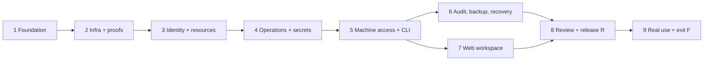

# Document 10 — MyKey Stage 1 Compressed Implementation Plan

| Field | Value |
| --- | --- |
| Product | **MyKey Private** (Stage 1 of MyKey) |
| Version / date | v1.0 — 10 November 2026 |
| Shape | **9 sessions, 89 runs, 14 calendar days**, executed by AI agents with the owner on call |
| Replaces | Document 07 (pre-roadmap) and Document 08 (47-session roadmap) **for sequencing, estimates and process**. Both stay in the repo as reference detail. |
| Does not replace | Documents 01–06. Document 04 still defines behaviour, Document 06 still defines the technical design, except where §3 of this document says otherwise. |
| Spec location | `docs/doc_01…doc_09*.md` (same folder as this file) |

> **For the session-planning agent:** you will be asked to write the detailed execution plan for **one** session of this document. Read §1–§5 first, then your session in §7. Your output is a run-by-run plan with exact files, interfaces, tests and commands that a third agent can execute without reading the specs end to end. You do not re-decide anything in §3 or §8.

**Goal:** In 14 days, ship a complete single-operator secrets service: the owner manages secrets in a web workspace, issues a scoped machine token, launches a real app through the CLI without a `.env` file, revokes access, and can rebuild the whole service on a clean host from off-host backups.

**Architecture:** A TypeScript API (Hono) in front of two stores with strictly separate jobs: OpenBao holds secret values, versions and token validity; PostgreSQL holds accounts, permissions, operation records and audit. Every write to OpenBao is recorded as a durable operation first, so a timeout is reported as `uncertain` and never guessed. A thin CLI fetches a complete, consistent secret set and starts the child process with it.

**Tech stack (candidates until Session 2 proves them):** Node LTS, TypeScript, Hono, Zod, OpenAPI 3.1, Scalar · Better Auth + Drizzle · PostgreSQL 18, pg-boss · OpenBao 2.7.x (namespaces, KV v2, token roles, Raft) · React, TanStack Query · Docker Compose, Traefik OSS, WireGuard on OVHcloud · OVHcloud KMS via OpenBao's KMIP seal · Restic bundles in Cloudflare R2 · Cloudflare Worker probe.

---

## 1. How this plan is used

Three layers, three different agents:

1. **This stage plan** fixes the sessions, the runs inside each session, what each must achieve, the order, and the decisions already made.
2. **A session plan** (written later, one per session, saved as `docs/plans/session-N-plan.md`) turns each run into exact steps: files, function signatures, tests, commands, expected output.
3. **An executing agent** carries out a session plan run by run.

**Vocabulary**

- **Session** — a block of related work that ends in something demonstrable and a go/no-go check. There are 9.
- **Run** — one focused agent work block inside a session: one deliverable, its tests, its commits, and a short run note. Sized so one agent can finish it in one sitting (roughly 1–3 hours of agent time). Runs are written `3.4` = Session 3, Run 4.
- **Old session** — a session of Document 08, written `D08-S13`. Every old session is mapped to new runs in §9, so its runbook can be mined for task detail. Ignore the old runbooks' process ceremony (entry files, three checkpoints, hour forecasts).

**What the session planner must read for any session**

- This document: §2–§5, the session's block in §7, and §8.
- Document 04 sections named in the session block. This is the behaviour contract; requirement text (FR/AC) is normative there, not here.
- Document 06 sections named in the session block. This is the design contract: tables, protocols, routes, limits.
- The mapped `D08-Sxx` runbooks, for step ideas, falsification tests and negative cases.
- The previous sessions' reports in `docs/evidence/session-N/report.md` and any decision records in `docs/decisions/`.

**Order of authority when two sources disagree**

1. Owner decisions in §3 of this document.
2. Document 04 (behaviour), then Document 06 (design).
3. The session and run descriptions in this document.
4. Document 08 runbooks (reference only). Document 07 is superseded for order and estimates.

If a session planner or executor finds a real contradiction that this order does not settle, it writes a one-paragraph decision record, picks the option that keeps the §4.1 rules intact, and tells the owner. It does not stop the session for it unless a §4.1 rule is at stake.

---

## 2. What "Stage 1 done" means

At the end of Day 14 all of the following are true.

**The product works end to end**

- Owner signs in with password + TOTP; there is no public signup.
- Owner creates projects and environments, and creates, edits, deletes, undeletes, restores, imports and exports secrets. Stale edits are rejected, never silently overwritten.
- Owner issues a read-only machine token bound to one environment (max 30 days, shown once), sees it in an inventory, and revokes it; after revocation new reads are denied by OpenBao itself.
- `secrets run --project <id> --env <name> -- <command>` starts a real app with the complete secret set in its environment, or starts nothing.
- A timeout in the middle of a write shows up as an `uncertain` operation that an operator can reconcile; it is never reported as success or as failure.
- Daily paired PostgreSQL + OpenBao backups go to R2; a clean host has been rebuilt from one of them, started closed, had all old sessions and tokens invalidated, and was reopened on purpose.
- The owner has alerts that arrive even when the host is down.

**The gates have been passed**

- **Gate R (controlled-use release), end of Session 8:** 56 release acceptance scenarios and all 29 technical proofs pass on one frozen build, using synthetic secrets only; a separate reviewer agent has examined the security-critical evidence; the owner has signed.
- **Gate F (stage exit), end of Session 9:** a real non-critical app runs on MyKey; the bounded agent experiment has been run; the owner has a written dossier and signs one of ADVANCE / HARDEN / PIVOT / STOP.

**Two checks finish after Day 14 without any engineering sessions** (see §3, decisions D-04 and D-05, and §11):

- W-1: the real 30-day backup-retention ageing check.
- W-2: the 28-day real-use observation report.

---

## 3. Owner decisions that make two weeks possible

The source documents require a formal decision, not a silent omission, whenever their rules change. These are those decisions. Run 1.1 turns each into a signed record in `docs/decisions/`.

| ID | Decision | What it changes |
| --- | --- | --- |
| **D-01** | Stage 1 is time-boxed to **14 calendar days** of agent-executed work in **9 sessions**. | Replaces the ~400 h target, the 903 h / 1,039 h estimate and the 47-session sequence. |
| **D-02** | Records P-01/P-02/P-03 are treated as **unavailable**. Documents 01–06 v0.3, as amended by this table, are the governing baseline. | Closes the open "missing governing records" blocker. If the owner finds those records later, they are reviewed as new input. |
| **D-03** | AC-1.42 before release means the **synthetic** consumer rehearsal (run together with AC-1.52). Real first-consumer onboarding belongs to AC-1.58. | Closes the open AC-1.42 interpretation. |
| **D-04** | At Gate R, AC-1.36 and AC-1.44 are proven with a **short-lock retention fixture** started on Day 1 (same bucket-lock mechanism, lock of a few days) that shows denied deletes, lock expiry, per-object delete errors, clean-up and restore of the oldest eligible pair. Production uses the real 30-day rule, verified by read-back. Real 30-day ageing is checked once as watch item **W-1**. | Formal amendment of the "actual 30-day ageing before release" rule. |
| **D-05** | Stage exit (Gate F) is decided on **Day 14** using the real-use days available by then. The 28-day observation of FR-1.100 / AC-1.58 continues passively as watch item **W-2**; a critical finding there triggers a hardening run. | Formal amendment of the "28 days before stage completion" rule. The exit report must state the actual number of real-use days. |
| **D-06** | The "independent non-author reviewer" is a **separate AI agent with a fresh context** that did not write the code, plus the owner's sign-off. | Replaces a second human reviewer. |
| **D-07** | Process evidence is reduced to **one note per run, one report per session, one registry file** (§4.4). | Replaces Document 08's entry/checkpoint/exit/handoff files and per-session hour forecasts. |
| **D-08** | The CLI binary is named **`secrets`**; the token variable is `SECRETS_MACHINE_TOKEN`. | Follows Document 04's default; removes the `mykey` naming in D08-S30. |
| **D-09** | The fallbacks in §8.1 are **pre-authorized**. If the first-choice design fails its proof inside its run, the agent switches to the listed fallback and records it, without waiting for approval. | Removes stop-and-wait points. |
| **D-10** | If the schedule slips, scope is cut only as **whole features in the order of §8.2**, each with a one-line owner approval. The §4.1 rules are never cut. | Replaces informal trimming. |
| **D-11** | The owner buys OVHcloud resources when an agent asks (§5). Agents create and manage everything in **GitHub and Cloudflare** themselves. | Assigns responsibilities. |

---

## 4. Rules for every session

### 4.1 Never traded for speed

These hold in every run. A run that cannot keep one of them stops and reports; it does not ship a workaround.

1. **One owner per fact.** Secret values and versions live only in OpenBao. Machine tokens are stored nowhere, not even encrypted. PostgreSQL holds metadata, permissions, operations and audit.
2. **No secret on a forbidden surface.** No secret value, machine token, session token, TOTP seed/code, recovery code or reset link in logs, job payloads, database tables where forbidden, browser storage, URLs, CI artifacts, evidence files, Git, or an agent's transcript.
3. **A timeout is not a failure.** Once a backend request may have been sent, the outcome is `uncertain` until evidence proves otherwise. No automatic retry, no takeover by another worker.
4. **All or nothing for machine delivery.** A partial, truncated or inconsistent secret set never launches a process and never produces an export.
5. **Permissions are checked on the server, every request,** from current database state. Hidden and absent resources return the same 404.
6. **Password alone grants nothing.** No signup route, no MFA-disable route, no trusted-device bypass, including Better Auth's own native routes.
7. **No stale writes.** Every change to an existing secret carries the expected version and state tag; there is no force-overwrite.
8. **Audit before release.** A sensitive read or effect is recorded before the value leaves or the effect starts; if audit is down, the action is refused.
9. **A restore starts closed.** Restored sessions, passwords, MFA and tokens are never trusted; the owner re-enrols and all tokens are revoked before reopening.
10. **Synthetic secrets only until Gate R is signed.**
11. **Say `unknown` when unknown.** No green status, zero count or "healthy" label without a real measurement behind it.

### 4.2 Limits and fixed values

All numeric limits come from **Document 06 §11** and are implemented once in `packages/contracts/limits.ts`. The ones planners most often need:

- Session: 30 min idle, 12 h absolute. Fresh TOTP window: 10 min. Reset link: 15 min, single use.
- TOTP: 6 digits, 30 s step, ±1 step, each step usable once. Recovery codes: 10, stored as verifiers only.
- Secret name `^[A-Z][A-Z0-9_]{0,127}$`, prefix `SECRETS_` reserved. Value ≤ 65,536 UTF-8 bytes. 20 versions kept.
- Environment name `^[a-z][a-z0-9-]{0,62}$`. Project name 1–64 code points, NFC.
- Environment capacity: ≤ 1,000 names, ≤ 8 MiB of current values.
- Machine token: default and maximum 2,592,000 s (30 days), non-renewable; warn 7 days before expiry.
- Backup: daily; alert when newest eligible pair is older than 26 h; pairs kept 30 days from capture; audit kept 365 days.
- Do not use PostgreSQL 19, any pre-release dependency, Redis, a second queue, a workflow engine, an MCP server, or OpenBao Agent as a required component.
- CLI targets: Linux glibc x64/arm64 and macOS x64/arm64. Native Windows is out of scope (the owner's Windows workstation uses the CLI through WSL2).

### 4.3 How a run is carried out

- Work test-first where a test is possible: write the failing test, make it pass, commit.
- Integration tests run against **real PostgreSQL and real OpenBao** in Docker (locally and in GitHub Actions). Mocks are not accepted as proof for anything involving the two stores.
- Tests that need the cloud (OVH hosts, KMS, R2 locks) are tagged and run against **staging**.
- Every run ends with `pnpm run check` and the run's tests green, a commit (or PR) on the session branch, and a run note.
- Runs marked **∥** have no dependency on their neighbours and may be given to parallel agents in separate git worktrees.
- Runs marked **OWNER** need the owner at a specific moment; the agent says exactly what it needs and continues with other runs while waiting.

### 4.4 Evidence, kept light

```text
docs/decisions/D-NN-<slug>.md            one page per decision (§3) and per fallback taken
docs/plans/session-N-plan.md             the detailed plan for a session
docs/evidence/registry.json              status of 102 FR, 60 AC, 29 proofs
docs/evidence/session-N/run-N.M.md       what was done, commit SHA, commands, results, open issues
docs/evidence/session-N/report.md        session result, gate status, what the next session must know
docs/runbooks/*.md                       operator procedures (bootstrap, backup, restore, alerts…)
```

Registry statuses: `OPEN`, `SPIKE_PASS` (proven in isolation), `PASS` (proven on the integrated product), `FAIL`, `WATCH` (W-1/W-2 only), `CUT` (removed under D-10 with approval). A spike pass is never reported as a pass. A skipped test is not a pass.

### 4.5 How a session ends

The last run of every session is its **gate run**:

1. Full test suite green; the session's end-to-end demonstration performed on staging (from Session 2 onward).
2. A fresh-context reviewer agent reviews the session's diff and the negative tests of every security-relevant run, and its findings are fixed or listed.
3. `registry.json` updated; `report.md` written, including anything that changes later sessions.
4. The owner gets a short message: what works now, what failed, any decision taken under D-09/D-10, and what is needed from them next.

### 4.6 Who does what

| Area | Who |
| --- | --- |
| GitHub: repository, branches, Actions, releases | Agent |
| Cloudflare: R2 buckets, lock rules, API tokens, Worker probe, DNS records (if the domain is on Cloudflare) | Agent |
| OVHcloud: buying servers and KMS, handing over access | **Owner**, when asked (§5) |
| Host hardening, deployment, backups, restore drills | Agent, over SSH/WireGuard |
| Holding recovery material off-host (OpenBao recovery keys, backup password, KMS certificate and key, gate authority) | **Owner**; the agent generates it on the host and tells the owner where to copy it from. It is never pasted into chat or Git. |
| Real TOTP enrolment, real secrets, signatures at Gates R and F | **Owner** |

---

## 5. Owner checklist

Each item is announced by the agent at the run shown, with exact instructions written by the session planner from current provider documentation.

| ID | When | What the owner does | What the agent needs back |
| --- | --- | --- | --- |
| **OWN-1** | Run 1.1 (Day 1) | Confirm the §3 decisions. Answer four questions: which domain to use, where alerts should go (email, Telegram, etc.), whether P-01/02/03 exist anywhere, repository name. | One reply. |
| **OWN-2** | Announced in Run 1.1, **needed by Run 2.5 (Day 2–3)** | **Buy two OVHcloud Linux servers** (production and staging) in one region. Indicative size until Run 1.3 confirms: x64, 4 vCPU, 8 GB RAM, 80 GB SSD each. Hourly-billed Public Cloud instances are fine. | IP addresses and initial root SSH access using the public key the agent provides. |
| **OWN-3** | Announced in Run 1.1, **needed by Run 2.7 (Day 3)** | **Activate OVHcloud KMS** in the same region; create the seal key, one extra disposable key for the loss test, and a KMIP access certificate, following the agent's steps. | KMS endpoint and key identifiers; certificate and private key placed directly on the staging host (not sent through chat). |
| **OWN-4** | Runs 2.7 and 6.5 | Copy the recovery material the agent lists to a safe place outside the servers (password manager or offline). | Confirmation. |
| **OWN-5** | Run 6.8 (Day 9–10) | **Buy one temporary clean server** for the restore drill (hourly billing; deleted after the drill). | IP and root SSH access. |
| **OWN-6** | Run 8.8 (Day 12) | About one hour: follow the first-run guide from scratch with synthetic data and say where it was confusing. | Notes. |
| **OWN-7** | Run 8.9 (Day 12) | Read the release report and sign Gate R. | Signature (a commit or a written "approved"). |
| **OWN-8** | Runs 9.1–9.2 (Day 12–13) | Enrol the real owner account with a real authenticator app on production; choose the first real, non-critical app; enter its secrets yourself. | The app runs through `secrets run`. |
| **OWN-9** | Run 9.9 (Day 14) | Read the exit dossier and choose ADVANCE / HARDEN / PIVOT / STOP. | Signed decision. |

---

## 6. Session map

| # | Session | Days | Runs | Old sessions absorbed | Ends with |
| --- | --- | --- | ---: | --- | --- |
| 1 | Foundation | 1 | 10 | D08-S01, S02, S04, S09 (launch), S22 | Working repo, CI, local stack, database base, retention clock running |
| 2 | Infrastructure and make-or-break proofs | 2–3 | 10 | S03, S05, S06, S07, S08, S10, S11 (capture spike) | Go/no-go on the stack, hardened hosts, real KMS unseal |
| 3 | Identity, access and resources | 4–5 | 10 | S11 (persistence), S12–S17 | Owner signs in with MFA and creates projects/environments on staging |
| 4 | Operations engine and secret lifecycle | 5–7 | 10 | S18–S21, S23–S25 | Full secret lifecycle through the API, crash-safe |
| 5 | Machine access, CLI and API reference | 7–8 | 10 | S26–S32 | A fixture app launched by the CLI on four platforms |
| 6 | Audit, limits, backup, recovery, deployment | 9–10 | 11 | S38, S40–S43 | Clean-host restore drill passed |
| 7 | Owner web workspace | 9–10 | 10 | S33–S37, S39 | Every owner task doable in the browser |
| 8 | Security review and controlled-use release | 11–12 | 9 | S44, S45 | **Gate R** signed |
| 9 | Real use, agent experiment, stage exit | 12–14 | 9 | S46, S47 | **Gate F** signed |



Sessions 6 and 7 run **in parallel**. Their one cross-dependency: Run 7.8 (activity timeline) needs Run 6.1 (audit and activity API).

**Honest reading of the schedule.** Eighty-nine runs in fourteen days means agents working most of each day, parallel runs where marked, and the owner answering within hours. The two things most likely to break it are a failed proof in Session 2 (handled by §8.1) and waiting for OVH resources (handled by announcing every purchase at least a day early).

---

## 7. The sessions

### Session 1 — Foundation (Day 1)

**Purpose.** Turn the decisions into records, create the repository and toolchain, lay the database base, and start the one clock that cannot be hurried: backup retention ageing.

**Read first.** Doc 06 §1.1, §2 (runtime units and repository layout), §3 (data model, roles and migrations), §8 "Import" (dotenv codec only), §9 (route table and error rules), §11 (limits), §13.2 (pair storage in R2). Doc 04 §5 (dotenv format v1), §8.1 (error envelope). Old runbooks D08-S01, S02, S04, S09, S22.

**Already on the owner's machine.** git, GitHub CLI (logged in), Docker + Compose, Node 24, pnpm 10, Python 3.12, WSL2 Ubuntu.

**Run 1.1 — Decisions and owner kick-off** · OWNER (OWN-1, announces OWN-2 and OWN-3)
- Do: write `docs/decisions/D-01…D-11` from §3; ask the four OWN-1 questions; hand the owner the OVH purchase list with the "needed by" times.
- Done when: decision records committed; owner has replied or the defaults are recorded as assumed.

**Run 1.2 — Repository and toolchain**
- Do: create the private GitHub repository; pnpm monorepo with strict TypeScript, lint, format and a test runner; folders per Doc 06 §2 (`apps/{api,provisioner,web,cli,ops}`, `packages/{contracts,db,auth,openbao,operations,audit}`, `infra`, `workers/probe`, `tests`). Keep the spec documents where they are in `docs/`.
- Done when: `pnpm install --frozen-lockfile`, `pnpm run check` and `pnpm test` pass on an empty skeleton.

**Run 1.3 — Version pins (G-PINS spike, PO-24)**
- Do: choose and pin exact versions (Node 24 vs 26 LTS, PostgreSQL 18, OpenBao 2.7.x, Traefik OSS 3.7.x, Better Auth 1.7.x, Hono, Zod, Drizzle, pg-boss, React, TanStack, Scalar, Restic); check each against current advisories; container images by digest; write `infra/dependencies.lock.json`; confirm server sizing for OWN-2.
- Done when: a clean build from the lock files succeeds twice with identical hashes; no pre-release pinned.

**Run 1.4 — CI pipeline**
- Do: GitHub Actions for check, unit and integration tests (PostgreSQL and OpenBao as service containers), secret scanning, dependency and image vulnerability scanning; Actions pinned by commit SHA; a job matrix ready for the four CLI platforms.
- Covers: early part of FR-1.73, AC-1.32.
- Done when: a seeded fake secret and a seeded vulnerable dependency each fail the pipeline.

**Run 1.5 — Local development stack**
- Do: Docker Compose stack with PostgreSQL 18 and OpenBao (Raft storage, namespaces, internal TLS) for development and tests. The local stack uses a development seal; real KMS unseal is proven only on staging (Run 2.7). Provide a test harness that starts a clean stack per test suite.
- Done when: one command brings the stack up; an integration test creates a namespace and writes/reads a KV v2 secret.

**Run 1.6 — Contracts foundation**
- Do: in `packages/contracts`: the error envelope and full error-code list, `limits.ts`, validators for project/environment/secret names, shared ID types, and the OpenAPI generation pipeline. Freeze the route list of Doc 06 §9 as typed route stubs; settle the single operation-status route as `GET /v1/operations/:operation`.
- Done when: OpenAPI 3.1 is generated from the Zod schemas; boundary tests for every name rule and limit pass.

**Run 1.7 — Database base (D08-S04)**
- Do: Drizzle schemas and reviewed SQL migrations for the tables in Doc 06 §3; the five database roles with least privilege; `PUBLIC` revoked; append-only audit insert path; migration checksums and a single-migrator rule; composite foreign keys that carry `organization_id`. List everything `pg_dump` does not capture (roles, grants, extensions, `pg_hba`) for later restore work.
- Covers: DB-G1 inventory.
- Done when: tests prove each runtime role can do what it needs and is denied DDL, audit update/delete, and other roles' tables.

**Run 1.8 — Strict dotenv codec (D08-S22)** · ∥
- Do: parser and canonical serializer for format v1 exactly as Doc 04 §5 defines it; property and fuzz tests; fixtures comparing against pinned Next.js and python-dotenv loaders; warnings name keys, never values.
- Covers: FR-1.33, FR-1.34, FR-1.38.
- Done when: export → import round-trips byte-exact; every rejected construct has a test.

**Run 1.9 — R2 buckets and retention clock (D08-S09)** · ∥
- Do: through Cloudflare, create buckets for production pairs, staging pairs, audit archive and a retention fixture; separate API tokens for upload, delete and bucket administration; the real 30-day lock rule on the production `pairs/` prefix; a **short lock** on the fixture (target 3–5 days; confirm the minimum R2 allows). Upload several synthetic encrypted pair bundles to the fixture and record upload time and capture time. Test now: overwrite denied, delete denied, bulk delete returning HTTP 200 with per-object errors, failed multipart upload clean-up. Start the cost sheet (bytes per pair, request counts).
- Covers: start of PO-9, R2-L1, COST-B1 under D-04.
- Done when: fixture objects are locked with their clocks recorded; the denied-delete results are saved.

**Run 1.10 — Registry and session gate**
- Do: create `docs/evidence/registry.json` with all 102 FR, 60 AC and 29 proofs mapped to runs (§9); run the §4.5 gate.
- Done when: session report written.

**Session 1 end goal.** A new agent can clone the repository, run one command, and have a tested skeleton with real PostgreSQL and OpenBao underneath; the retention fixture is ageing; the owner knows what to buy and by when.

---

### Session 2 — Infrastructure and make-or-break proofs (Days 2–3)

**Purpose.** Prove or replace the four risky assumptions before any feature depends on them: OpenBao permissions and token issuance, Better Auth secure storage, late-arriving backend writes, and real KMS unseal. Stand up and harden the hosts. Runs 2.1–2.4 need only the local stack, so they proceed while the owner buys servers.

**Read first.** Doc 06 §1.4 (gates), §2 (host and network rules), §4.1–4.3 (auth storage, transitions, route allowlist), §5 (OpenBao layout and privileges), §6 (coordination and reconciliation), §13.1–13.3 (capture and custody), §17 (alternatives). Doc 05 §3.5, §3.10, §3.11, §4, §5 (gap register), §6. Old runbooks D08-S03, S05, S06, S07, S08, S10, S11.

**Run 2.1 — OpenBao tenancy and permissions spike (D08-S06)** · ∥
- Do: two synthetic organizations as namespaces `org-<id>`, each with a KV v2 mount (CAS required, 20 versions); policy templates and identities for runtime, issuer, provisioner, backup and machine; AppRole login for the runtime; OpenBao audit device recording the two server-generated correlation headers. Attack it from each identity: other namespace, other environment, destroy, metadata delete, policy write, token create.
- Covers: PO-3; early evidence for PO-4, FR-1.13.
- Done when: a written authority matrix shows every allowed and denied action, verified with real tokens.

**Run 2.2 — Machine-token issuance proof** · ∥
- Do: prove on the pinned OpenBao that a short-lived issuer, using only a fixed token role, creates a token that is orphan, read-only, non-renewable, without the default policy, and limited to one environment; that the token survives the issuer's expiry and revocation; that revoking by accessor kills it; and that the machine token itself cannot renew, create tokens, write, or read another environment.
- Covers: early PO-2 (closed in Run 5.4).
- Done when: all of the above observed. If the issuer needs broader rights than a fixed role, take the §8.1 fallback.

**Run 2.3 — Better Auth secure-storage spike (D08-S07, G-AUTH)** · ∥
- Do: list every native route and adapter operation of the pinned Better Auth; mount only the allowlist; call the disabled ones directly (signup, MFA disable, trusted device, reset initiation). Build the protected session storage (keyed lookup verifier, optional authenticated ciphertext), verifier-only recovery codes, encrypted TOTP seed, one-use TOTP steps under a two-process race. Inspect the real tables and a database dump for anything usable as a bearer.
- Covers: early PO-5, PO-6, PO-15.
- Done when: `docs/auth-route-contract.md` exists and no usable session token or recovery code is found at rest. Otherwise switch to the §8.1 auth fallback and record it.

**Run 2.4 — Late-write and exclusion spike (D08-S08, G-EFFECT)** · ∥
- Do: a minimal intent → dispatch marker → OpenBao write → finalize loop with the `operation` and `effect_slot` tables. Kill the executor at each boundary; delay a request past its timeout with a network fault injector; prove the slot blocks any second executor; prove that stopping and restarting OpenBao terminates in-flight requests so reconciliation can trust what it reads.
- Covers: early PO-16.
- Done when: no scenario produces a duplicate write or a false "failed"; the maintenance procedure of Doc 06 §6.4 is demonstrated once.

**Run 2.5 — Host hardening and network skeleton (D08-S03)** · OWNER (OWN-2)
- Do: on both hosts: WireGuard; SSH reachable only over the VPN with keys; firewall open for TCP 443 and the WireGuard port only; Compose skeleton with non-root, read-only containers and resource limits; default-deny outbound traffic with an allowlist (DNS, ACME, KMS, R2, alerts); Traefik with a certificate via TLS-ALPN; DNS records; a `/health` stub. Verify with real packets from outside, not from configuration files.
- Covers: FR-1.70, FR-1.71, FR-1.72; AC-1.30, AC-1.31; PO-11.
- Done when: an outside scan shows exactly the two open ports on both hosts; spoofed forwarded headers and plain HTTP are refused.

**Run 2.6 — Off-host probe and alert path**
- Do: a Cloudflare Worker that checks the public health endpoint every minute and expects a heartbeat from the host; alerts go to the owner's chosen destination.
- Covers: early PO-14.
- Done when: stopping the staging host produces a delivered alert within the grace period.

**Run 2.7 — Real KMS auto-unseal (D08-S05)** · OWNER (OWN-3, OWN-4)
- Do: OpenBao on staging sealed with the built-in KMIP seal against the real OVHcloud KMS. Test container restart, host reboot, KMS unreachable during restart, expired or revoked client certificate and its re-issue. With the **disposable** key only: show that a missing seal key leaves OpenBao sealed and that recovery keys cannot fix it. Write the custody map: every key, certificate and secret needed to rebuild, and where the owner keeps it.
- Covers: FR-1.64, FR-1.65; AC-1.26; PO-1; early KMS-L1.
- Done when: unseal works unattended after reboot, and each failure case behaves as documented. If KMIP cannot be made to work, take the §8.1 seal fallback.

**Run 2.8 — CLI approach decision (D08-S10)** · ∥
- Do: a short, time-boxed comparison of OpenBao Agent's process-supervisor mode with a thin first-party CLI on one Linux fixture; record why the thin CLI is chosen (or the exception).
- Covers: early AGENT-B1.
- Done when: decision record written. This run is capped; it must not grow.

**Run 2.9 — Paired backup spike (part of D08-S11)**
- Do: on staging: freeze new effects, take a PostgreSQL dump plus the cluster-globals export and an OpenBao Raft snapshot, write a pair manifest, pack one Restic repository per pair, upload to R2, download and verify. Restore the PostgreSQL part into a brand-new cluster and prove the runtime roles work with least privilege.
- Covers: early PO-13, PO-21, DB-G1.
- Done when: a pair captured on staging is restored into a disposable PostgreSQL and a disposable OpenBao and both are readable.

**Run 2.10 — Go/no-go gate**
- Do: record the outcome of each proof and any fallback taken; update pins if they changed; adjust later sessions if a fallback changes their work; §4.5 gate.
- Done when: the owner has a one-page go/no-go and the registry shows `SPIKE_PASS` or a recorded fallback for G-AUTH, G-BAO and G-EFFECT.

**Session 2 end goal.** Two hardened hosts, OpenBao unsealing itself from the real KMS, alerts that fire when the host dies, and written proof that the auth, token and late-write designs hold, or a recorded switch to their fallbacks.

---

### Session 3 — Identity, access and resources (Days 4–5)

**Purpose.** Build everything a human needs before touching a secret: the API skeleton, sign-in with mandatory MFA, sessions, recovery, the permission checks, and organizations, projects and environments.

**Read first.** Doc 04 §1 (model, authorization matrix, state precedence), §2 and §2.1, §3. Doc 06 §3, §4 (all), §5 (organization bootstrap), §7.1, §9 (cookie/Origin rules), §11 (auth limits), §14.1 (gate). `docs/auth-route-contract.md` from Run 2.3. Old runbooks D08-S11–S17.

**Run 3.1 — API skeleton and persistence layer (D08-S11)**
- Do: the Hono application with server-generated request IDs, the error envelope, sanitized errors, strict input and output validation, `no-store` on all API responses; tenant-scoped repository helpers; transactional outbox and pg-boss jobs that carry IDs only; the audit append path with an allowlist of fields; log redaction as a second defence; the external service gate (a root-owned file outside the database, missing or unreadable means closed) checked on every request.
- Done when: a request through the stack is validated, audited and denied when the gate is closed.

**Run 3.2 — Owner bootstrap and password sign-in (D08-S12)**
- Do: an operator-only, idempotent bootstrap command in `apps/ops` that creates the owner and the organization record; password sign-in through the allowlisted native route; every account-creation path over HTTP refused.
- Covers: FR-1.01; AC-1.01; PO-5.
- Done when: an interrupted and repeated bootstrap yields exactly one owner; every signup path returns the generic not-found.

**Run 3.3 — Throttling (D08-S12)** · ∥
- Do: rate counters in PostgreSQL that hold across two API processes, per source and per account, with keyed digests as counter keys; identical responses for known and unknown accounts; counter failure means refusal.
- Covers: FR-1.07; AC-1.05.
- Done when: the limits of Doc 06 §11 are enforced across two processes.

**Run 3.4 — TOTP and recovery codes (D08-S13)**
- Do: enrolment, second-factor completion with session-token rotation, one-use steps that survive restarts, ten recovery codes stored as verifiers and shown once, regeneration requiring fresh TOTP. A recovery-code login does not count as fresh TOTP.
- Covers: FR-1.02, FR-1.03; AC-1.02; PO-15.
- Done when: a password-only or enrolment-incomplete session reaches no product route; a replayed TOTP step is refused in a two-process race.

**Run 3.5 — Sessions and fresh verification (D08-S14)**
- Do: expiry as the earlier of 12 h absolute and 30 min since real user activity; the activity signal; session list and revoke; password change that requires current password plus fresh TOTP and revokes other sessions; the 10-minute fresh-TOTP check used by sensitive actions.
- Covers: FR-1.05, FR-1.06, FR-1.77; AC-1.04, AC-1.35.
- Done when: background polling does not extend a session; each sensitive action returns `fresh_verification_required` without recent TOTP.

**Run 3.6 — Operator reset and recovery (D08-S14)**
- Do: reset started only from the host tool; the account blocked at once and all sessions ended; a 15-minute single-use link with the token in the URL fragment, redeemed in a request body; the restricted re-enrolment path when MFA is lost; final sign-in required afterwards.
- Covers: FR-1.04; AC-1.03; PO-6.
- Done when: an expired link leaves the account blocked; only one link ever redeems; no token appears in server logs.

**Run 3.7 — Authorization pipeline (D08-S15)**
- Do: the request pipeline of Doc 06 §4.4 (gate → limits → authentication → membership and ancestry → visibility → action → state → freshness → admission); the state-precedence rules of Doc 04 §1.2; identical 404 for hidden and absent; rejection of requests carrying both cookie and bearer; Origin and Fetch-Metadata checks on every cookie-authenticated POST/PATCH. Synthetic fixtures: second organization, admin, editor, reader, ungranted member.
- Covers: FR-1.09, FR-1.10, FR-1.11; AC-1.08.
- Done when: every cell of the authorization matrix has a passing test, including after a grant is removed mid-session.

**Run 3.8 — Organization provisioning (D08-S16)**
- Do: the provisioner process and its durable, step-by-step provisioning of namespace, mount, policies and roles, each read back before the organization becomes active; drift detection that returns `503 backend_inconsistent`, puts the narrowest scope into review and alerts; no root or provisioner credential in the API process.
- Covers: FR-1.08, FR-1.12, FR-1.55; AC-1.06, AC-1.09; PO-4.
- Done when: killing the provisioner at every step and retrying ends with one correct namespace; removing a policy on staging triggers review and an alert.

**Run 3.9 — Projects and environments (D08-S17)**
- Do: create, rename and list; creating a project also creates `development`; an environment is `pending` until its machine policy and role are verified; no delete route exists.
- Covers: FR-1.14, FR-1.15, FR-1.16, FR-1.19; AC-1.10.
- Done when: name rules pass their boundary tests and a pending environment cannot issue credentials.

**Run 3.10 — Session gate**
- Do: integrated auth and permission suite on staging (closes G-AUTH on the integrated product); search auth tables, logs and a database dump for seeded canary values; §4.5 gate.

**Session 3 end goal.** On staging, a bootstrapped owner signs in with password and TOTP, recovers through the operator reset, and creates projects and environments through the API, while a synthetic second organization and lesser roles are provably shut out.

---

### Session 4 — Operations engine and secret lifecycle (Days 5–7)

**Purpose.** The heart of the product: durable operations, every secret action, crash safety, import, and the consistent whole-environment read that the CLI will depend on.

**Read first.** Doc 04 §4 and §4.1, §5. Doc 06 §6 (all), §7.2, §8 (all), §9 (response rules), §11. The Run 2.4 results. Old runbooks D08-S18–S21, S23–S25.

**Run 4.1 — Operation records and replay (D08-S18)**
- Do: the `operation`, `operation_step`, `effect_slot` and tombstone model; states `accepted`, `executing`, `awaiting_input`, `uncertain`, `succeeded`, `partial`, `rejected`; idempotency keys scoped to principal, action and target with a keyed fingerprint; replay answers (`idempotency_conflict`, `replay_expired`); the operation status and list routes.
- Covers: FR-1.82, FR-1.83.
- Done when: concurrent identical requests produce one operation; a changed payload under the same key conflicts.

**Run 4.2 — Mutation protocol with create and update (D08-S19)**
- Do: the six-step protocol of Doc 06 §6.2 (validate → admit under the per-environment lock → commit dispatch marker → one backend effect → read back → finalize) with secret create (CAS 0, no prior history) and update (expected version + state tag); the value envelope; the name index with byte counters; capacity limits.
- Covers: FR-1.20, FR-1.24, FR-1.25; AC-1.12, AC-1.14.
- Done when: two updates with the same version and tag yield exactly one success; oversize, NUL and reserved names are refused before any effect.

**Run 4.3 — Listing, history and reveal (D08-S19)**
- Do: name-only listing and search with signed keyset cursors and `listing_changed`; version history with attribution; the reveal endpoint (audit committed before the value is returned, `no-store`); single-key read rules while another key is under review.
- Covers: FR-1.21, FR-1.26; server side of FR-1.22.
- Done when: no listing or history response contains a value; reveal fails when audit is unavailable.

**Run 4.4 — Delete, undelete, restore (D08-S20)**
- Do: soft delete of the current version; undelete of that same version; restore of a historical version as a new version; no destroy or metadata-delete path anywhere.
- Covers: FR-1.27, FR-1.28, FR-1.29, FR-1.32; AC-1.15; PO-7.
- Done when: a tag captured before delete+undelete is rejected afterwards; races across two processes leave a consistent state.

**Run 4.5 — Uncertainty and reconciliation (D08-S21)**
- Do: `503 outcome_unknown` with the operation ID; review states that block the affected key or environment; the operator `reconcile` command that resolves from backend evidence, and the closed-maintenance procedure for cases it cannot resolve; stuck-work alert after two minutes.
- Covers: FR-1.30, FR-1.31, FR-1.88; AC-1.16.
- Done when: a write that timed out after reaching OpenBao is shown as uncertain, blocks further changes to that key, and is resolved correctly by the operator tool.

**Run 4.6 — Fault suite for secret actions (D08-S21)**
- Do: automated tests that kill the executor at intent, dispatch, backend success and final commit, and that delay a backend request beyond the timeout, for create, update, delete, undelete and restore.
- Covers: AC-1.38; G-EFFECT on the integrated product for KV actions.
- Done when: every scenario ends in a truthful state with no duplicate effect.

**Run 4.7 — Import (D08-S23)**
- Do: preview (values handled in memory only; stores file fingerprint and per-key classification; expires in 15 minutes); apply by resubmitting the same file, entry by entry through the mutation protocol; per-key outcomes; `partial` as a terminal state; resume of an interrupted import by exact-file resubmission.
- Covers: FR-1.35, FR-1.36; AC-1.39; PO-17.
- Done when: an import interrupted halfway resumes only the unattempted entries; no imported value exists in PostgreSQL or job payloads.

**Run 4.8 — Consistent whole-environment read (D08-S24)**
- Do: the complete read of Doc 06 §8 under the environment lock: full name set, all values, envelope checks, index-versus-backend comparison, audit commit, then one buffered response with explicit length. Any failed key, lost lock or audit failure discards everything.
- Covers: FR-1.84; AC-1.41; PO-19 (G-RESOLVE).
- Done when: reads during concurrent writes and imports return either one coherent set or an explicit error, never a mixture; an empty environment succeeds.

**Run 4.9 — Human export (D08-S25)**
- Do: export with fresh TOTP, canonical dotenv bytes, `Content-Length` and digest, attachment response, no reusable URL.
- Covers: FR-1.37; AC-1.17.
- Done when: export then import into an empty environment reproduces the same values; a canary search of server surfaces is clean.

**Run 4.10 — Session gate**
- Do: §4.5 gate; the full secret lifecycle demonstrated on staging through the API.

**Session 4 end goal.** Through the API alone, the owner can run the whole secret lifecycle, import and export, and every interrupted or delayed write ends in a state that is true and recoverable.

---

### Session 5 — Machine access, CLI and API reference (Days 7–8)

**Purpose.** Let software use secrets: token issuance and revocation, archive, the machine API, the CLI on four platforms, the consumer setup guides, and the API reference.

**Read first.** Doc 04 §3 (archive/reactivate), §6, §7, §8. Doc 06 §5 (machine roles), §7.1 (archive), §7.3, §8 (machine resolve), §9, §10, §18.4. Run 2.2 and 2.8 results. Old runbooks D08-S26–S32.

**Run 5.1 — Token issuance and inventory (D08-S26)**
- Do: issue with owner/admin role and fresh TOTP for an active environment; durable `issuing` record before dispatch; token held only in the request's memory, verified (orphan, read-only, TTL), then returned once with status 201; inventory by accessor with effective expiry and last use.
- Covers: FR-1.39, FR-1.40, FR-1.41.
- Done when: no token bytes exist in PostgreSQL, logs or jobs; a replayed successful issuance returns `409 credential_not_replayable`.

**Run 5.2 — Revocation and uncertain issuance (D08-S27)**
- Do: revoke as denied-state first, then revoke by accessor, then verify; `revoking` is never shown as revoked; a lost issuance response blocks new issuance for that environment until an operator inventories and revokes unrecorded tokens.
- Covers: FR-1.42, FR-1.43; AC-1.40.
- Done when: losing the response at each boundary never yields a token nobody knows about that still works.

**Run 5.3 — Archive and reactivate (D08-S28)**
- Do: archive sets `revoking`, lets admitted work finish, revokes and verifies every credential, then sets `archived`; it resumes after interruption; archiving a project covers its environments; reactivation re-verifies the backend and never revives a token.
- Covers: FR-1.17, FR-1.18; AC-1.11; PO-18.
- Done when: an issuance racing an archive cannot leave a usable token.

**Run 5.4 — Machine API (D08-S29)**
- Do: the bearer-only `keys` and `resolve` routes; the presented token is used for self-lookup and for every backend read; no fallback to the runtime identity; history selectors refused. Then attack OpenBao directly with a real machine token.
- Covers: FR-1.44, FR-1.45; AC-1.19; PO-2.
- Done when: the token reads only its environment's current values through MyKey, and direct OpenBao write, delete, renew, token-create and cross-environment reads are all denied.

**Run 5.5 — CLI core and `keys` (D08-S30)**
- Do: the `secrets` CLI: configuration holds the API URL only; token from `SECRETS_MACHINE_TOKEN` or stdin, never an argument; HTTPS and certificate checks, no skip-verify, API major-version check, refusal of unsafe runtime settings; the typed error model and exit codes of Doc 04 §7; `secrets keys`.
- Covers: FR-1.46, FR-1.47, FR-1.79.
- Done when: HTTP URLs, bad certificates, redirects and an incompatible API version each fail with the right exit code and no credential sent.

**Run 5.6 — CLI `run` and `export` (D08-S30)**
- Do: `run` validates the complete response, strips `SECRETS_*`, fails on name collisions unless `--override`, spawns without a shell, forwards signals, returns the child's exit status or 128 + signal, and never caches. `export` writes a new 0600 file exclusively, refusing existing paths and symlinks.
- Covers: FR-1.48, FR-1.49, FR-1.50; AC-1.20, AC-1.21.
- Done when: a truncated, partial or expired response launches nothing; the token is absent from the child's environment and from process arguments.

**Run 5.7 — Four-platform packaging (D08-S31)**
- Do: build and test the CLI on real Linux x64, Linux arm64, macOS x64 and macOS arm64 GitHub runners; a standalone executable if it passes on all four, otherwise the pinned Node package with a tested installer (§8.1); native Windows exits with a clear message.
- Covers: FR-1.51; AC-1.37; PO-8; closes AGENT-B1.
- Done when: the same CLI test suite passes on all four platforms from released artifacts, not from cross-compiled guesses.

**Run 5.8 — Consumer setup and fixture apps (D08-S31)** · ∥
- Do: small Next.js and FastAPI fixture apps; `docs/runbooks/consumer-local.md` and `consumer-deploy.md` covering install, endpoint check, token issue, protected token supply through an owner-readable file read by a launch wrapper, launch, rotation, revocation and replacement after restore.
- Covers: FR-1.85; PO-20; the synthetic rehearsal of AC-1.42 (D-03).
- Done when: following the runbook from a clean machine launches both fixtures with no token in shell history, arguments, image or repository.

**Run 5.9 — OpenAPI and Scalar reference (D08-S32)** · ∥
- Do: reconcile the generated OpenAPI with the implemented routes; deny undocumented aliases; bundle Scalar locally as an owner-only, read-only reference with request execution, telemetry and external assets disabled.
- Covers: FR-1.52, FR-1.53, FR-1.54; AC-1.22; PO-10.
- Done when: a captured browser session of the reference shows no third-party requests.

**Run 5.10 — Session gate**
- Do: §4.5 gate; on staging, the full machine journey: issue → supply → `secrets run` a fixture → revoke → denied.

**Session 5 end goal.** A fixture application starts through `secrets run` on all four platforms with a complete secret set and no `.env` file, and stops being able to fetch secrets the moment its token is revoked.

---

### Session 6 — Audit, limits, backup, recovery, deployment (Days 9–10, parallel with Session 7)

**Purpose.** Make the service operable and recoverable: complete audit, limits, health and alerts, the daily paired backup, retention, the clean-host restore drill, and a repeatable deployment with runbooks.

**Read first.** Doc 04 §8 (audit), §9, §10. Doc 06 §11, §12, §13 (all), §14 (all), §15.2b (KMS-L1, DB-G1, R2-L1, COST-B1), §18.1 (private operator status). Run 1.9, 2.7 and 2.9 results. Old runbooks D08-S38, S40–S43.

**Run 6.1 — Audit coverage and activity API (D08-S38)** — do first; Run 7.8 depends on it
- Do: audit events for every action listed in FR-1.56, including denials and authentication failures; the organization audit and activity routes with filters and cursors; OpenBao's audit device on an operator-only sink, with access refused when it cannot record; request and operation IDs linking the two logs.
- Covers: FR-1.56, FR-1.57, FR-1.58, FR-1.59, FR-1.80; AC-1.23.
- Done when: a coverage test walks every route and finds its audit event; the runtime role cannot alter audit rows.

**Run 6.2 — Audit archive and 365-day retention (D08-S38)**
- Do: audit segments with checksum and sequence manifest, uploaded encrypted to the R2 audit prefix; gap and duplicate detection; local records kept until the upload is verified; an audited purge tool for expired records only.
- Covers: FR-1.81.
- Done when: a deliberately dropped segment is detected.

**Run 6.3 — Limits and overload (D08-S40)** · ∥
- Do: enforce every limit in Doc 06 §11: body sizes rejected before allocation, concurrency caps, per-session and per-credential rates, `503 busy`, `507`, the disk and inode floors that block growing writes.
- Covers: FR-1.60, FR-1.61; AC-1.24.
- Done when: each limit has a test at and just beyond its boundary; a failed limiter refuses requests.

**Run 6.4 — Health, operator status and alerts (D08-S40)**
- Do: public `/health` that says only up or down; the private operator status over the VPN (KMS reachable and OpenBao unsealed as separate fields, capture age of the newest eligible pair, audit health, capacity, unresolved operations, credential expiry); one alert per condition in FR-1.63, each with a runbook; token-expiry warning at 7 days, KMIP certificate at 30 days.
- Covers: FR-1.62, FR-1.63, FR-1.95; AC-1.18, AC-1.25, AC-1.49; PO-14, PO-23.
- Done when: each listed condition is simulated on staging and its alert is delivered; an owner session is denied the private routes.

**Run 6.5 — Daily paired backup (D08-S41)** · OWNER (OWN-4)
- Do: the capture coordinator of Doc 06 §13.1 (durable freeze, drain, capture, release) as a daily timer; PostgreSQL dump, cluster-globals export and Raft snapshot packed as one Restic repository per pair; upload, download-and-verify with a full data check, then a signed eligibility manifest; a separate least-privilege backup identity. Hand the owner the backup password and signing key locations for off-host custody.
- Covers: FR-1.66; AC-1.27; PO-13, PO-21.
- Done when: a capture taken while reads continue and writes compete is verified end to end; a crashed capture leaves no eligible pair.

**Run 6.6 — Retention, clean-up and cost (D08-S41)**
- Do: daily clean-up of expired pairs that inspects every per-object result and re-checks with HEAD/LIST; read the outcome of the Day-1 fixture (lock expiry observed, clean-up done, oldest eligible pair restored); refusal to remove a KMS key still referenced by a retained pair; the cost sheet with daily pair size, 30-day projection, request and egress costs, restore time. Schedule watch item W-1.
- Covers: FR-1.78; AC-1.36 (as amended by D-04); PO-9; R2-L1; COST-B1.
- Done when: fixture evidence shows denied delete during the lock and verified removal after it; the production rule reads back as 30 days.

**Run 6.7 — Quarantine gate and restore tooling (D08-S42)**
- Do: the gate record bound to host and backend identity, written atomically; the verification-report generator and the gate-opening tool that refuses stale or mismatched reports; scripts for each step of the Doc 06 §14.2 restore sequence; the private owner re-enrolment procedure.
- Done when: a restored database with "active" rows cannot open the service; only a fresh matching report can.

**Run 6.8 — Clean-host restore drill (D08-S42)** · OWNER (OWN-5)
- Do: on a brand-new server, using only off-host material, with staging treated as lost: rebuild PostgreSQL globals and roles, restore the pair, unseal with the KMS key and a re-issued certificate, invalidate all restored sessions, MFA, reset links and every token accessor, rotate service credentials, re-enrol the owner, verify, open the gate, issue a new token, take a fresh backup. Time every step. Include a stale pair with an old password and an injected unauthorized grant.
- Covers: FR-1.67, FR-1.68, FR-1.69, FR-1.86, FR-1.87; AC-1.28, AC-1.43, AC-1.44 (as amended by D-04); PO-22; KMS-L1; DB-G1.
- Done when: the new host serves the restored secrets; every old credential fails before and after reopening; the runtime roles have exactly their rights.

**Run 6.9 — Deployment, rollback and supply chain (D08-S43)** · ∥
- Do: build once and promote the same image digest; migrations under the deployment role before start; smoke and negative tests before going public; rehearse upgrade, failed migration and rollback (or restore-based rollback) on staging; release blocked by scan findings.
- Covers: FR-1.73, FR-1.74; AC-1.32.
- Done when: an upgrade and a rollback have each been performed on staging from released artifacts.

**Run 6.10 — Runbooks and honest limits (D08-S43)** · ∥
- Do: runbooks for bootstrap, each alert, backup, restore, reconciliation, upgrade, certificate renewal and advisory response; the user-facing limitations page (single owner, no HA, no offline cache, not zero-knowledge, outage blocks new launches).
- Covers: FR-1.75; AC-1.33.
- Done when: a fresh agent executes the alert and recovery runbooks on staging using only the written text.

**Run 6.11 — Session gate**
- Do: §4.5 gate; drill results and timings in the report; delete the temporary drill host.

**Session 6 end goal.** Staging has been declared lost and rebuilt on a clean server from R2 alone, started closed, and reopened deliberately; backups run daily; every alert has been seen to fire and has a runbook.

---

### Session 7 — Owner web workspace (Days 9–10, parallel with Session 6)

**Purpose.** Every owner task must be doable in the browser, with states shown truthfully and no secret left behind in the browser.

**Read first.** Doc 04 §8, §11 (all, especially §11.1 screens and §11.2 conventions). Doc 06 §9 "Browser workflow requirements" and CSP rules, §18 (all). Doc 03 §6. The generated OpenAPI from Run 5.9. Old runbooks D08-S33–S37, S39.

**Rules for the whole session.** TanStack Query caches metadata only, with no persistence. Secret-bearing requests bypass the cache and live in component state for at most 30 seconds. No value, token or recovery code in the URL, history, local or session storage. No optimistic success for anything security-relevant. Status is never shown by colour alone.

**Run 7.1 — Shell, design system and API client (D08-S33)**
- Do: the React application served from the API origin; navigation that always shows organization, project and environment; a typed API client generated from the contracts; a build that works under the strict CSP (local scripts only).
- Covers: FR-1.89.

**Run 7.2 — Sign-in and security screens (D08-S33)**
- Do: password, TOTP, enrolment with one-time recovery-code display, session list and revoke, password change, recovery-code regeneration, reset completion from the URL fragment.
- Done when: a password-only session cannot render any workspace route.

**Run 7.3 — Workspace overview and resources (D08-S33, S39)**
- Do: project and environment lists with readiness and lifecycle states (`pending`, `active`, `revoking`, `archived`, `needs_review`), create and rename, archive and reactivate with confirmation; counts labelled with their source and time.
- Covers: FR-1.90; AC-1.46.

**Run 7.4 — Secret list, edit and reveal (D08-S34)**
- Do: name list with search, create and edit with stale-version conflict handling (reload or cancel, no force), masked values with explicit reveal that clears after 30 seconds or on hide/navigation/sign-out, explicit copy with the clipboard warning.
- Covers: FR-1.22, FR-1.23.

**Run 7.5 — History, delete, undelete, restore (D08-S34)** · ∥
- Do: version history with attribution (unknown shown as unknown), confirmations with deterministic text, restore as a new version.

**Run 7.6 — Import, export and first-run guide (D08-S35)** · ∥
- Do: import preview with per-key classification, apply with per-entry progress, partial and resume states; export behind fresh TOTP with whole-body verification before download; the first-run guide leading from empty workspace to a launched fixture app.

**Run 7.7 — Machine credentials (D08-S36)** · ∥
- Do: inventory with scope, state and effective expiry; issue with fresh TOTP and a one-time token display kept out of route state; revoke; 7-day warning; "replace, not renew" guidance.
- Covers: FR-1.91; AC-1.47.

**Run 7.8 — Operation and activity timeline, safe analytics (D08-S39)** — needs Run 6.1
- Do: timeline that distinguishes accepted, executing, uncertain, awaiting input, partial and terminal states and tells the owner when an operator is required; organization summaries where permission filtering happens before counting; every chart has a table equivalent, a source and an observation time; no-data is distinct from zero.
- Covers: FR-1.92, FR-1.94; AC-1.48, AC-1.55.
- Done when: a forced delayed write, an unknown issuance and an interrupted import each display correctly.

**Run 7.9 — Errors, accessibility and browser security (D08-S37)**
- Do: one error presentation across UI, API and CLI with request IDs and safe next steps; keyboard-only operation of the main flows and a usable narrow layout; CSP, no framing, `Referrer-Policy: no-referrer`, cross-site state changes refused on every route including native auth routes.
- Covers: FR-1.76, FR-1.93, FR-1.96; AC-1.29, AC-1.34, AC-1.51; PO-12.

**Run 7.10 — Browser end-to-end suite and session gate**
- Do: automated browser tests for every owner operation; a scan of browser storage, caches and network logs for seeded canaries; §4.5 gate.

**Session 7 end goal.** Using only the browser, the owner completes every task from sign-in to revoking a token, sees uncertain and pending states for what they are, and leaves no secret in browser storage.

---

### Session 8 — Security review and controlled-use release (Days 11–12)

**Purpose.** Freeze one build, attack it, have it reviewed by an agent that did not write it, fix what is found, prove the whole acceptance list on it, and get the owner's signature for real secrets.

**Read first.** Doc 04 §12 (all acceptance scenarios), §12.2, §13. Doc 06 §15 (all), Appendix B. Doc 03 §12.1. Every session report so far. Old runbooks D08-S44, S45, and D08 Part IV section B ("unacceptable release substitutions").

**Run 8.1 — Freeze the release candidate**
- Do: final version and advisory review (closes G-PINS); record source commit, schema revision, dependency manifest hash and image digests; deploy the candidate to **production**, gate closed, synthetic data only.
- Done when: production runs the exact candidate digests.

**Run 8.2 — Isolation and permission attack suite (D08-S44)** · ∥
- Do: with two synthetic organizations, attack through the API and directly against OpenBao and PostgreSQL: guessed IDs, forged selectors, cursor reuse, counts and timing, unexpected auth routes.
- Covers: FR-1.13; AC-1.07.

**Run 8.3 — Fault replay on the candidate (D08-S44)** · ∥
- Do: rerun every kill, delay and race suite (secret actions, issuance, revocation, archive, import, complete read, backup capture) against the frozen candidate.
- Covers: PO-16 and the integrated replays of AC-1.11, AC-1.38, AC-1.40, AC-1.41.

**Run 8.4 — Forbidden-surface canary sweep (D08-S44)** · ∥
- Do: seed labelled synthetic secrets, tokens, codes and links; exercise every reveal, export, issue, reset and sign-out path; search the database, backups, logs, proxy logs, job tables, audit, browser storage, CLI arguments and environment, CI artifacts and the Scalar bundle.
- Covers: AC-1.13, AC-1.50.

**Run 8.5 — Independent review (D-06)**
- Do: fresh-context reviewer agents examine auth and sessions, the mutation and reconciliation protocol, token issuance and revocation, backup and restore, and the CLI, reading the code and the negative-test evidence; findings ranked by severity.
- Done when: a written review exists for each area.

**Run 8.6 — Fix and re-prove**
- Do: fix every high and critical finding; any change to code, schema, policy or pins creates a new candidate and reruns the affected proofs.
- Done when: no open high or critical finding.

**Run 8.7 — Full acceptance run and evidence manifest (D08-S45)**
- Do: execute all 56 release acceptance scenarios and confirm all 29 proofs on the final candidate; AC-1.53, 1.54, 1.58 and 1.59 stay `OPEN` as not yet due; assemble the manifest and walk every published UI, API, CLI and documentation claim against the product.
- Covers: FR-1.101, FR-1.102; AC-1.42 (D-03), AC-1.56, AC-1.57, AC-1.60.

**Run 8.8 — Owner first-run walkthrough** · OWNER (OWN-6)
- Do: the owner follows the documentation from an unfamiliar start with synthetic data: bootstrap, MFA, project, environment, token, fixture app launch, restore guidance. Confusing steps are fixed or recorded.
- Covers: FR-1.97; AC-1.45, AC-1.52.

**Run 8.9 — Gate R** · OWNER (OWN-7)
- Do: the release report: what is proven, what is amended (D-04, D-05), known limits, residual risks; the owner signs.
- Done when: signed authorization to use real, non-critical secrets on production.

**Session 8 end goal.** One frozen build has passed every release scenario and proof, has been reviewed by an independent agent, and is approved by the owner for real non-critical secrets.

---

### Session 9 — Real use, agent experiment, stage exit (Days 12–14)

**Purpose.** Put a real application on the service, run the bounded agent experiment, measure, and give the owner what they need to decide what comes next.

**Read first.** Doc 03 §3 Journey D, §7, §9 (hypotheses H-01…H-09), §12.2. Doc 04 §11 (FR-1.98–1.100), §12.1 (AC-1.53, 1.54, 1.58, 1.59). Doc 06 §19. Doc 02 §7.1 (the three options to compare at exit). Old runbooks D08-S46, S47.

**Run 9.1 — Production opened for real use** · OWNER (OWN-8)
- Do: the owner enrols the real account with a real authenticator; the operator opens the gate; first real project and environment created.

**Run 9.2 — First real consumer** · OWNER (OWN-8)
- Do: the owner chooses a non-critical app and enters its secrets (agents never see real values); token issued and supplied by the consumer runbook; the app launched through `secrets run`; one rotation and one revocation performed; leak check of the consumer host.
- Covers: start of AC-1.58.
- Done when: the real app runs on MyKey and the real-use clock is recorded.

**Run 9.3 — Agent fixture (D08-S46)** · ∥
- Do: on staging, a trusted runner that accepts one predetermined request, fixes the environment, command and arguments itself, holds a synthetic token in protected configuration, calls the shipping CLI, and returns only an allowlisted status, result category and correlation ID.
- Covers: FR-1.98.

**Run 9.4 — Agent experiment (D08-S46)**
- Do: a real external agent makes the allowed request, then tries unauthorized scope, other commands, arguments and paths, a revoked token, an unavailable service, and prompt injection through status text; inspect the agent's prompt, transcript, tool output, runner and CLI logs for canaries; write down plainly what the experiment does not prove.
- Covers: FR-1.99; AC-1.53, AC-1.54.

**Run 9.5 — Baseline comparison** · ∥
- Do: the same bounded task (new secret → app picks it up → rotate a token) done with MyKey and with direct OpenBao CLI plus manual dotenv handling; record steps, time and mistakes.
- Covers: hypotheses H-05 and H-09.

**Run 9.6 — Field metrics and watch items** · ∥
- Do: automated weekly report (latency P50/P95, backup age, resource headroom, CLI error categories, alerts, provider costs, operator minutes); schedule W-1 and W-2 (§11).
- Covers: FR-1.100 instrumentation.

**Run 9.7 — Staging restore re-drill** (only if anything recovery-relevant changed since Run 6.8)
- Do: repeat the clean-host drill with production procedures and synthetic data; otherwise reference Run 6.8's evidence.

**Run 9.8 — Exit dossier**
- Do: one document: what is implemented and proven, measured but uncertain, disproven, untested, deferred; H-01…H-09 results; real-use days so far; defects; costs; and a comparison of three next steps (invited teams, agent-ready private product, maintain only).
- Covers: AC-1.59.

**Run 9.9 — Gate F** · OWNER (OWN-9)
- Do: the owner signs ADVANCE, HARDEN, PIVOT or STOP, with the plan for running MyKey Private in the meantime and the owner of W-1 and W-2.

**Session 9 end goal.** A real app runs on MyKey Private, the agent experiment has an honest written result, and the owner has signed the Stage 1 exit decision.

---

## 8. Pre-made decisions for when things go wrong

### 8.1 Technical fallbacks (authorized by D-09)

| Area | First choice | Proof run | Fallback if the proof fails in that run |
| --- | --- | --- | --- |
| Auth storage | Better Auth with a protected adapter covering every token path | 2.3 | Better Auth for password verification only, with a product-owned session, TOTP and recovery layer in `packages/auth` built on maintained libraries. Plaintext bearer storage is never acceptable. |
| Seal | OpenBao built-in KMIP seal with OVHcloud KMS | 2.7 | The released OVHcloud seal plugin, after a provenance check. If both fail: stop and ask the owner. |
| Token issuance | Issuer inside the API process, fixed token role, orphan tokens | 2.2 | A separate private issuer process holding the issuer credential. |
| Late writes | Per-environment serialization plus closed maintenance (stop and restart OpenBao) | 2.4 | Any uncertain effect closes the whole service for operator reconciliation. Never automatic takeover. |
| CLI packaging | Standalone executable per platform | 5.7 | Pinned Node package with a tested installer on all four platforms. |
| Backup format | One Restic repository per pair, bundled as one R2 object | 2.9 / 6.5 | Another maintained encrypted archive format with the same pair-per-object layout. Never a shared mutable repository under locks. |
| Complete read | Read under the environment lock | 4.8 | Refuse `run` and export while any write is in flight for that environment. Never a partial success. |

Each fallback taken gets a decision record and a note in the session report listing which later runs change.

### 8.2 Scope valves (D-10)

If a session gate shows the schedule more than one day behind, the agent proposes the next valve and the owner approves with one line. A cut removes the whole feature: routes, UI, documentation and claims.

1. Analytics charts become tables only (FR-1.94 keeps its minimum).
2. CLI platforms reduced to Linux x64 and macOS arm64 (amends FR-1.51).
3. Import resume removed: an interrupted import ends `partial` and the owner starts a new preview (amends FR-1.36).
4. Project and environment archive/reactivate removed (FR-1.17, FR-1.18).
5. Restore-old-version removed (FR-1.29); history stays read-only.

Never cut: anything in §4.1, MFA and recovery, audit, revocation, the paired backup and the clean-host restore drill, the canary sweep, the independent review, Gate R.

---

## 9. Traceability

Every requirement, acceptance scenario and proof keeps the primary owner Document 08 Part IV gave it; this table moves that ownership to the new runs.

| Old session | New run(s) | FR | AC | Proofs |
| --- | --- | --- | --- | --- |
| D08-S01 | 1.1, 1.10 | — | — | — |
| D08-S02 | 1.2, 1.3, 1.4, 1.5, 1.6 | — | — | PO-24 |
| D08-S03 | 2.5, 2.6 | 1.70, 1.71, 1.72 | 1.30, 1.31 | PO-11 |
| D08-S04 | 1.7 | — | — | (DB-G1 inventory) |
| D08-S05 | 2.7 | 1.64, 1.65 | 1.26 | PO-1 (KMS-L1 early) |
| D08-S06 | 2.1, 2.2 | — | — | PO-3 |
| D08-S07 | 2.3 | — | — | (PO-5, 6, 15 early) |
| D08-S08 | 2.4 | — | — | (PO-16 early) |
| D08-S09 | 1.9 | — | — | (PO-9, R2-L1, COST-B1 start) |
| D08-S10 | 2.8 | — | — | (AGENT-B1 early) |
| D08-S11 | 2.9, 3.1 | — | — | (PO-21, DB-G1 early) |
| D08-S12 | 3.2, 3.3 | 1.01, 1.07 | 1.01, 1.05 | PO-5 |
| D08-S13 | 3.4 | 1.02, 1.03 | 1.02 | PO-15 |
| D08-S14 | 3.5, 3.6 | 1.04, 1.05, 1.06, 1.77 | 1.03, 1.04, 1.35 | PO-6 |
| D08-S15 | 3.7 | 1.09, 1.10, 1.11 | 1.08 | — |
| D08-S16 | 3.8 | 1.08, 1.12, 1.55 | 1.06, 1.09 | PO-4 |
| D08-S17 | 3.9 | 1.14, 1.15, 1.16, 1.19 | 1.10 | — |
| D08-S18 | 4.1 | 1.82, 1.83 | — | — |
| D08-S19 | 4.2, 4.3 | 1.20, 1.21, 1.24, 1.25, 1.26 | 1.12, 1.14 | — |
| D08-S20 | 4.4 | 1.27, 1.28, 1.29, 1.32 | 1.15 | PO-7 |
| D08-S21 | 4.5, 4.6 | 1.30, 1.31, 1.88 | 1.16, 1.38 | — |
| D08-S22 | 1.8 | 1.33, 1.34, 1.38 | — | — |
| D08-S23 | 4.7 | 1.35, 1.36 | 1.39 | PO-17 |
| D08-S24 | 4.8 | 1.84 | 1.41 | PO-19 |
| D08-S25 | 4.9 | 1.37 | 1.17 | — |
| D08-S26 | 5.1 | 1.39, 1.40, 1.41 | — | — |
| D08-S27 | 5.2 | 1.42, 1.43 | 1.40 | — |
| D08-S28 | 5.3 | 1.17, 1.18 | 1.11 | PO-18 |
| D08-S29 | 5.4 | 1.44, 1.45 | 1.19 | PO-2 |
| D08-S30 | 5.5, 5.6 | 1.46, 1.47, 1.48, 1.49, 1.50, 1.79 | 1.20, 1.21 | — |
| D08-S31 | 5.7, 5.8 | 1.51, 1.85 | 1.37 | PO-8, PO-20, AGENT-B1 |
| D08-S32 | 5.9 | 1.52, 1.53, 1.54 | 1.22 | PO-10 |
| D08-S33 | 7.1, 7.2, 7.3 | 1.89 | — | — |
| D08-S34 | 7.4, 7.5 | 1.22, 1.23 | — | — |
| D08-S35 | 7.6 | — | — | — |
| D08-S36 | 7.7 | 1.91 | 1.47 | — |
| D08-S37 | 7.9 | 1.76, 1.93, 1.96 | 1.29, 1.34, 1.51 | PO-12 |
| D08-S38 | 6.1, 6.2 | 1.56, 1.57, 1.58, 1.59, 1.80, 1.81 | 1.23 | — |
| D08-S39 | 7.3, 7.8 | 1.90, 1.92, 1.94 | 1.46, 1.48, 1.55 | — |
| D08-S40 | 6.3, 6.4 | 1.60, 1.61, 1.62, 1.63, 1.95 | 1.18, 1.24, 1.25, 1.49 | PO-14, PO-23 |
| D08-S41 | 6.5, 6.6 | 1.66, 1.78 | 1.27, 1.36 | PO-9, PO-13, PO-21, R2-L1, COST-B1 |
| D08-S42 | 6.7, 6.8 | 1.67, 1.68, 1.69, 1.86, 1.87 | 1.28, 1.43, 1.44 | PO-22, KMS-L1, DB-G1 |
| D08-S43 | 6.9, 6.10 | 1.73, 1.74, 1.75 | 1.32, 1.33 | — |
| D08-S44 | 8.2, 8.3, 8.4, 8.5, 8.6 | 1.13 | 1.07, 1.13, 1.50 | PO-16 |
| D08-S45 | 8.1, 8.7, 8.8, 8.9 | 1.97, 1.101, 1.102 | 1.42, 1.45, 1.52, 1.56, 1.57, 1.60 | — |
| D08-S46 | 9.3, 9.4 | 1.98, 1.99 | 1.53, 1.54 | — |
| D08-S47 | 9.1, 9.2, 9.5–9.9 | 1.100 | 1.58, 1.59 | — |

FR and AC numbers are written without their `FR-`/`AC-` prefix. Totals: 102 FR, 60 AC, 24 inherited proofs and 5 supplemental proofs, each with exactly one owning row.

---

## 10. Where mistakes are most likely

The five failures most likely to hurt a real user, each pinned to the run that must test it:

1. **A timeout after the write reached OpenBao is reported as "failed", and the user retries into a duplicate or a conflict.** Runs 2.4, 4.5, 4.6, replayed in 8.3.
2. **The CLI launches an app with part of its secrets** after a truncated response or a write landing mid-read. Runs 4.8 and 5.6, replayed in 8.3.
3. **A token or secret ends up in a log, a job row, browser storage or an agent transcript.** Run 8.4 sweeps everything; Runs 3.10, 4.9, 5.1 and 7.10 check their own surfaces early.
4. **A Better Auth native route lets someone skip MFA or create an account.** Run 2.3 lists every route; Run 3.10 and Run 7.9 call the disabled ones directly.
5. **A restore brings old sessions, MFA or tokens back to life,** or cannot unseal because a key or certificate was only on the lost host. Runs 2.7, 6.7 and 6.8.

---

## 11. After Day 14: watch items

These need no session. An agent runs each check once and reports to the owner.

| ID | When | Check | If it fails |
| --- | --- | --- | --- |
| **W-1** | About 32–35 days after the first production backup pair | The oldest pair is still eligible until day 30 and restorable; pairs past 30 days are physically removed after their lock expires; no clean-up error was hidden behind an HTTP 200. | A hardening run on the retention code; no new real secrets until fixed if restorability is affected. |
| **W-2** | 28 days after Run 9.2 | The four weekly reports, daily-use record, incidents, backup ages, restore time, costs, and the owner's friction notes, added to the exit dossier. | A critical defect reopens Stage 1 as a hardening run before any Stage 2 work. |

---

## 12. Inputs still needed from the owner (asked in Run 1.1)

1. The domain for the production and staging hostnames, and whether it is managed in Cloudflare.
2. Where alerts should be delivered.
3. Whether P-01/P-02/P-03 exist anywhere (D-02 assumes not).
4. The GitHub repository name (default `mykey`, private).
5. Confirmation of D-04 and D-05, the two decisions that move calendar-bound checks out of the two-week window.
